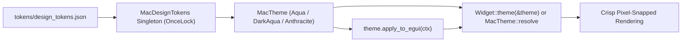
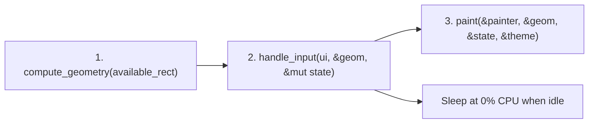

# Architecture Guide: `egui-macview`

This document explains how `egui-macview` is organized and how it brings native macOS AppKit layout, styling, and animations to [`egui`](https://github.com/emilk/egui) across Windows, macOS, Linux, and Web.

---

## 1. Design Goals

In standard `egui`, widgets size themselves dynamically from their content and push the layout cursor forward as they render. That works well for quick debug panels, but makes it hard to build desktop applications with aligned form columns, fixed-height toolbars, or 1px hairline borders that never clip.

`egui-macview` solves this with four practical building blocks:

1. **Predictable Layout Containers (`src/layout/`)**:
   Containers such as `MacSplitView`, `MacStackView`, `MacForm`, `MacRow`, and `MacFixedView` compute exact rectangles before painting, and snap widget bounds to physical device pixels (`subpixel_snap_rect`) so 1px borders stay crisp at 100%, 125%, 150%, and 200% display scaling.
2. **Design Tokens & Dynamic Theming (`tokens/design_tokens.json` & `src/theme/`)**:
   Every control reads its dimensions, padding insets, corner radii, and colors from [`MacTheme`](src/theme/mod.rs). No magic numbers or hardcoded hex colors are scattered across widget code.
3. **3-Phase Control Pipeline (`src/controls/`)**:
   Complex controls separate their work into three easy-to-read steps:
   - **Compute geometry**: Calculate rectangles for the outer frame, sub-controls, and hit targets.
   - **Handle input**: Process mouse clicks, drags, and keyboard shortcuts and update state.
   - **Paint**: Draw backgrounds, borders, icons, and labels onto the `egui::Painter`.
4. **Battery-Efficient Rendering (`src/motion/`)**:
   - **Zero idle repaints**: When no animation is active and the user is not interacting, `egui-macview` schedules zero background repaints (`0% CPU` at rest).
   - **Window focus awareness**: Continuous animations (such as indeterminate spinners or media timers) automatically pause when the window is unfocused or minimized (`is_window_active`).
   - **2D viewport culling**: `MacTableView` and `MacCollectionView` only allocate and paint rows or grid tiles that intersect `ui.clip_rect()`.

### 1.1 Design Token & Theme Resolution Pipeline

All widget dimensions, spacing, corner radii, and colors flow from a single JSON catalog (`tokens/design_tokens.json`) through `MacTheme` into each control:



### 1.2 3-Phase Widget Lifecycle

Complex controls (`MacPlayerView`, `MacComboBox`, `MacDatePicker`, `MacTableView`, `MacCollectionView`) execute in three clean steps each frame so layout math, input state, and drawing never tangle:



---

## 2. Coordinate Spaces & Display Scaling

`egui-macview` works in logical **AppKit points (`pt`)** with the origin $(0, 0)$ at the top-left corner:

```text
[ Application State ]  --->  [ Logical Points (pt) ]  --->  [ Physical Device Pixels (px) ]
  (Rust structs/enums)         (e.g. 28pt button height)      (snapped via pixels_per_point)
```

When rendering on fractional-DPI displays (such as 125% or 150% scaling on Windows), `subpixel_snap_rect` rounds rectangle edges to the nearest physical pixel boundary so strokes never look blurry.

---

## 3. Spring Animations (`CASpring`)

Instead of fixed linear timers or frame-dependent `pos += vel * dt` loops that behave differently at 60Hz vs. 120Hz ProMotion, [`CASpring`](src/motion/mod.rs) evaluates Apple's damped spring curve directly from elapsed time $t$:

- **Consistent across refresh rates**: A toggle switch, disclosure chevron, or floating HUD fade takes the exact same real-world duration on a 60Hz monitor, a 120Hz MacBook, or a 144Hz desktop display.
- **Automatic sleep**: Once the spring settles within epsilon of its target value, it stops requesting repaints so the CPU can sleep.

---

## 4. Repository Structure

```text
egui-macview/
├── Cargo.toml
├── README.md                               (Quickstart guide, examples & component table)
├── ARCHITECTURE.md                         (This architecture overview)
├── CHANGELOG.md                            (Release history)
├── specs/                                  (Detailed design & hardware measurement specs)
│   ├── SPEC-INDEX.md
│   ├── SPEC-001-DESIGN-TOKENS-AND-WCAG.md
│   ├── ...
│   └── SPEC-012-ADVANCED-MEDIA-SCHEDULING-AND-GRID-CONTROLS.md
├── tokens/
│   └── design_tokens.json                  (W3C DTCG colors, dimensions & spring tokens)
├── src/
│   ├── lib.rs                              (Crate root & public exports)
│   ├── controls/                           (AppKit & AVKit UI widgets)
│   │   ├── box_view.rs                     (MacBox grouping container & separator)
│   │   ├── button_cell.rs                  (MacButton & MacButtonCell)
│   │   ├── circular_slider.rs              (MacCircularSlider rotary knob)
│   │   ├── collection_view.rs              (MacCollectionView 2D grid with viewport culling)
│   │   ├── color_well.rs                   (MacColorWell swatch & picker popover)
│   │   ├── combo_box.rs                    (MacComboBox editable & filterable dropdown)
│   │   ├── date_picker/                    (MacDatePicker stepper field, calendar & clock)
│   │   ├── disclosure_group.rs             (MacDisclosureGroup & MacDisclosureButton)
│   │   ├── input_cell.rs                   (MacInputCell text & numeric field)
│   │   ├── level_indicator.rs              (MacLevelIndicator audio/capacity meter)
│   │   ├── outline_view.rs                 (MacOutlineView collapsible sidebar tree)
│   │   ├── path_control.rs                 (MacPathControl breadcrumb bar)
│   │   ├── player_view/                    (MacPlayerView Floating HUD, Inline & Minimal)
│   │   ├── popup_button.rs                 (MacPopUpButton dropdown menu)
│   │   ├── progress_indicator.rs           (MacProgressIndicator bar & 12-spoke spinner)
│   │   ├── rating_indicator.rs             (MacRatingIndicator 5-star rating control)
│   │   ├── rule_editor.rs                  (MacRuleEditor predicate filter rows)
│   │   ├── search_field.rs                 (MacSearchField with clear button)
│   │   ├── segmented.rs                    (MacSegmentedControl animated pill switcher)
│   │   ├── slider.rs                       (MacSlider linear slider with ticks)
│   │   ├── stepper.rs                      (MacStepper up/down increment buttons)
│   │   ├── tab_view.rs                     (MacTabView segmented & borderless tabs)
│   │   ├── table_view/                     (MacTableView sortable multi-column table)
│   │   ├── thumbnail_cell.rs               (MacThumbnailCell preview card)
│   │   ├── toggle.rs                       (MacToggle pill switch)
│   │   ├── token_field.rs                  (MacTokenField capsule tag input)
│   │   └── trim_scrubber/                  (MacTrimScrubber QuickTime timeline trim bar)
│   ├── feedback/                           (MacContextMenu & MacToastManager)
│   ├── layout/                             (MacSplitView, MacStackView, MacScrollView, MacForm, MacRow)
│   ├── motion/                             (CASpring animation runtime)
│   ├── navigation/                         (MacToolbar, MacMenuBar, MacCommandPalette, MacCanvasFooter)
│   ├── state/                              (NSUndoManager undo/redo history stack)
│   ├── surfaces/                           (MacPanel, MacPopover, MacCard, MacFloatingInfoBox)
│   ├── symbols/                            (MacSymbol & embedded CupertinoIcons.ttf)
│   ├── theme/                              (MacTheme, MacAppearance & WCAG contrast helpers)
│   └── tokens/                             (Strongly typed token deserializers & accessors)
├── examples/
│   ├── macview_gallery.rs                  (6-screen interactive showcase app)
│   ├── studio_controls_v05.rs              (Standalone studio & media demo)
│   └── transpiled_preferences_demo.rs      (macOS preferences & settings demo)
└── tests/                                  (23 integration & architectural guard test suites)
```
