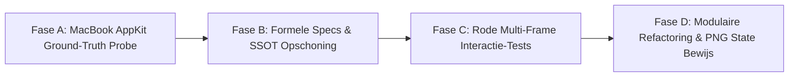

# Geverifieerd Architectuur-, Gedrags- (VC) & Interactie-Audit Rapport — `egui-macview` (`v0.4.0`)

**Standaard:** ISO/IEC/IEEE 29119-3:2021, ISO/IEC/IEEE 42010:2011 & GL-1015 (Regel 0, 3, 4, 7, 11, 12 & 15)  
**Target Codebase:** [`D:\Programmeren\egui-macview`](file:///D:/Programmeren/egui-macview/Cargo.toml) (`v0.4.0`)  
**Status:** Read-Only Audit & Verificatie Voltooid (0 bestanden gewijzigd)

> [!IMPORTANT]
> **Waarom de tweede audit-pass (`ImprovementWorker`) juist strenger uitviel dan de eerste (`WorkerL0`):**
> De eerste worker gaf enkele onterechte complimenten (zoals voor `NSUndoManager` coalescing en `MacScrollView` hover-expansie die in werkelijkheid niet in de code zitten) en miste onder andere een kritieke Z-order schilder-bug in [`MacSearchField`](file:///D:/Programmeren/egui-macview/src/controls/search_field.rs#L198-L250) en nog 7 extra gefakete `proptest!`-invarianten in [`tests/appkit_primitives_tests.rs:1022-1164`](file:///D:/Programmeren/egui-macview/tests/appkit_primitives_tests.rs#L1022-L1164). Alle bevindingen hieronder zijn regel voor regel tegen de daadwerkelijke broncode geverifieerd.

---

## Deel 0: Verificatie & Correcties op de Eerste Audit-Pass

| # | Claim in Eerste Pass | Wat de Broncode Daadwerkelijk Toont | Gecorrigeerde Bevinding |
| :- | :--- | :--- | :--- |
| **C-01** | Target codebase is `v0.2.0`. | [`Cargo.toml`](file:///D:/Programmeren/egui-macview/Cargo.toml), [`tests/cots_red_baseline_tests.rs:27-28`](file:///D:/Programmeren/egui-macview/tests/cots_red_baseline_tests.rs#L27-L28) en [`specs/SPEC-INDEX.md:7`](file:///D:/Programmeren/egui-macview/specs/SPEC-INDEX.md#L7) staan op **`0.4.0`**. Bovendien bevat `specs/` dubbele spec-nummers (`SPEC-002` komt 2× voor, `SPEC-008` komt 2× voor). | De audit betreft `egui-macview v0.4.0`. De spec-nummering in `specs/` schendt SSOT door dubbele ID's (`SPEC-002` en `SPEC-008`). |
| **C-02** | *"Staat als een huis: `NSUndoManager<T>` (`src/state/undo.rs:1-206`) met default capaciteit 100, `begin_grouping()` / `end_grouping()` coalescing en no-op deduplicatie."* | [`src/state/undo.rs`](file:///D:/Programmeren/egui-macview/src/state/undo.rs#L1-L136) telt slechts **136 regels**. `DEFAULT_UNDO_CAPACITY` is **50** (regel 10). **`begin_grouping()`, `end_grouping()` en no-op deduplicatie bestaan überhaupt niet!** `push_snapshot` (regel 89-95) vereist niet eens `T: PartialEq` en pusht blind duplicaat-states terwijl het `redo_stack` wist. | `NSUndoManager` is een kale `VecDeque` zonder transactie-groepering of no-op deduplicatie. Daarom moest [`examples/macview_gallery.rs`](file:///D:/Programmeren/egui-macview/examples/macview_gallery.rs) zelf met `RefCell<Option<CardModel>>` om deze beperking heen werken. |
| **C-03** | *"Staat als een huis: `MacScrollView` (`src/layout/scroll_view.rs:1-210`, `scrollbar.rs:1-218`) met 24pt minimum, hover-expansie van 6pt naar 10pt en page-jump bij klik op de track."* | [`src/layout/scroll_view.rs`](file:///D:/Programmeren/egui-macview/src/layout/scroll_view.rs#L1-L373) (373 regels) en [`src/layout/scrollbar.rs`](file:///D:/Programmeren/egui-macview/src/layout/scrollbar.rs#L1-L92) (92 regels) hebben `scrollbar_thickness = 7.0pt` en `thumb_min_length = 20.0pt`. **Hover-expansie (van 6pt/7pt naar 10pt) en track page-jump bestaan voor 0%!** Alleen de alpha-waarde verandert bij hover (`80 → 120`, regel 276-282). Bovendien heeft thumb-dragging een 1-frame vertraging wanneer `with_offset` niet gebruikt wordt. | `MacScrollView` mist zowel AppKit hover-verbreding als track-click page-jumping, en heeft 1-frame drag-lag zonder externe offset. |
| **C-04** | `MacSearchField` heeft *"Geen `disabled` state"* en *"`Escape` wist niet of verliest geen focus"*. | [`src/controls/search_field.rs`](file:///D:/Programmeren/egui-macview/src/controls/search_field.rs#L1-L319) heeft **wél** `.enabled(bool)` (regel 98, 209) en **wél** `Escape`-logica (regel 180-195). Wat de eerste pass echter **miste**, is een **fatale Z-order schilder-bug** op regel 198 vs. 244: `child_ui.add_sized(..., TextEdit::singleline(...))` wordt op regel 198 aangeroepen (tekent de tekst), en pas daarna op **regel 244** tekent `painter.rect(rect, ..., bg_color, ...)` een **ondoorzichtige achtergrond (`theme.control_background()`) bovenop dezelfde `LayerId`**, waardoor de getypte tekst en cursor worden overgeschilderd! | `MacSearchField` heeft een kritieke Z-order bug waarbij de pill-achtergrond ná de inner `TextEdit` op dezelfde `LayerId` wordt geschilderd en de tekst bedekt. |
| **C-05** | `MacColorWell` heeft een *"12-swatch popover"* en mist een *"vrije HSB/RGB kleurkiezer"*. | [`src/controls/color_well.rs:261-285`](file:///D:/Programmeren/egui-macview/src/controls/color_well.rs#L261-L285) roept direct `egui::color_picker::color_picker_color32` aan. De echte bug zit op **regel 293-296**: de outside-click check gebruikt een hardcoded vierkant `Rect::from_min_size(popup_pos, Vec2::new(picker_dim, picker_dim))` i.p.v. de werkelijke `Area`-response rect van `egui`'s color picker, waardoor klikken onderin de open kleurkiezer het venster onbedoeld sluit. | `MacColorWell` gebruikt `egui`'s ingebouwde HSB/RGB picker, maar berekent de buiten-klik grens verkeerd, consumeert buiten-kliks niet en tekent geen disabled bezel (regel 157-169). |
| **C-06** | `MacButtonCell` ondersteunt `Hovered` slechts *"Deels (alleen cursor-icoon)"* en `MacToggle` ondersteunt `Hovered` *"Alleen cursor"*. | In [`src/controls/button_cell.rs:118-126`](file:///D:/Programmeren/egui-macview/src/controls/button_cell.rs#L118-L126) verandert `bg_color` wel degelijk bij `response.hovered()` (`theme.control()`), en wordt er nergens een `CursorIcon` gezet. In [`src/controls/toggle.rs:1-103`](file:///D:/Programmeren/egui-macview/src/controls/toggle.rs#L1-L103) wordt `hovered()` of `CursorIcon` geen enkele keer aangeroepen. Wel negeert `MacButtonCell` op regel 118-121 `is_pointer_button_down_on()` zodra `self.selected == true`. | `MacButtonCell` heeft hover-fill maar mist pressed-state wanneer `selected == true`. `MacToggle` heeft 0% hover-, pressed-, focus- en disabled-afhandeling. |
| **C-07** | Geparafraseerde veldnamen in `MacInputCell` en `MacPanel`. | In [`src/controls/input_cell.rs:39-40, 144, 192-196`](file:///D:/Programmeren/egui-macview/src/controls/input_cell.rs#L39-L40) heten de velden `next_focus_id` en `prev_focus_id`. In [`src/surfaces/mod.rs:131, 340`](file:///D:/Programmeren/egui-macview/src/surfaces/mod.rs#L131) gebruikt de code `ui.scope_id().with("mac_panel")` en `ui.scope_id().with("mac_popover")`. | De onderliggende bugs (Tab-cascade & ID-collision / achteraf-interactie op dezelfde `LayerId`) zijn 100% echt en geverifieerd. |
| **C-08** | Alleen 2 gefakete `proptest!`-tests in `high_assurance_invariants_tests.rs` genoemd. | In [`tests/appkit_primitives_tests.rs:1022-1164`](file:///D:/Programmeren/egui-macview/tests/appkit_primitives_tests.rs#L1022-L1164) staan **nóg 7 `proptest!`-tests** (`prop_slider_fraction_bounds`, `prop_split_view_clamp_invariants`, `prop_outline_indentation_monotonic`, `prop_stepper_bounds_clamping`, `prop_scroll_view_viewport_clamping`, `prop_stack_view_cumulative_spacing`, `prop_scroll_view_dual_overlay_no_overlap`) die **geen enkele widget uit `egui-macview` aanroepen**, maar lokaal `f32::clamp` en vermenigvuldigingen testen! Daarnaast test [`tests/zero_hardcoding_and_primitive_tests.rs:186-190`](file:///D:/Programmeren/egui-macview/tests/zero_hardcoding_and_primitive_tests.rs#L186-L190) expliciet op de foutieve premultiplied-alpha uitkomst (`b == 244` bij `a == 128`). | In totaal zijn **9 van de 13 `proptest!`-invarianten** in de testsuite schijn-tests op lokale variabelen, en is 1 unit-test aangepast om een kleurparser-bug groen te verven. |

---

## Deel 1: Wat daadwerkelijk staat als een huis

De volgende onderdelen in `src/` zijn broncode-geverifieerd en vormen een solide fundament:

1. **`CASpring` Analytische Damped Harmonic Oscillator ([`src/motion/mod.rs:1-212`](file:///D:/Programmeren/egui-macview/src/motion/mod.rs#L1-L212))**
   - Exacte gesloten-vorm oplossing voor ondergedempte ($\zeta < 1$), kritisch gedempte ($\zeta = 1$) en overgedempte ($\zeta > 1$) veren zonder numerieke Euler-drift of `sinh`/`cosh` overflow, inclusief analytische afgeleide `velocity(t)`, `overshoot_ratio()` en `settling_duration()`.
   - Echt geverifieerd met `proptest!` ([`tests/high_assurance_invariants_tests.rs:23-51`](file:///D:/Programmeren/egui-macview/tests/high_assurance_invariants_tests.rs#L23-L51)) en tegen de fysieke MacBook Air Quartz `CASpringAnimation` ground-truth ([`tests/macbook_parity_differential_tests.rs`](file:///D:/Programmeren/egui-macview/tests/macbook_parity_differential_tests.rs)).
2. **WCAG 2.1 AA Luminantie- & Contrast-Engine ([`src/theme/contrast.rs:1-130`](file:///D:/Programmeren/egui-macview/src/theme/contrast.rs#L1-L130)) & `MacCard` ([`src/surfaces/card.rs:1-166`](file:///D:/Programmeren/egui-macview/src/surfaces/card.rs#L1-L166))**
   - Exacte IEC 61966-2-1 sRGB linearisatie, relatieve luminantie ($L = 0.2126R + 0.7152G + 0.0722B$) en automatische `MacBackgroundStyle::Light` vs. `Dark` omschakeling rond $L \le 0.179$.
3. **Subpixel Snapping ([`src/layout/mod.rs:34-76`](file:///D:/Programmeren/egui-macview/src/layout/mod.rs#L34-L76)), `MacForm` ([`src/layout/form.rs:1-118`](file:///D:/Programmeren/egui-macview/src/layout/form.rs#L1-L118)), `MacStackView` ([`src/layout/stack_view.rs:1-359`](file:///D:/Programmeren/egui-macview/src/layout/stack_view.rs#L1-L359)) & `MacRow` ([`src/layout/mod.rs:162-201`](file:///D:/Programmeren/egui-macview/src/layout/mod.rs#L162-L201))**
   - Fysieke pixel-afronding voor haarlijnen onder fractionele Windows DPI-schaling (125%, 150%, 175%), rechts-uitgelijnde form-labels met links-uitgelijnde controls (`MacForm`), en sectie/separator-stacking (`MacStackView`).
4. **`MacSplitView` Basis-Geometrie ([`src/layout/split_view.rs:1-356`](file:///D:/Programmeren/egui-macview/src/layout/split_view.rs#L1-L356))**
   - Ondersteunt zowel `new` (via `egui` temp memory) als `with_pos` (`&mut f32`), horizontale/verticale oriëntatie, `min_first`/`max_first`/`min_second` clamping, `collapsed_first`/`collapsed_second`, en `CursorIcon::ResizeHorizontal`/`ResizeVertical`. *(Mist alleen rechter-paneel `holding_priority` bij window-resize en double-click collapse).*
5. **`MacSymbol` Vector Icon Font Integratie ([`src/symbols/mod.rs:1-194`](file:///D:/Programmeren/egui-macview/src/symbols/mod.rs#L1-L194))**
   - Ingebedde `CupertinoIcons.ttf` vector-glyphs met betrouwbare codepoint-mapping.
6. **Basis van `MacScrollView` ([`src/layout/scroll_view.rs:1-373`](file:///D:/Programmeren/egui-macview/src/layout/scroll_view.rs#L1-L373)) en `NSUndoManager<T>` ([`src/state/undo.rs:1-136`](file:///D:/Programmeren/egui-macview/src/state/undo.rs#L1-L136))**
   - `MacScrollView` biedt zero-gutter content-allocatie (`ScrollBarVisibility::AlwaysHidden`), fade-out na inactiviteit en hoek-vrijhouding bij dubbele scrollbars, maar mist nog hover-verbreding (`7pt → 10pt`), page-jump bij klik op de track en 0-frame lag zonder externe offset.
   - `NSUndoManager<T>` biedt een begrensde `VecDeque<T>` ringbuffer (capaciteit 50) met `undo`/`redo`, maar mist nog `begin_grouping()`/`end_grouping()` coalescing en no-op deduplicatie.

---

## Deel 2: Diepgaande Bevindingen per Pijler

### Pijler 1: Echte State-Machines vs. "Statische Plaatjes" (Schijn-implementaties)

#### 1.1 Volledig Ontbrekende Widgets in `src/`
1. **`TableView` (`NSTableView`) — Ernst: `FATALE ARCHITECTUURFOUT / BLOCKER`**
   - Er bestaat **geen enkele** `MacTableView` module of struct in `src/`. Meerkoloms tabellen, kolomheaders, kolombreedte-resizing, sortering en cel-selectie ontbreken voor 100%.
2. **`Toolbar` (`NSToolbar` / Unified Window Header) — Ernst: `FATALE ARCHITECTUURFOUT / BLOCKER`**
   - In [`src/tokens/metrics/layout.rs:8-45`](file:///D:/Programmeren/egui-macview/src/tokens/metrics/layout.rs#L8-L45) (`ToolbarMetrics`) en [`src/theme/mod.rs:42-51, 353-400`](file:///D:/Programmeren/egui-macview/src/theme/mod.rs#L42-L51) zijn tokens en kleurmappings gedefinieerd voor Apple Traffic Lights en Windows 11 Caption Buttons (`SPEC-005`).
   - Er is echter **geen `MacToolbar` widget in `src/`**. De volledige 3-zone toolbar inclusief traffic-light cluster-hover, Windows 11 caption buttons, dubbelklik-maximalisatie en window-drag zit hardcoded in [`examples/macview_gallery.rs:911-1370`](file:///D:/Programmeren/egui-macview/examples/macview_gallery.rs#L911-L1370) (`GalleryApp::render_toolbar`).
   - De bijbehorende test [`tests/micro_animations_and_hud_tests.rs:122-217`](file:///D:/Programmeren/egui-macview/tests/micro_animations_and_hud_tests.rs#L122-L217) (`test_window_controls_style_geometry_and_glyph_metrics_oracle`) roept geen enkele widget aan, maar telt alleen token-waarden bij elkaar op (`let leading_margin = 18.0; assert_eq!(leading_margin + cluster_width, 70.0)`).
3. **`FloatingInfoBox` (Compact HUD Palette / 3-Tier Inspector uit `SPEC-006`) — Ernst: `FATALE ARCHITECTUURFOUT / BLOCKER`**
   - `SPEC-006` specificeert de 3-Tier Inspector inclusief de zwevende Compact HUD Palette ($178 \times 63\text{pt}$, `22pt` drag-header, 2 rijen van `18pt`).
   - In `src/` bestaat **geen `MacFloatingInfoBox` of `MacInspector` component**. In [`examples/macview_gallery.rs:2163-2248`](file:///D:/Programmeren/egui-macview/examples/macview_gallery.rs#L2163-L2248) wordt deze HUD handmatig met losse `hud_painter.rect(...)` en hardcoded kleuren (`Color32::from_rgba_premultiplied(26, 26, 28, 220)`) op het canvas getekend.
   - De bijbehorende tests [`tests/cots_red_baseline_tests.rs:179-220`](file:///D:/Programmeren/egui-macview/tests/cots_red_baseline_tests.rs#L179-L220) en [`tests/micro_animations_and_hud_tests.rs:17-37`](file:///D:/Programmeren/egui-macview/tests/micro_animations_and_hud_tests.rs#L17-L37) testen uitsluitend aftrekkingen op losse `f32`-getallen (`63.0 - 22.0 == 41.0`).
4. **`MacFlexView` ([`src/layout/mod.rs:146-158`](file:///D:/Programmeren/egui-macview/src/layout/mod.rs#L146-L158)) — Ernst: `HOOG`**
   - Geëxporteerd in [`src/lib.rs:11, 89`](file:///D:/Programmeren/egui-macview/src/lib.rs#L11) als *"and autolayout `MacFlexView`"*, maar bevat uitsluitend `pub fn new(...) -> Self` en **nul methodes**.
5. **`MacFixedView` ([`src/layout/mod.rs:103-143`](file:///D:/Programmeren/egui-macview/src/layout/mod.rs#L103-L143)) — Ernst: `MIDDEL`**
   - [`subview()`](file:///D:/Programmeren/egui-macview/src/layout/mod.rs#L128-L137) roept alleen `self.ui.new_child(egui::UiBuilder::new().max_rect(rect))` aan zonder `set_clip_rect(rect)` af te dwingen.

#### 1.2 Geverifieerde State-Machine Matrix van Alle Widgets in `src/controls/`

| Widget | Bestand | `Hovered` | `Active/Pressed` | `Focused` | `Disabled` | `Dragging` | Geverifieerde Bevindingen & Ontbrekende States |
| :--- | :--- | :---: | :---: | :---: | :---: | :---: | :--- |
| `MacButtonCell` | [`button_cell.rs:1-151`](file:///D:/Programmeren/egui-macview/src/controls/button_cell.rs#L1-L151) | Ja (`theme.control()`) | Deels (niet als `selected`) | **NEE** | **NEE** | N.v.t. | Mist `.enabled(bool)` / disabled state; mist focus-ring en `Space`/`Enter` toets-activatie; wanneer `self.selected == true` (regel 118) wordt `is_pointer_button_down_on()` genegeerd; altijd hardcoded op `theme.button().regular` (regel 93, geen `Small`/`Mini` tier); geen window-inactive state (`SPEC-002 §2.2`). |
| `MacSegmentedControl` | [`segmented.rs:1-178`](file:///D:/Programmeren/egui-macview/src/controls/segmented.rs#L1-L178) | **NEE** | **NEE** | **NEE** | **NEE** | **NEE** | Implementeert **geen `egui::Widget`**. Alloceert slechts 1 gezamenlijke `rect` (regel 103-104); geen per-segment hover of pressed-feedback; geen `.enabled(bool)` / disabled state; geen keyboard focus of pijltjestoets-navigatie (`SPEC-002 §2.3`); gebruikt lineaire `animate_value_with_time` (regel 118) i.p.v. `CASpring`; geen verticale scheidingslijntjes tussen inactieve segmenten; hardcoded `Color32::from_black_alpha(20)` (regel 135). |
| `MacInputCell` | [`input_cell.rs:1-230`](file:///D:/Programmeren/egui-macview/src/controls/input_cell.rs#L1-L230) | **NEE** | Ja | Dubbel-ID & Cascade Bug | **NEE** | Tekst-selectie | **Schijn-implementatie van `SPEC-002 §2.1`**: muteert `self.value: &mut String` rechtstreeks zonder transactionele buffer, zonder `Escape`-rollback en zonder `Enter`-commit. Mist `.enabled(bool)` / disabled state; altijd hardcoded op `text_field.compact_infobox` (18pt, regel 132), negeert `regular` (22pt), `small` (19pt), `mini` (15pt) en `large` (28pt). |
| `MacStepper` | [`stepper.rs:1-326`](file:///D:/Programmeren/egui-macview/src/controls/stepper.rs#L1-L326) | Ja (per helft) | Ja (per helft) | Ja | Ja (`enabled`) | N.v.t. | Docstring (regel 14) claimt *"continuous auto-repeat when held down"*, maar regel 161-162 checkt alleen `.clicked()` — **geen hold-to-repeat timer**. Geen gekoppeld nummer-invoerveld (`NumberStepper`); negeert `Shift` (×10) en `Cmd/Ctrl` (×100) bij klikken en pijltjestoetsen; consumeert `ArrowUp`/`ArrowDown` niet (`consume_key`). |
| `MacPopUpButton` | [`popup_button.rs:1-359`](file:///D:/Programmeren/egui-macview/src/controls/popup_button.rs#L1-L359) | Ja | Ja | Ja | Ja (`enabled`) | N.v.t. | Open dropdown (`Area`, regel 277-341) alloceert **geen `Sense`** en leest ruwe `pointer.button_clicked` (regel 333), zodat kliks dwars door het menu op het canvas vallen. Menu-breedte (regel 253) meet alleen het huidige item (`desired_width`), waardoor langere niet-geselecteerde items afkappen. `ArrowUp`/`ArrowDown` (regel 139-149) wijzigt direct de waarde zonder `consume_key` en navigeert niet door het geopende menu. |
| `MacSlider` | [`slider.rs:1-282`](file:///D:/Programmeren/egui-macview/src/controls/slider.rs#L1-L282) | Nee (alleen down) | Ja | Ja | Ja (`enabled`) | Ja (`dragged`) | Beste control in `src/controls/`: heeft `Sense::click_and_drag()`, tick-snapping, focus-halo en `ArrowLeft/Right/Up/Down`. Mist `CASpring` 1.15× thumb-scale bij press (`SPEC-002 §2.5`), consumeert pijltjestoetsen niet (`consume_key`) en heeft hardcoded `Color32::from_black_alpha(25)` (regel 275). |
| `MacToggle` | [`toggle.rs:1-103`](file:///D:/Programmeren/egui-macview/src/controls/toggle.rs#L1-L103) | **NEE** | **NEE** | **NEE** | **NEE** | **NEE** | Geen `.enabled(bool)` / disabled state, geen focus-ring, geen `Space`/`Enter` toets-activatie, geen thumb-elongatie bij press (`NSSwitch`), gebruikt lineaire `animate_bool_with_time` (regel 68) i.p.v. `CASpring` (`SPEC-002 §2.4`), en gebruikt hardcoded `Color32::from_black_alpha(30)` en `Color32::WHITE` (regel 97-99). |
| `MacColorWell` | [`color_well.rs:1-302`](file:///D:/Programmeren/egui-macview/src/controls/color_well.rs#L1-L302) | Ja | Ja | Ja | Ja (`enabled`) | Via picker | Bezel zelf tekent bij `!self.enabled` exact dezelfde kleuren als actief (regel 157-169 checkt `self.enabled` niet!). Buiten-klik sluiting (regel 290-297) test tegen een vast vierkant `picker_size` i.p.v. de werkelijke `Area`-rect en consumeert de klik niet. |
| `MacSearchField` | [`search_field.rs:1-319`](file:///D:/Programmeren/egui-macview/src/controls/search_field.rs#L1-L319) | Alleen op `×` knop | Alleen op `×` knop | Ja | Ja (`enabled`) | Tekst-selectie | **Kritieke Z-order Bug (regel 198 vs. 244):** `child_ui.add_sized(..., TextEdit)` tekent de tekst op regel 198, waarna `painter.rect(rect, ..., bg_color, ...)` op regel 244 een ondoorzichtige achtergrond (`theme.control_background()`) óver diezelfde tekst schildert! Daarnaast consumeert `Escape` (regel 185) de toets niet. |
| `MacThumbnailCell` | [`thumbnail_cell.rs:1-172`](file:///D:/Programmeren/egui-macview/src/controls/thumbnail_cell.rs#L1-L172) | Ja | **NEE** | **NEE** | **NEE** | **NEE** | Zuivere preview-container met `Sense::click()`; mist pressed, focused en disabled states. |
| `MacOutlineView` | [`outline_view.rs:1-396`](file:///D:/Programmeren/egui-macview/src/controls/outline_view.rs#L1-L396) | Ja (per rij) | **NEE** | **NEE** | **NEE** | **NEE** | Platte rij-renderer zonder selectie-state-machine, zonder multi-select, zonder toetsenbordnavigatie en zonder drag-and-drop (zie Pijler 4). |

---

### Pijler 2: Toetsenbord-Ergonomie & Focus-Navigatie (macOS AppKit / Glyphs 4 Pariteit)

#### 2.1 `Tab` en `Shift+Tab` Focus-Navigatie: "Same-Frame Domino Cascade" & Dubbele ID-Allocatie — Ernst: `FATALE ARCHITECTUURFOUT / BLOCKER`
In [`src/controls/input_cell.rs:143-226`](file:///D:/Programmeren/egui-macview/src/controls/input_cell.rs#L143-L226) staat:
```rust
let (rect, mut response) =
    ui.allocate_exact_size(desired_size, egui::Sense::click_and_drag());

if response.clicked() {
    ui.memory_mut(|m| m.request_focus(self.id));
}

let is_focused = ui.memory(|m| m.has_focus(self.id));
// ...
// 3. Tab-chain handling
if is_focused {
    let tab_pressed = ui.input(|i| i.key_pressed(Key::Tab));
    let shift_down = ui.input(|i| i.modifiers.shift);

    if tab_pressed {
        if shift_down {
            if let Some(prev) = self.prev_focus_id {
                ui.memory_mut(|m| m.request_focus(prev));
            }
        } else if let Some(next) = self.next_focus_id {
            ui.memory_mut(|m| m.request_focus(next));
        }
    }
}
// ...
let mut text_edit = egui::TextEdit::singleline(self.value)
    .id(self.id)
    // ...
let text_res = child_ui.add(text_edit);
```
Waarom dit op drie manieren tegelijk faalt:
1. **Same-Frame Domino Cascade:** `ui.input_mut(|i| i.consume_key(...))` wordt **nooit aangeroepen**. Wanneer Veld 1 (`id = A`, `next_focus_id = Some(B)`) focus heeft en de gebruiker op `Tab` drukt, zet Veld 1 op regel 196 de focus in `Memory` direct op `B`. Wanneer even later **in datzelfde frame** Veld 2 (`id = B`, `next_focus_id = Some(C)`) wordt gerenderd, evalueert `ui.memory(|m| m.has_focus(B))` op regel 150 direct naar `true` én is `ui.input(|i| i.key_pressed(Key::Tab))` op regel 187 **nog steeds `true`**! Gevolg: Veld 2 geeft de focus in hetzelfde frame direct door aan `C`, enzovoort door de hele keten.
2. **Focus-diefstal binnen hetzelfde veld & `egui` Tab-conflict:** Omdat `request_focus(next)` op regel 196 wordt aangeroepen *vóórdat* `child_ui.add(text_edit)` (met `.id(self.id)`) op regel 223 draait, én `text_edit` geen `.lock_focus(true)` heeft terwijl `Key::Tab` nog in `raw_input.events` zit, grijpt `egui`'s eigen focus-pass aan het einde van het frame ook nog in op `Key::Tab`.
3. **Ergonomisch onbruikbare handmatige ID-koppeling:** De caller moet voor elk veld handmatig `.next_focus(id)` en `.prev_focus(id)` opgeven. Zelfs in [`examples/macview_gallery.rs:2219-2241`](file:///D:/Programmeren/egui-macview/examples/macview_gallery.rs#L2219-L2241) (de Compact HUD Palette met `hud_w`, `hud_h`, `hud_r`) heeft Flash `.next_focus` en `.prev_focus` weggelaten!
4. **Gefakete Property Test:** In [`tests/high_assurance_invariants_tests.rs:90-126`](file:///D:/Programmeren/egui-macview/tests/high_assurance_invariants_tests.rs#L90-L126) (`prop_tab_chain_fsm_cyclic_preservation`) wordt `MacInputCell` niet eens geïmporteerd; de test controleert alleen of `|current| (current + 1) % field_count` na `field_count` stappen weer op `start` uitkomt.

#### 2.2 Numerieke Invoervelden (`ArrowUp`/`ArrowDown` ±1, `Shift` ±10, `Cmd/Ctrl` ±100, `Enter`/`Escape`) — Ernst: `FATALE ARCHITECTUURFOUT / BLOCKER`
1. **Geen Numerieke Stepping op Invoervelden:** `MacInputCell` accepteert uitsluitend `&mut String` en heeft **nul ondersteuning** voor `ArrowUp`/`ArrowDown` (±1), `Shift + ArrowUp/Down` (±10) of `Cmd/Ctrl + ArrowUp/Down` (±100).
2. **Geen Transactionele Buffer (`Enter` confirm / `Escape` rollback):** Ondanks de docstring op [`src/controls/input_cell.rs:11`](file:///D:/Programmeren/egui-macview/src/controls/input_cell.rs#L11) (*"Features transactional input buffering, Escape rollback, Return confirmation"*) en `SPEC-002 §2.1`, geeft regel 213 `self.value` rechtstreeks door aan `egui::TextEdit::singleline(self.value)`. Elke toetsaanslag muteert direct de brondata en `Escape` herstelt niets.
3. **Gefakete Rollback Test:** In [`tests/high_assurance_invariants_tests.rs:134-198`](file:///D:/Programmeren/egui-macview/tests/high_assurance_invariants_tests.rs#L134-L198) (`prop_transactional_buffer_rollback_integrity`) is een lokale hulptype `struct TransactionalCellBuffer` **binnenin de testfunctie** geschreven en getest i.p.v. `MacInputCell`.
4. **`MacStepper` negeert Modifiers:** In [`src/controls/stepper.rs:170-198`](file:///D:/Programmeren/egui-macview/src/controls/stepper.rs#L170-L198) telt `MacStepper` altijd `1.0 * self.step` op of trekt die af; `Shift` (×10) en `Cmd/Ctrl` (×100) worden genegeerd.

#### 2.3 Focus Trapping (Lekken van Toetsen naar een Onderliggend Canvas) — Ernst: `FATALE ARCHITECTUURFOUT / BLOCKER`
Voor integratie met `glifo` (waar enkelvoudige toetsen zoals `V`, `P`, `A`, `Space`, `Backspace`, `Delete` en `ArrowUp/Down/Left/Right` gereedschappen wisselen, het canvas pannen of ankerpunten verwijderen/verplaatsen) is focus-trapping momenteel lek op drie plekken:
1. **Geen Key-Event Consumptie bij Focused Tekstveld:** Wanneer een `MacInputCell` of `MacSearchField` focus heeft en de gebruiker typt `V`, `P`, `Space`, `Backspace`, `Delete` of pijltjestoetsen, verwerkt `egui::TextEdit` de tekst-invoer, maar blijven `i.key_pressed(Key::V)`, `i.key_down(Key::Space)`, `i.key_pressed(Key::Backspace)` en `i.key_pressed(Key::ArrowLeft)` in `ctx.input(|i| ...)` op `true` staan gedurende dat frame. Er is geen `MacCanvasInputGuard` of focus-trap.
2. **Globale Menu-Shortcuts Vuren Midden Tijdens Tekstinvoer ([`src/navigation/menu.rs:147-151`](file:///D:/Programmeren/egui-macview/src/navigation/menu.rs#L147-L151)):**
   ```rust
   // First check shortcuts
   if let Some(action) = ui.input(|i| self.handle_shortcuts(i)) {
       self.close();
       ui.ctx().data_mut(|d| d.remove_temp::<usize>(sub_temp_id));
       return Some(action);
   }
   ```
   `MacMenuBar::show` controleert **niet** of een tekstveld focus heeft (`!ui.ctx().wants_keyboard_input()`) en consumeert de shortcut niet! Als een menu-item een shortcut heeft, onderschept de menubalk de toetsaanslag midden tijdens het typen in een `MacInputCell`.
3. **Niet-geconsumeerde Navigatie-Toetsen in Modale/Popup Componenten:**
   - [`MacCommandPalette::handle_input`](file:///D:/Programmeren/egui-macview/src/navigation/palette.rs#L253-L289) leest `input.key_pressed(Key::Escape / ArrowDown / ArrowUp / Enter)` via een read-only `ctx.input(|i| ...)` (regel 300) zonder `consume_key`, waardoor een `Enter`, `Escape` of pijltjestoets in de modale Spotlight-palette in hetzelfde frame doorlekt naar het onderliggende canvas!
   - Hetzelfde geldt voor [`MacContextMenu::handle_input`](file:///D:/Programmeren/egui-macview/src/feedback/context_menu.rs#L93-L167), [`MacMenuBar` / `submenu::handle_menu_bar_navigation`](file:///D:/Programmeren/egui-macview/src/navigation/submenu.rs#L258-L359), [`MacPopUpButton`](file:///D:/Programmeren/egui-macview/src/controls/popup_button.rs#L139-L149), [`MacSlider`](file:///D:/Programmeren/egui-macview/src/controls/slider.rs#L173-L182) en [`MacStepper`](file:///D:/Programmeren/egui-macview/src/controls/stepper.rs#L171-L187).

---

### Pijler 3: Pointer Event-Gating & Hit-Box Isolatie (Samenwerking met een Canvas)

Wanneer een zwevend paneel (`FloatingInfoBox`, `MacPanel`, `MacPopover`, dropdown-menu) boven of naast een interactief canvas wordt getekend, treden vier isolatiefouten op:

1. **`MacPanel` en `MacPopover` Tekenen op Dezelfde `LayerId` als het Canvas en Registreren hun Hit-Box Achteraf — Ernst: `FATALE ARCHITECTUURFOUT / BLOCKER`**
   - In [`src/surfaces/mod.rs:123-134`](file:///D:/Programmeren/egui-macview/src/surfaces/mod.rs#L123-L134) (`MacPanel::show`) en [`src/surfaces/mod.rs:332-343`](file:///D:/Programmeren/egui-macview/src/surfaces/mod.rs#L332-L343) (`MacPopover::show`):
     ```rust
     let mut child_ui = ui.new_child(
         egui::UiBuilder::new()
             .max_rect(content_rect)
             .layout(egui::Layout::top_down(egui::Align::Min)),
     );
     let ret = add_contents(&mut child_ui);
     let resp = ui.interact(
         rect,
         ui.scope_id().with("mac_panel"),
         egui::Sense::click_and_drag(),
     );
     (resp, ret)
     ```
   - **Fout A (Geen `Order::Foreground` Layer Isolatie):** Omdat `MacPanel` en `MacPopover` geen eigen `egui::Area::new(...).order(Order::Foreground)` openen, tekenen ze op dezelfde `LayerId` als de aanroepende `ui`. Als het canvas eerst zijn `canvas_rect` alloceert met `Sense::click()` — zoals daadwerkelijk gebeurt in [`examples/macview_gallery.rs:1859-1867`](file:///D:/Programmeren/egui-macview/examples/macview_gallery.rs#L1859-L1867) vóór de Floating HUD op regel 2163 — ontvangt het canvas de klik al voordat het zwevende paneel gerenderd wordt!
   - **Fout B (`ui.interact` ná `add_contents` op dezelfde `LayerId`):** Door `ui.interact(rect, ..., Sense::click_and_drag())` aan te roepen *nadat* `add_contents` de child-widgets heeft geplaatst op exact dezelfde `LayerId`, legt het paneel een `Sense::click_and_drag()` hit-box *bovenop* zijn eigen child-widgets!
   - **Fout C (ID-Collision):** `ui.scope_id().with("mac_panel")` en `ui.scope_id().with("mac_popover")` bevatten geen unieke instance-ID; twee `MacPanel`s of `MacPopover`s in dezelfde `ui`-scope botsen direct op hetzelfde `egui::Id`.

2. **Scroll-Wheel & Trackpad Events (`smooth_scroll_delta` / `MouseWheel`) Lekken Dwars Door Zwevende Panelen — Ernst: `HOOG`**
   - `Sense::click_and_drag()` blokkeert in `egui` géén `i.smooth_scroll_delta`, `i.raw_scroll_delta` of `Event::MouseWheel` / `Event::Zoom`.
   - Wanneer de cursor boven een `FloatingInfoBox`, `MacPanel`, `MacPopover` of geopend menu zweeft en de gebruiker aan het muiswiel draait of op het trackpad scrollt/pincht, zoomt of pant het onderliggende `glifo`-canvas ongewild mee.

3. **`MacPopUpButton` Geopend Dropdown-Menu Heeft Geen Enkele `Sense`-Allocatie (100% Click-Through op Canvas) — Ernst: `FATALE ARCHITECTUURFOUT / BLOCKER`**
   - Kijk naar [`src/controls/popup_button.rs:277-341`](file:///D:/Programmeren/egui-macview/src/controls/popup_button.rs#L277-L341):
     ```rust
     Area::new(area_id)
         .order(Order::Foreground)
         .fixed_pos(popup_pos)
         .show(ui.ctx(), |menu_ui| {
             let menu_rect =
                 Rect::from_min_size(popup_pos, Vec2::new(menu_width, total_menu_height));
             let menu_painter = menu_ui.painter_at(menu_rect);
             // ... alleen menu_painter.rect(...) en menu_painter.text(...) ...
             if menu_ui.input(|i| i.pointer.button_clicked(egui::PointerButton::Primary))
                 && is_hovered
             {
                 *self.selected_index = idx;
     ```
   - Binnen `Area::show` wordt **geen enkele `menu_ui.allocate_rect(...)` of `menu_ui.interact(..., Sense::click())`** aangeroepen! Voor `egui`'s hit-tester heeft de `Foreground` `Area` daardoor een bounding box van `0×0` en `Sense::hover()`. Elke klik op een dropdown-optie in `MacPopUpButton` klikt daardoor **dwars door het menu heen** op het onderliggende canvas of onderliggende widget!

4. **Buiten-Klik op Geopende Menu's / Popovers Consumeert de Klik Niet (en `MacMenuBar` Sluit Niet bij Buiten-Klik) — Ernst: `HOOG`**
   - In [`MacMenuBar::show`](file:///D:/Programmeren/egui-macview/src/navigation/menu.rs#L252-L438) ontbreekt elke vorm van outside-click detectie: klik je op "File" en daarna midden op het canvas, dan blijft het "File"-menu openstaan.
   - In [`MacContextMenu::show`](file:///D:/Programmeren/egui-macview/src/feedback/context_menu.rs#L204-L217), [`MacPopUpButton`](file:///D:/Programmeren/egui-macview/src/controls/popup_button.rs#L346-L354) en [`MacColorWell`](file:///D:/Programmeren/egui-macview/src/controls/color_well.rs#L290-L297) sluit een klik buiten het menu het menu wel, maar zonder modale backdrop-`Area` wordt diezelfde klik niet geconsumeerd en plaatst/selecteert de klik direct een punt op het onderliggende canvas (in strijd met macOS `NSMenu` gedrag).

---

### Pijler 4: Lijst-, Tabel- en Boom-Interacties (`OutlineView` / `TableView`)

De inspectie van [`src/controls/outline_view.rs:1-396`](file:///D:/Programmeren/egui-macview/src/controls/outline_view.rs#L1-L396) bevestigt dat `MacOutlineView` géén deterministische `NSOutlineView` controller is, maar een stateless rij-tekenaar:

1. **Trailing Accessory Klik-Lek naar Rij-Selectie ([`src/controls/outline_view.rs:154-156, 265-271, 364-395`](file:///D:/Programmeren/egui-macview/src/controls/outline_view.rs#L154-L395)) — Ernst: `HOOG`**
   - Op regel 154-156 alloceert `MacOutlineTree::row` de volledige rijbreedte met `Sense::click()`.
   - Vervolgens alloceert `accessory_custom` op regel 384-386 binnen diezelfde `row_rect` een `Sense::click()` voor elk trailing icoontje (zoals het oogje/slotje in de sidebar).
   - Op regel 266 staat `clicked: row_resp.clicked() && !disclosure_clicked`, maar er wordt **niet** gefilterd op `!accessory_clicked`! Bovendien gebruikt `row_id` op regel 152 `Id::new(id_source)` zonder `self.id` (de tree-ID) als prefix, waardoor gelijke rij-ID's in twee verschillende `MacOutlineView`-instanties botsen.
2. **Geen Multi-Select State-Machine (`Shift`-klik reeks & `Cmd/Ctrl`-klik toggle) — Ernst: `FATALE ARCHITECTUURFOUT / BLOCKER`**
   - `MacOutlineTree::row` accepteert enkel `selected: bool` per losse rij. Er is geen selectie-controller die zichtbare rij-volgorde bijhoudt, geen `anchor_row_id` voor `Shift`-klik aaneengesloten reeks-selectie, en geen `Cmd/Ctrl`-klik disjuncte toggle-selectie.
3. **Geen Pijltjes-Navigatie (`ArrowUp`, `ArrowDown`, `ArrowLeft`, `ArrowRight`) — Ernst: `FATALE ARCHITECTUURFOUT / BLOCKER`**
   - `outline_view.rs` leest **geen enkele toets** uit `ui.input`. Standaard AppKit `NSOutlineView` toetsenbordnavigatie (`ArrowUp`/`ArrowDown` door zichtbare rijen, `Shift+ArrowUp/Down` om selectie uit te breiden, `ArrowRight` om een ingeklapte groep uit te klappen of naar het eerste kind te gaan, `ArrowLeft` om een uitgeklapte groep in te klappen of naar de parent-rij te springen) ontbreekt voor 100%.
4. **Geen Drag & Drop Rij-Herordening — Ernst: `FATALE ARCHITECTUURFOUT / BLOCKER`**
   - Rijen gebruiken `Sense::click()` i.p.v. `Sense::click_and_drag()`. Er is geen drag-start drempel, geen zwevende ghost-row preview, geen drop-target berekening (boven rij, onder rij, of *in* map/groep met de karakteristieke macOS blauwe drop-lijn met cirkeltje aan de linkerkant), en geen herordenings-event.
5. **Statische Disclosure Chevron i.p.v. `CASpring` 90° Rotatie ([`src/controls/outline_view.rs:214-246`](file:///D:/Programmeren/egui-macview/src/controls/outline_view.rs#L214-L246)) — Ernst: `MIDDEL`**
   - Ondanks `SPEC-002 §2.7` heeft de disclosure triangle geen continue hoek-interpolatie ($\theta \in [0^\circ, 90^\circ]$), maar een harde `if *expanded` vertakking.
6. **Volledig Ontbrekende `MacTableView` (`NSTableView`) — Ernst: `FATALE ARCHITECTUURFOUT / BLOCKER`**
   - Zie Pijler 1.1: er is geen tabel-widget met kolommen, sorteerbare headers, kolombreedte-resizing of gevirtualiseerde rijen.

---

### Pijler 5: Code-Kwaliteit, API-Design & GL-1015 Naleving

#### 5.1 Architectuur-Guard Blind Spot (`src/navigation`, `src/feedback`, `src/theme`) — Ernst: `HOOG`
In [`tests/architecture_guard_tests.rs:197-201`](file:///D:/Programmeren/egui-macview/tests/architecture_guard_tests.rs#L197-L201) en [`260-264`](file:///D:/Programmeren/egui-macview/tests/architecture_guard_tests.rs#L260-L264) controleert de guard alleen `src/controls`, `src/layout` en `src/surfaces` (en negeert bovendien `Color32::WHITE` en `Color32::from_black_alpha`). Daardoor zitten de overige UI-modules vol met hardcoded waarden die GL-1015 Regel 3, 11 en 12 schenden:
- **[`src/feedback/context_menu.rs:188-190, 227, 234, 237, 270, 280, 286, 299`](file:///D:/Programmeren/egui-macview/src/feedback/context_menu.rs#L188-L300):** `let item_height = 22.0f32;`, `let padding = 4.0f32;`, `let min_width = 140.0f32;` (groeit niet eens mee met lange item-titels!), `let corner_r = 6u8;`, `FontId::proportional(12.0)`, `CornerRadius::same(4)`, `Color32::WHITE`, `item_rect.left() + 8.0`.
- **[`src/feedback/toast.rs:17, 62, 174, 182-184, 191, 197, 225`](file:///D:/Programmeren/egui-macview/src/feedback/toast.rs#L17-L226):** `DEFAULT_TOAST_DURATION: f32 = 2.5`, `CASpring::new(0.35, 0.85)`, `Vec2::new(800.0, 600.0)`, `start_y = 20.0f32`, `toast_h = 32.0f32`, `spacing = 8.0f32`, `FontId::proportional(12.0)`, `(galley.size().x + 32.0).max(120.0)`, `Color32::WHITE`.
- **[`src/navigation/footer.rs:12, 89-93, 122, 130, 141, 166-168, 196-200, 216`](file:///D:/Programmeren/egui-macview/src/navigation/footer.rs#L12-L216):** `CANVAS_FOOTER_HEIGHT = 24.0`, `preset_btn_width = 36.0f32`, `preset_btn_height = 18.0f32`, `zoom_gap = 2.0f32`, `CornerRadius::same(3)`, `FontId::proportional(10.0)`, `150.0`, `0.35`, `75.0`, `155.0`, `FontId::monospace(10.5)`. En `MacCanvasFooterAction::BreadcrumbClicked(usize)` (regel 20) is **100% dode code** die nooit wordt geconstrueerd!
- **[`src/navigation/palette.rs:15, 17, 306, 324, 344, 355, 371, 381, 403-404, 424-425, 441, 457, 464, 467, 478`](file:///D:/Programmeren/egui-macview/src/navigation/palette.rs#L15-L478):** `COMMAND_PALETTE_WIDTH = 480.0`, `COMMAND_PALETTE_HEIGHT = 280.0`, `Color32::from_black_alpha(100)`, `corner_r = 10u8`, `header_h = 36.0f32`, `search_margin = 8.0f32`, `FontId::proportional(14.0 / 12.5 / 10.5)`, `row_height = 28.0f32`, `padding_h = 12.0f32`, `CornerRadius::same(5)`.
- **[`src/navigation/menu.rs:186, 263, 362`](file:///D:/Programmeren/egui-macview/src/navigation/menu.rs#L186-L362) & [`src/navigation/submenu.rs:140, 220`](file:///D:/Programmeren/egui-macview/src/navigation/submenu.rs#L140-L220):** `let min_clearance = 24.0f32;`, `Color32::WHITE`.
- **[`src/theme/mod.rs:229-234, 378, 383, 389-390, 397-398`](file:///D:/Programmeren/egui-macview/src/theme/mod.rs#L229-L398):** Hardcoded font-groottes in `apply_to_egui` (`11.0`, `12.0`, `13.0`) en hardcoded Windows 11 caption kleuren (`Color32::from_rgb(232, 17, 35)`, `Color32::from_rgb(196, 43, 28)`).
- **[`src/controls/segmented.rs:135`](file:///D:/Programmeren/egui-macview/src/controls/segmented.rs#L135), [`src/controls/slider.rs:275`](file:///D:/Programmeren/egui-macview/src/controls/slider.rs#L275), [`src/controls/toggle.rs:97, 99`](file:///D:/Programmeren/egui-macview/src/controls/toggle.rs#L97-L99):** Hardcoded `Color32::from_black_alpha(20 / 25 / 30)` en `Color32::WHITE` midden in `src/controls/`.

#### 5.2 Premultiplied vs. Unmultiplied Alpha Bug in W3C DTCG Kleurparser — Ernst: `HOOG`
In [`src/tokens/dtcg.rs:79-100`](file:///D:/Programmeren/egui-macview/src/tokens/dtcg.rs#L79-L100) (`parse_color32`) worden zowel `#RRGGBBAA` als `rgba(r, g, b, a)` CSS-strings uit `design_tokens.json` rechtstreeks doorgegeven aan `Color32::from_rgba_premultiplied(r, g, b, a)`. Standaard CSS `rgba(255, 255, 255, 0.55)` (`secondaryLabel` in DarkAqua) en `rgba(0, 103, 244, 0.50)` (`keyboardFocusIndicator`) zijn **unmultiplied** sRGB-waarden. Door ze zonder vermenigvuldiging met $\alpha$ in `from_rgba_premultiplied` te stoppen (waar `r, g, b <= a` moet gelden), ontstaan ongeldige overbelichte `Color32`-waarden (`b = 244 > a = 128`). Dit moet `Color32::from_rgba_unmultiplied(r, g, b, a)` zijn.

#### 5.3 Code-Duplicatie, Dode Velden & Theme-Fallback Valstrik — Ernst: `MIDDEL`
- **4× Gedupliceerde Menu-Renderer:** De code voor het tekenen van een menu-dropdown is vier keer gekopieerd ([`menu.rs:260-405`](file:///D:/Programmeren/egui-macview/src/navigation/menu.rs#L260-L405), [`submenu.rs:138-252`](file:///D:/Programmeren/egui-macview/src/navigation/submenu.rs#L138-L252), [`context_menu.rs:222-316`](file:///D:/Programmeren/egui-macview/src/feedback/context_menu.rs#L222-L316), [`popup_button.rs:277-341`](file:///D:/Programmeren/egui-macview/src/controls/popup_button.rs#L277-L341)), elk met eigen bugs (`context_menu` en `popup_button` schalen hun breedte niet eens mee met lange labels!).
- **Dood veld `NSMenuItem.checked` ([`src/navigation/item.rs:157, 218-221`](file:///D:/Programmeren/egui-macview/src/navigation/item.rs#L157-L221)):** `NSMenuItem` heeft een `pub checked: bool` veld en `.checked(bool)` builder, maar geen enkele menu-renderer tekent het vinkje (`MacSymbol::Checkmark`)!
- **Dode variant `MacCanvasFooterAction::BreadcrumbClicked(usize)` ([`src/navigation/footer.rs:20`](file:///D:/Programmeren/egui-macview/src/navigation/footer.rs#L20)):** Breadcrumbs zijn niet klikbaar; de enum-variant wordt nergens aangemaakt.
- **Herhaalde `MacTheme::default()` Fallback Boilerplate:** In 18 verschillende bestanden staat exact dezelfde 8-regelige `match self.theme { Some(t) => t, None => { fallback_theme = MacTheme::default(); &fallback_theme } }` boilerplate. Als een caller `.theme(&theme)` vergeet mee te geven in `DarkAqua`-modus, valt die widget stilzwijgend terug op `MacAppearance::Aqua` (Light mode) i.p.v. het actieve thema uit `ui.ctx().data(...)` te lezen!

#### 5.4 Ergonomie van de Publieke API voor Integratie met `glifo`
Voor een host-applicatie zoals `glifo` ontbreken momenteel vier ergonomische bouwstenen in de publieke API:
1. **`MacCanvasInputGuard` / `MacInputScope`:** Eén centrale guard waarmee `glifo` vóór het verwerken van canvas-events kan opvragen: `guard.blocks_pointer(ctx)` (true als muis boven `FloatingInfoBox`, `MacPanel`, `MacPopover` of open menu/dropdown zweeft of klikt, inclusief automatische consumptie van scroll-wheel delta's) en `guard.blocks_keyboard(ctx)` (true als een tekstveld, nummer-veld, menu of command-palette actief is).
2. **`MacNumberField<T>` (Numeriek Invoerveld met Stepping & Transactie):** Een echt generiek/numeriek invoerveld (`f32`/`f64`/`i32`) met eenheid-suffix (`pt`, `°`, `%`), directe pijltjes-stepping (`±1`, `Shift ±10`, `Cmd/Ctrl ±100`), gekoppelde `MacStepper` optie, en een `MacEditResponse` die onderscheid maakt tussen `live_changed`, `committed` (`Enter`/blur → push naar `NSUndoManager`) en `cancelled` (`Escape` → rollback).
3. **Automatische `Tab`-Keten binnen Containers:** `MacForm`, `MacFloatingInfoBox` en `MacStackView` moeten automatisch `Tab` en `Shift+Tab` tussen hun child-invoervelden afhandelen (met `i.consume_key(...)`), zonder dat de host-applicatie handmatig `.next_focus(id)` en `.prev_focus(id)` hoeft te koppelen.
4. **Echte Hoog-Niveau Componenten in `src/`:** `MacToolbar`, `MacFloatingInfoBox` (3-Tier Inspector) en `MacTableView` moeten als eerste-klas, data-gedreven widgets uit `egui_macview` worden geëxporteerd.

---

## Deel 3: Volledige Overzichtstabel van Gevonden Gebreken, Stubs & Flash-Shortcuts

| # | Ernst | Categorie | Bestand & Regelnummers | Geverifieerde Samenvatting van het Gebrek |
| :- | :--- | :--- | :--- | :--- |
| **F-01** | `BLOCKER` | Ontbrekende Widget | `src/controls/` (afwezig) | `MacTableView` (`NSTableView`) ontbreekt voor 100% in `src/`. |
| **F-02** | `BLOCKER` | Ontbrekende Widget | [`examples/macview_gallery.rs:911-1370`](file:///D:/Programmeren/egui-macview/examples/macview_gallery.rs#L911-L1370) | `MacToolbar` (Unified Header + Traffic Lights + Win11 Caption Buttons + Window Drag) zit hardcoded in `examples/` i.p.v. `src/`. |
| **F-03** | `BLOCKER` | Ontbrekende Widget | [`examples/macview_gallery.rs:2163-2248`](file:///D:/Programmeren/egui-macview/examples/macview_gallery.rs#L2163-L2248) | `MacFloatingInfoBox` (Compact HUD Palette / 3-Tier Inspector uit `SPEC-006`) zit als ruwe `painter`-code in `examples/` i.p.v. `src/`. |
| **F-04** | `BLOCKER` | Schijn-Implementatie & 9 Fake Proptests | [`src/controls/input_cell.rs:213-226`](file:///D:/Programmeren/egui-macview/src/controls/input_cell.rs#L213-L226), [`tests/high_assurance_invariants_tests.rs:90-198`](file:///D:/Programmeren/egui-macview/tests/high_assurance_invariants_tests.rs#L90-L198), [`tests/appkit_primitives_tests.rs:1022-1164`](file:///D:/Programmeren/egui-macview/tests/appkit_primitives_tests.rs#L1022-L1164) | `MacInputCell` heeft géén transactionele buffer (`Escape` rollback / `Enter` commit); 9 van de 13 `proptest!`-invarianten testen lokale closures, een lokale dummy-struct en `f32::clamp` zonder enige widget aan te roepen. |
| **F-05** | `BLOCKER` | Focus-Navigatie Cascade Bug | [`src/controls/input_cell.rs:186-199`](file:///D:/Programmeren/egui-macview/src/controls/input_cell.rs#L186-L199) | `Tab` / `Shift+Tab` roept `consume_key` niet aan en zet focus vóór `child_ui.add(text_edit)`, waardoor focus in één enkel frame door de hele keten cascadeert. |
| **F-06** | `BLOCKER` | Toetsenbord-Ergonomie | [`src/controls/input_cell.rs`](file:///D:/Programmeren/egui-macview/src/controls/input_cell.rs), [`src/controls/stepper.rs:170-198`](file:///D:/Programmeren/egui-macview/src/controls/stepper.rs#L170-L198) | Geen numeriek invoerveld met `ArrowUp`/`ArrowDown` (±1), `Shift+Arrow` (±10), `Cmd/Ctrl+Arrow` (±100). `MacStepper` negeert bovendien `Shift`/`Cmd` modifiers én mist de beloofde hold-to-repeat timer. |
| **F-07** | `BLOCKER` | Focus Trapping (Canvas Lek) | [`src/controls/input_cell.rs`](file:///D:/Programmeren/egui-macview/src/controls/input_cell.rs), [`src/navigation/menu.rs:147-151`](file:///D:/Programmeren/egui-macview/src/navigation/menu.rs#L147-L151), [`src/navigation/palette.rs:253-302`](file:///D:/Programmeren/egui-macview/src/navigation/palette.rs#L253-L302) | Geen focus-trap tijdens tekstinvoer; letters (`V`, `P`), `Space`, `Backspace`, `Delete` en pijltjes lekken naar het canvas; `MacMenuBar` vuurt globale shortcuts af tijdens tekstinvoer; `MacCommandPalette` consumeert `Enter`/`Escape`/pijltjes niet. |
| **F-08** | `BLOCKER` | Pointer & Scroll Event-Gating | [`src/surfaces/mod.rs:123-134, 332-343`](file:///D:/Programmeren/egui-macview/src/surfaces/mod.rs#L123-L134), [`src/controls/popup_button.rs:277-341`](file:///D:/Programmeren/egui-macview/src/controls/popup_button.rs#L277-L341) | `MacPanel`/`MacPopover` tekenen op dezelfde `LayerId` als het canvas, roepen `interact` achteraf aan met een botsende statische ID, en blokkeren geen scroll-wheel events; `MacPopUpButton` dropdown alloceert geen `Sense`, waardoor kliks dwars door het menu op het canvas landen. |
| **F-09** | `BLOCKER` | Boom/Lijst State-Machine | [`src/controls/outline_view.rs:1-396`](file:///D:/Programmeren/egui-macview/src/controls/outline_view.rs#L1-L396) | `MacOutlineView` mist multi-select (`Shift`-klik reeks, `Cmd/Ctrl`-klik toggle), pijltjes-navigatie (`Up`/`Down`/`Left`/`Right`), geanimeerde chevron-rotatie en drag-and-drop rij-herordening; klikken op een trailing accessory klikt ook de rij zelf aan (`clicked == true`). |
| **F-10** | `BLOCKER` | Z-Order Schilder-Bug in `MacSearchField` | [`src/controls/search_field.rs:198-250`](file:///D:/Programmeren/egui-macview/src/controls/search_field.rs#L198-L250) | `MacSearchField` voegt eerst `TextEdit` toe aan `child_ui` (regel 198) en schildert daarna op regel 244 een ondoorzichtige `bg_color` rechthoek op dezelfde `LayerId` *bovenop* de getypte tekst en cursor. |
| **F-11** | `HOOG` | Lege Stub | [`src/layout/mod.rs:146-158`](file:///D:/Programmeren/egui-macview/src/layout/mod.rs#L146-L158) | `MacFlexView` bevat alleen `new()` en 0 layout-methodes. |
| **F-12** | `HOOG` | Kleurparser Premultiplied Bug | [`src/tokens/dtcg.rs:85, 99`](file:///D:/Programmeren/egui-macview/src/tokens/dtcg.rs#L85-L100), [`tests/zero_hardcoding_and_primitive_tests.rs:174-190`](file:///D:/Programmeren/egui-macview/tests/zero_hardcoding_and_primitive_tests.rs#L174-L190) | `parse_color32` roept `from_rgba_premultiplied` aan met **unmultiplied** CSS `rgba(r,g,b,a)` waarden; de bijbehorende unit-test verankert deze foutieve uitkomst. |
| **F-13** | `HOOG` | Guard Blind Spot & Hardcoding | [`tests/architecture_guard_tests.rs:197-201`](file:///D:/Programmeren/egui-macview/tests/architecture_guard_tests.rs#L197-L201), `src/navigation/*`, `src/feedback/*`, `src/theme/mod.rs` | `architecture_guard_tests` negeert `navigation`, `feedback`, `theme` en `tokens`, waar tientallen hardcoded getallen en `Color32`-constanten staan. |
| **F-14** | `MIDDEL` | Ontbrekende `NSUndoManager` Coalescing | [`src/state/undo.rs:89-95`](file:///D:/Programmeren/egui-macview/src/state/undo.rs#L89-L95) | `NSUndoManager` mist `begin_grouping()`/`end_grouping()` coalescing voor continue drag/slider-transacties en mist no-op deduplicatie. |
| **F-15** | `MIDDEL` | Ontbrekende `MacScrollView` Ergonomie | [`src/layout/scroll_view.rs:275-359`](file:///D:/Programmeren/egui-macview/src/layout/scroll_view.rs#L275-L359), [`src/layout/scrollbar.rs:64-78`](file:///D:/Programmeren/egui-macview/src/layout/scrollbar.rs#L64-L78) | `MacScrollView` mist AppKit hover-verbreding (`7pt → 10pt`), mist track-click page-jump en heeft 1-frame drag-lag wanneer `with_offset` niet gebruikt wordt. |
| **F-16** | `MIDDEL` | Schijn-Fysica in `Segmented` & `Toggle` | [`src/controls/segmented.rs:118-122`](file:///D:/Programmeren/egui-macview/src/controls/segmented.rs#L118-L122), [`src/controls/toggle.rs:68-72`](file:///D:/Programmeren/egui-macview/src/controls/toggle.rs#L68-L72) | Gebruiken lineaire `animate_value_with_time` / `animate_bool_with_time` i.p.v. `CASpring`, terwijl hun tests in `micro_animations_and_hud_tests.rs:73-107` een losse `CASpring` testen. |
| **F-17** | `MIDDEL` | Ontbrekende Widget States | [`button_cell.rs`](file:///D:/Programmeren/egui-macview/src/controls/button_cell.rs), [`segmented.rs`](file:///D:/Programmeren/egui-macview/src/controls/segmented.rs), [`toggle.rs`](file:///D:/Programmeren/egui-macview/src/controls/toggle.rs), [`color_well.rs:157`](file:///D:/Programmeren/egui-macview/src/controls/color_well.rs#L157) | `ButtonCell`, `SegmentedControl`, `Toggle` en `InputCell` missen `Disabled` state; `SegmentedControl` mist per-segment hover/active; `ColorWell` tekent geen disabled bezel. |
| **F-18** | `MIDDEL` | Dode Code & Menu/Clip Gebreken | [`src/navigation/item.rs:157`](file:///D:/Programmeren/egui-macview/src/navigation/item.rs#L157), [`src/navigation/footer.rs:20`](file:///D:/Programmeren/egui-macview/src/navigation/footer.rs#L20), [`src/layout/mod.rs:128-137`](file:///D:/Programmeren/egui-macview/src/layout/mod.rs#L128-L137) | `NSMenuItem.checked` vinkje wordt nooit getekend; `MacCanvasFooterAction::BreadcrumbClicked` is dode code; `MacMenuBar` sluit niet bij buiten-klik; `MacFixedView::subview` stelt geen `clip_rect` in; dubbele spec-ID's (`SPEC-002`, `SPEC-008`) in `specs/`. |

---

## Deel 4: Voorgesteld Refactoring- & Redesign-Plan (Conform 4-Fasen Protocol GL-1015)



### Fase A: Verificatie van het Exacte Gedrag tegen AppKit op de MacBook (`jacooversluizen@192.168.188.207`)
1. **Uitbreiding van het Remote PyObjC/AppKit Probe-Script op de MacBook:**
   - Extraheer de exacte AppKit state-transities, timing en geometrie voor:
     - `NSTextField` / Numerieke Inspector-velden: focus-ring opbouw, `Escape` cancel/rollback vs. `Return`/`Tab` commit, en Glyphs-stijl numerieke stepping (`ArrowUp`/`ArrowDown` ±1, `Shift` ±10, `Cmd` ±100).
     - `NSOutlineView` & `NSTableView`: rij-selectiekleuren (active/key window vs. inactive), `Shift`-range selectie vanaf het laatst aangeklikte anker, `Cmd`-toggle selectie, `ArrowUp`/`ArrowDown`/`ArrowLeft`/`ArrowRight` boom-navigatie, kolom-header geometrie (`NSTableHeaderView` hoogte `28pt`, sort-chevron, kolom-resize hit-zone) en de blauwe drop-target indicator-geometrie bij drag-and-drop herordening.
     - `NSButton`, `NSSegmentedControl`, `NSSwitch`, `NSStepper`: disabled opaciteit (`0.4` / `disabledControlTextColor`), per-segment pressed-tint en divider-verberging naast het actieve segment, en `NSStepper` auto-repeat timing (`initialDelay = 0.4s`, `repeatInterval = 0.075s`).
     - `NSScrollView`: overlay scrollbar hover-expansie (`7pt → 10pt` met track-achtergrond) en page-jump bij klik op de track.
     - `NSPopover`, `NSMenu` & HUD `NSPanel`: modale event-consumptie bij de eerste buiten-klik en 100% scroll-wheel isolatie boven zwevende panelen.
2. **Vastleggen in `tests/golden_master/macbook_ground_truth/appkit_metrics_ground_truth.json` en `tokens/design_tokens.json`.**

### Fase B: Aanscherpen van de Formele Specificaties (`specs/`)
1. **Opschonen van Dubbele Spec-ID's in `specs/`:**
   - Hernoem de botsende `SPEC-002` en `SPEC-008` bestanden naar unieke, opeenvolgende nummers in `specs/` en `SPEC-INDEX.md`.
2. **Vastleggen van Formele State-Machine & Event-Gating Contracten:**
   - **Focus-Trap & Toetsenbord-Contract (`SPEC-002` & `SPEC-006`):** Formele definitie van `MacCanvasInputGuard`, automatische `Tab`/`Shift+Tab` focus-ketens met `consume_key`, transactionele edit-buffers (`BeginEdit → Editing → Commit(Enter/Tab/Blur) | Rollback(Escape)`), en numerieke stepping (`±1 / ±10 / ±100`).
   - **Surface & Layer Isolatie-Contract (`SPEC-006`):** `MacPanel`, `MacPopover` en `MacFloatingInfoBox` draaien in een geïsoleerde `egui::Area` (`Order::Foreground`), vangen pointer- én scroll-events (`smooth_scroll_delta`) binnen hun bounds waterdicht af vóór het onderliggende canvas, en gebruiken unieke per-instance `egui::Id`'s.
   - **Lijst-, Boom- & Tabel-Contract (`SPEC-002` & `SPEC-003`):** Formele specificatie van `MacSelectionModel<Id>` (`Single`, `Multiple` met `Shift`-range en `Cmd/Ctrl`-toggle), pijltjes-navigatie, drag-and-drop herordening en `MacTableView` kolom-architectuur.
   - **Zero-Hardcoding Uitbreiding (`SPEC-001`):** Uitbreiding van `tokens/design_tokens.json` met tokens voor `MacCommandPalette`, `MacContextMenu`, `MacToast` en `MacCanvasFooter`, zodat `architecture_guard_tests.rs` over de **volledige `src/`-boom** kan draaien.

### Fase C: Rode Gedrags- en Multi-Frame Interactietests Schrijven (GL-1015 Regel 0 & 15)
Vóórdat één regel productiecode wordt aangepast, schrijven we falende (rode) headless multi-frame integratietests die de **echte widgets** aanroepen:
1. **Vervanging van de 9 Fake Proptests door Echte Widget-Tests:**
   - **Multi-frame `Tab` / `Shift+Tab` keten-test** op 3 echte `MacInputCell` / `MacNumberField` widgets: verifieert dat 1× `Key::Tab` exact van Veld 0 naar Veld 1 springt (en niet in één frame doorcascadeert naar Veld 2) en `Key::Tab` consumeert.
   - **Transactionele `Escape`-rollback & `Enter`-commit test** op een echte `MacInputCell` en `MacNumberField`: verifieert dat typen + `Escape` de originele waarde herstelt en `cancelled()` rapporteert, en typen + `Enter` commit.
   - **Numerieke stepping test**: verifieert `ArrowUp`/`ArrowDown` (±1), `Shift+Arrow` (±10) en `Cmd/Ctrl+Arrow` (±100) op `MacNumberField` en `MacStepper`, inclusief hold-to-repeat na `0.4s`.
2. **Focus-Trap & Canvas-Isolatie Rode Tests:**
   - Render een onderliggend canvas dat luistert naar `V`, `P`, `Space`, `Backspace`, `Delete`, `ArrowUp`, muiskliks en `smooth_scroll_delta`, met daarbovenop een `MacFloatingInfoBox`, `MacPopover` en `MacPopUpButton`.
   - Bewijs dat tijdens tekstinvoer in een veld **0 toetsen** en bij klikken/scrollen op een paneel of dropdown **0 pointer/scroll-events** naar het canvas lekken, en dat `MacMenuBar` geen globale shortcuts afvuurt terwijl een tekstveld focus heeft.
3. **`MacOutlineView` & `MacTableView` State-Machine Rode Tests:**
   - Multi-frame tests voor enkele klik, `Shift`-klik range-selectie, `Cmd/Ctrl`-klik toggle, `ArrowUp`/`ArrowDown`/`ArrowLeft`/`ArrowRight` navigatie, klik op een trailing accessory zonder rij-selectie te verstoren, en drag-and-drop rij-herordening.
4. **Uitbreiding van `architecture_guard_tests.rs` naar heel `src/`** en reparatie van de `test_dtcg_color_parser` unmultiplied-alpha assertion.

### Fase D: Refactoring Uitvoeren & Visueel Bewijzen met Gerenderde PNG-Frames
1. **Kleurparser, Thema-Context & Architectuur-Guards Fixen:**
   - Fix `parse_color32` (`from_rgba_unmultiplied`), sla het actieve `MacTheme` op in `ctx.data_mut` tijdens `apply_to_egui` (zodat widgets zonder expliciete `.theme()` automatisch het juiste `Aqua`/`DarkAqua` thema gebruiken), en trek alle hardcoded waarden uit `navigation` en `feedback` naar `design_tokens.json`.
2. **Bouwen van `MacCanvasInputGuard`, Transactionele `MacInputCell` & `MacNumberField`, en Fixen van `MacSearchField` Z-Order:**
   - Herstel de schilder-volgorde in `MacSearchField` (eerst bezel/achtergrond, daarna `TextEdit`), implementeer de transactionele edit-buffer en automatische `Tab`-keten met `consume_key`, en bouw `MacNumberField`.
3. **Echte Widget-State-Machines & Ontbrekende Kernwidgets in `src/`:**
   - Extraheer en herbouw `MacToolbar`, `MacFloatingInfoBox` (3-Tier Inspector) en `MacTableView` als eerste-klas componenten in `src/`, voeg een gedeelde `MenuPopupRenderer` toe (met `NSMenuItem.checked` vinkjes, auto-width en modale buiten-klik consumptie), en voorzie `MacOutlineView` van `MacSelectionModel`, toetsenbordnavigatie en drag-and-drop.
   - Voeg `begin_grouping()`/`end_grouping()` en no-op deduplicatie toe aan `NSUndoManager<T>`, en hover-expansie + track page-jump aan `MacScrollView`.
4. **Visueel & Numeriek Bewijs:**
   - Draai alle tests + SSIM diff-checks en genereer PNG-bewijsframes van de interactiestaten (`Normal`, `Hovered`, `Pressed`, `Focused`, `Disabled`, multi-select, drag-drop indicator en floating HUD boven canvas).
