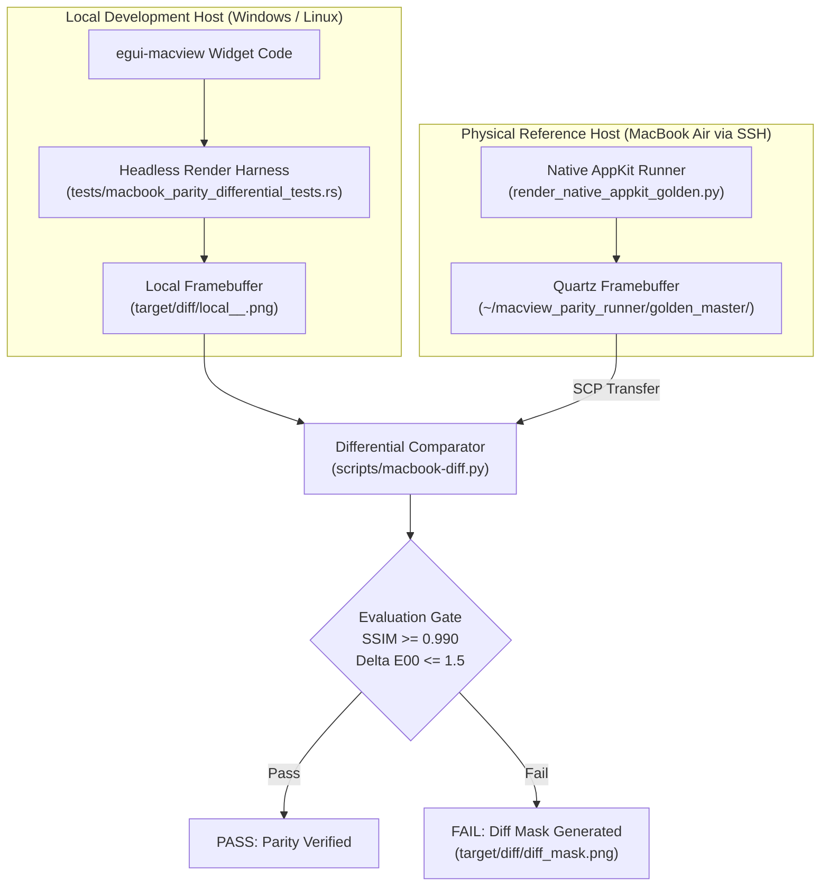

# SPEC-009: Cross-Platform Parity and Remote Differential Testing Harness

| Attribute | Specification Value |
| :--- | :--- |
| **Document ID** | SPEC-009 |
| **Document Title** | Cross-Platform Parity and Remote Differential Testing Harness |
| **Document Version** | `0.3.0` |
| **Status** | Accepted / Normative |
| **Target Milestone** | Milestone 0.3.0 (Parity Verification Gate) |
| **Target Ecosystem** | Standalone crate `egui-macview` and cross-platform desktop applications |
| **Author** | Jaco Oversluizen / `egui-macview` contributors |
| **Normative Test Suite** | `tests/macbook_parity_differential_tests.rs` |
| **Normative Standards** | ISO/IEC 25010:2023, ISO/IEC/IEEE 29119-3:2021, CIE DE2000, Continuous Integration & Automated Parity Testing |

---

## Revision History

| Version | Date | Author | Description / Milestone |
| :--- | :--- | :--- | :--- |
| `0.1.0` | 2026-11-05 | Architecture Team | Baseline Initial Release: Parity Concepts |
| `0.2.0` | 2026-11-06 | Architecture Team | Golden Master Bitmaps & Metric Extraction Baseline |
| `0.3.0` | 2026-11-06 | Architecture Team | Initial Normative Release: Cross-platform parity test protocol, headless framebuffer capture, remote SSH runner contract, and mathematical differential gates |

---

## 1. Scope & System Architecture

When engineering applications in Rust (`egui`) intended to look, feel, and behave indistinguishably from native macOS software, visual inspection ("vibecoding") is strictly replaced by automated specification-driven verification and differential visual regression testing.

SPEC-009 establishes automated remote differential parity testing for `egui-macview`, connecting:
1. **Local Developer Host (Windows / Linux):** Headless rendering of `egui` components into uncompressed 32-bit RGBA framebuffers.
2. **Physical macOS Reference Host (MacBook Air via SSH):** Native AppKit / Quartz offscreen rendering into reference PNGs and geometry ground-truth JSONs.
3. **Automated Mathematical Comparator (`macbook-diff.py`):** Pure-Python deterministic engine enforcing ISO 25010 structural similarity ($\text{SSIM} \ge 0.990$) and CIE DE2000 color parities ($\Delta E_{00} \le 1.5$).



---

## 2. Universal Differential Parity Protocol (UDP-01)

### 2.1 Standardized Component Manifest Schema
Every testable component is declared in a normalized schema. Both the local `egui` test harness and the remote macOS runner parse this schema to ensure exact dimensional and state symmetry:

```json
{
  "component_id": "segmented_control",
  "native_appkit_class": "NSSegmentedControl",
  "dimensions": {
    "width": 160.0,
    "height": 24.0
  },
  "appearances": ["aqua", "dark_aqua"],
  "metrics_keys": ["w", "h"],
  "states": [
    { "variant": "theme", "segments": ["Aqua", "DarkAqua"], "selected": 0 },
    { "variant": "units", "segments": ["pt", "px", "mm"], "selected": 0 }
  ]
}
```

### 2.2 Dual-Tier Test Execution Model

To ensure fast local feedback cycles while maintaining absolute parity:

| Tier | Name | Trigger | Network Dependency | Purpose |
| :--- | :--- | :--- | :---: | :--- |
| **Tier 1** | **Offline Golden Master Oracles** | `cargo test` | None (RAM & local disk) | Validates local geometry, CoreAnimation spring physics analytical equations, and checks against checked-in golden master bitmaps. Runs in `< 10ms`. |
| **Tier 2** | **Live Remote SSH Differential** | `cargo test -- --ignored` or `macbook-diff.py --live` | Yes (`ssh macbook` reachable) | Renders fresh frames live on the MacBook Air, synchronizes assets, and evaluates SSIM/pixel delta. |

---

## 3. Mathematical Acceptance Criteria (ISO 25010 Quality Model)

| Metric | Algorithm / Formula | Pass Threshold | Rejection Threshold | Action on Failure |
| :--- | :--- | :---: | :---: | :--- |
| **Structural Similarity (SSIM)** | Wang et al. (2004) over 8-bit luminance channels | $\text{SSIM} \ge 0.990$ | $\text{SSIM} < 0.980$ | Generate diff mask, inspect layout tokens. |
| **Perceptual Color Delta** | $\Delta E_{00}$ (CIE DE2000) | $\Delta E_{00} \le 1.5$ | $\Delta E_{00} > 2.5$ | Re-evaluate Dynamic Contrast / sRGB conversion. |
| **Bounding Box Delta** | Absolute coordinate error $|\Delta w|, |\Delta h|$ | $\le 0.5\,\text{pt}$ | $> 1.0\,\text{pt}$ | Adjust padding/margin token formulas. |
| **Physics Settling Delta** | $\max \|x(t)_{\text{num}} - x(t)_{\text{exact}}\|$ | $< 10^{-4}$ | $\ge 10^{-3}$ | Re-verify CASpring ODE analytical solver. |
| **Font Anti-Aliasing Halo** | 1-pixel boundary mask | Active on glyph contours | N/A | Isolates subpixel rendering engine differences. |

---

## 4. Headless Framebuffer Capture Specification

### 4.1 Local `egui` Headless Protocol
Headless tests in Rust MUST allocate an isolated `egui::Context`, configure clean `RawInput`, run a single frame with explicit sizing, and ensure any rasterization resources are cleared without panic:

```rust
// Headless test harness pattern
let ctx = egui::Context::default();
let raw_input = egui::RawInput {
    screen_rect: Some(egui::Rect::from_min_size(
        egui::Pos2::ZERO,
        egui::vec2(width, height),
    )),
    ..Default::default()
};

let mut full_output = ctx.run_ui(raw_input, |ui| {
    // Render target widget with explicit MacTheme appearance
});

// Epaint texture safety assertion (prevents debug assertion panics)
full_output.textures_delta.clear();
```

### 4.2 Remote macOS AppKit Runner Contract
The remote host executes `render_native_appkit_golden.py` using its Python virtual environment (`~/.macview_venv/bin/python`).
1. Views are instantiated using exact `NSMakeRect(0, 0, width, height)`.
2. Explicit appearance is applied via `NSAppearance.appearanceNamed_(NSAppearanceNameAqua)` or `NSAppearanceNameDarkAqua`.
3. Rendering uses `cacheDisplayInRect_toBitmapImageRep_` into 32-bit `NSCalibratedRGBColorSpace`.
4. Output is exported as uncompressed PNG via `representationUsingType_properties_(NSPNGFileType, None)`.
5. Frame dimensions and physics durations are serialized to `appkit_metrics_ground_truth.json`.

---

## 5. Failure Protocol and Root Cause Remediation

When a differential test fails ($\text{SSIM} < 0.990$):

1. **Diff Mask Inspection:**
   `macbook-diff.py` writes `diff_mask.png` where matching pixels are dimmed to 30% monochrome and divergent pixels glow in intense magenta/red (`#FF0055`).
2. **Root Cause Classification:**
   - **Type A (Specification Error):** The token value in `design_tokens.json` was derived from outdated HIG documentation. Fix: Update spec and token JSON.
   - **Type B (Implementation Bug):** The Rust widget has an off-by-one pixel rounding error or incorrect stroke centering. Fix: Correct Rust rendering logic.
   - **Type C (Subpixel Rendering):** The difference is purely subpixel font smoothing. Fix: Apply the 1px boundary mask per the differential testing specification.
3. **Strict Ban on Tolerance Inflation:**
   Lowering the threshold from $0.990$ to "make the test pass" without mathematical justification violates Specification-Driven Verification and Test-Driven Development.
