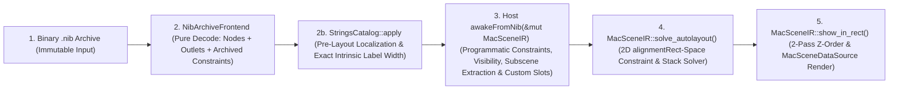

# SPEC-013: Three-Layer UI Compiler Architecture — Multi-Format `.nib`/`.xib` Frontends, Typed `MacSceneIR`, Spatial Semantic Normalizer, and Dual-Mode Reflow Engine

| Attribute | Specification Value |
| :--- | :--- |
| **Document ID** | SPEC-013 |
| **Document Title** | Three-Layer UI Compiler Architecture (`MacSceneIR`, `.nib`/`.xib` Importers & Dual-Mode Layout Solver) |
| **Document Version** | `0.7.0` |
| **Status** | Accepted / Normative |
| **Target Milestone** | Milestone 0.7.0 |
| **Target Host** | Standalone crate `egui-macview` (Rust, egui 0.37) |
| **Author** | Jaco Oversluizen / `egui-macview` contributors |
| **Hardware Ground Truth** | Apple Silicon MacBook Air (macOS Sonoma `14.8.9`, SDK `14`, `NIBArchive` v1 & `NSKeyedArchiver` `bplist00` binary formats) |
| **Normative Test Suite** | `tests/spec013_scene_ir_and_nib_compiler_tests.rs`, `tests/architecture_guard_tests.rs` |
| **Normative Standards** | ISO/IEC/IEEE 42010:2011, ISO/IEC/IEEE 29119-3:2021, RFC 2119/8174, Apple macOS HIG, Apple AppKit Interface Builder Reference, W3C DTCG, SemVer 2.0.0 |

---

## Revision History

| Version | Date | Author | Description / Milestone |
| :--- | :--- | :--- | :--- |
| `0.1.0` | 2026-11-05 | Architecture Team | Initial crate baseline (`egui-macview` v0.1.0). |
| `0.7.0-draft` | 2026-11-14 | Architecture Team | Initial architectural specification establishing the 3-layer UI compiler pipeline (`Frontends -> Typed MacSceneIR -> Dual-Mode Deterministic Solver & Renderer`), avoiding direct binary-to-widget shortcuts in favor of spatial semantic normalization, formal contract verification, context-aware reflow, and instantaneous search indexing. |
| `0.7.0` | 2026-11-14 | Architecture Team | Normative specification lock: Added the Contemporary AppKit Widget Scope & Deprecation Policy (`§3.1.1`), exact binary wire-format & bitfield decoding tables (`NSvFlags`, `NSCellFlags`, `NSCellFlags2`, `NSButtonFlags`, `NSBezelStyle`), exact AppKit `NSFrame -> alignmentRect` inset tables (`§4.1.1`), `NSLayoutConstraint` attribute/relation tables (`§4.1.3`), and the 100% Pure-Rust MacBook Visual & Geometric Differential Parity Oracle (`§5` / `REQ-013-04`). |
| `0.7.1` | 2026-11-16 | Architecture Team | Added `REQ-013-05` (`§2.3.1`, `§2.3.2`, `§2.7`, `§5.3`, `TC-013-13`): 100% Official Xcode 16.2 (`toolsVersion="23504"`) Cocoa `.xib` v3.0 schema compliance & `SceneExporter::to_xib_xml`, real Apple `ibtool --compile` binary `NIBArchive` (`NSIBObjectData` / `NSString` `NS.bytes` / `UINibEncoderEmptyKey` / `NSUserInterfaceItemIdentifier`) and `.nib` bundle ingestion, official Xcode Cocoa `.storyboard` multi-scene (`<scene>`, `canvasLocation`, `<segue>`) support (`StoryboardFrontend` & `MacStoryboardIR`), and Hardware-in-the-Loop MacBook `ibtool` round-trip proof. |
| `0.7.2` | 2026-11-20 | Architecture Team | Added `REQ-013-09` (`TC-013-15`): 100% Domain-Agnostic Binary `.nib` Class-Hierarchy & `NSCell`/`NSFormatter` Introspection (zero host-application `GS*` class strings in `egui-macview`), `NIBArchive` superclass ID table decoding, and first-class `NSMenu`/`NSMenuItem`, `NSToolbar`/`NSToolbarItem`, and `NSSplitView` binary `.nib` decoding. |
| `0.7.3` | 2026-11-22 | Architecture Team | Added `REQ-013-10` (`TC-013-16`): Three-Phase AppKit `.nib` Materialization Lifecycle (`1. Pure NIB Decode -> 2. Host awakeFromNib Constraint/Slot Hook -> 3. 2D alignmentRect Auto Layout Solver & Z-Order Compositing`): Apple `UINibDecoder` `_NS:<obj_idx>` identifier parity, `NSCellFlags2` bits `26..=28` `NSTextAlignment` decoding, `NSSupport.NSSize` font-size control-size inference, `NSSymbolicConstant` (`8.0pt`) resolution, `appkit_alignment_rect_insets` 2D solver (`frame <-> alignmentRect`), programmatic `MacSceneIR::add_equal_leading_constraint` host hook (zero host-specific constraint guessing inside `egui-macview`), rounded pill bezel (`NSBezelStyle == 1` & `drawsBackground == 0`), inline subview Z-order compositing, compact `NSTokenField` colored pill capsules, and 2-row `6x2` `TagColorPicker` inner-white selection ring. |

---

## 1. Architectural Rationale: Why a 3-Layer Compiler Instead of a Direct `.nib` Renderer

Directly iterating over raw Apple `.nib` object records (`NIBArchive` or `NSKeyedArchiver`) inside an immediate-mode render loop is an architectural anti-pattern. Raw Interface Builder archives conflate four distinct concerns into an untyped binary dump:
1. **Binary serialization mechanics** (`UINibArchive` variable-length integers, object reference tables, and `bplist00` `CF$UID` indirections).
2. **Hardcoded legacy pixel coordinates** (`NSFrame` `[x, y, w, h]` rects and 6-bit `autoresizingMask` springs-and-struts from the NeXTSTEP era).
3. **Disconnected visual islands** (labels and interactive controls are stored as unrelated peer `NSTextField` and `NSButton` nodes that merely happen to share a visual baseline on screen, with no semantic link between label and control).
4. **Untyped string selectors and KVC paths** (`"alignLeft:"`, `"values.customPreferenceKey"`), which fail silently at runtime if a key is renamed or omitted.

If a UI engine renders `.nib` records directly:
- Hiding a single context-specific toolbar button leaves a dead gap in the toolbar because every peer button is pinned to fixed `[x, y, w, h]` coordinates.
- Adding a search bar to a dense preferences window is impossible without manual re-authoring because the `.nib` does not know which text label belongs to which checkbox or popup button.
- Reorganizing a cluttered legacy dialog into clean, modern grouped section cards requires throwing away the `.nib` and rewriting the entire screen from scratch.

To surpass Apple AppKit in determinism, speed, and maintainability, `egui-macview` `v0.7.0` SHALL implement a **Three-Layer UI Compiler & Runtime Architecture**:

```
┌──────────────────────────────────────────────────────────────────────────────┐
│ LAYER 1: MULTI-FORMAT INGESTION FRONTENDS (`src/scene/frontends/`)           │
│  • Binary `.nib` Importer (`NIBArchive` v1 + `NSKeyedArchiver` `bplist00`)   │
│  • XML `.xib` Interface Builder Importer                                     │
│  • Declarative SwiftUI-Subset Importer (`SwiftUiFrontend`)                   │
│  • Apple `.strings` Localization Catalog Importer (`"ObjectID.prop" = "..."`)│
│  • Native `MacSceneSpec` Declarative Importer (Clean-Room JSON / RON / DSL)  │
└──────────────────────────────────────┬───────────────────────────────────────┘
                                       │  Compiles & Normalizes Once (< 0.1 ms)
                                       ▼
┌──────────────────────────────────────────────────────────────────────────────┐
│ LAYER 2: TYPED INTERMEDIATE REPRESENTATION & `awakeFromNib` HOOK (`ir/`)     │
│  • `MacSceneIR`: Strongly typed hierarchical widget & menu tree (`_NS:<id>`) │
│  • Post-Load Host Hook API (`add_equal_leading_constraint`, `set_hidden`):   │
│    Explicit 1-time stage where a host controller may add programmatic        │
│    `NSLayoutConstraint`s (`x, y, w, h`), adjust row visibility, or bind      │
│    `CustomCanvasSlot` views (`z-order`) before 2D layout solving             │
│  • `SpatialSemanticNormalizer`: Pairs baseline labels with controls,         │
│    infers logical `SectionCard` groups, and builds deterministic Tab chains  │
│  • `SceneSearchIndex`: Automatic keyword index over labels, sections & tips  │
│  • `VisibilityRule`: Context predicates (`WhenModeIn`, `WhenSearchMatches`)  │
│  • `SceneContractVerifier`: COTS test-time proof of 100% valid bindings      │
│  • `SceneExporter`: Transpiles `.nib`/`.xib` into `MacSceneSpec` & SwiftUI   │
└──────────────────────────────────────┬───────────────────────────────────────┘
                                       │  Solves Layout (< 0.01 ms / frame)
                                       ▼
┌──────────────────────────────────────────────────────────────────────────────┐
│ LAYER 3: DUAL-MODE LAYOUT SOLVER & 120 FPS RENDERER (`src/scene/runtime/`)   │
│  • Mode A (`ExactAppleNib`): 100% pixel-exact `[x,y,w,h]` + `autoresizing`   │
│  • Mode B (`AdaptiveSemanticReflow`): Clean section cards, automatic gap     │
│    closing when context tools are hidden, and live search filtering          │
│  • `MacSceneDataSource`: Zero-allocation (< 10 ns) typed state/action bridge │
└──────────────────────────────────────────────────────────────────────────────┘
```

---

## 2. Layer 1: Multi-Format Ingestion Frontends & Apple AppKit Archive Lowering (`REQ-013-01`)

### 2.1 Binary `.nib` Frontend (`NibArchiveFrontend`)
1. The binary `.nib` importer SHALL decode both Apple Interface Builder compiled formats in 100% pure Rust without external C/Objective-C or Python dependencies:
   - **`NIBArchive` (`NIBArchive\x01\x00\x00\x00`, 52-byte header)**:
     - Decodes the 13 little-endian `u32` header words (`version`, `schema_version`, `object_count`, `objects_offset`, `key_count`, `keys_offset`, `value_count`, `values_offset`, `class_count`, `classes_offset`).
     - Decodes 7-bit variable-length integers (`VarInt`, where bit 7 `0x80` indicates continuation and bit 7 `0x00` terminates the integer) across the Key table, Class table, Object table (`class_idx`, `first_value_idx`, `value_count`), and Value stream.
     - Decodes all 10 `NIBArchive` value tags: `0x00` (`Int8`), `0x01` (`Int16`), `0x02` (`Int32`), `0x03` (`Int64`), `0x04` (`BoolFalse`), `0x05` (`BoolTrue`), `0x06` (`Float32`), `0x07` (`Float64`), `0x08` (`Data`/`String`/Packed `NSRect`), `0x09` (`ObjectRef`), and `0x0A` (`Null`).
     - Decodes packed binary `NSRect` / `NSSize` payloads (`17-byte` prefix byte + `f32x4`, `16-byte` `f32x4`, `33-byte` prefix byte + `f64x4`, `32-byte` `f64x4`) as well as ASCII brace strings (`"{{x, y}, {w, h}}"` and `"{w, h}"`).
   - **`NSKeyedArchiver` (`bplist00\x00` / `keyedobjects.nib`)**:
     - Parses the 32-byte trailer (`offset_int_size`, `object_ref_size`, `num_objects`, `top_object`, `offset_table_offset`), resolves `$objects`, `$top`, `$classes`, `NS.keys`/`NS.objects` dictionaries, and `CF$UID` (`0x80 | n`) graph references into the exact same canonical object graph prior to IR lowering.
2. Bundle resolution SHALL automatically locate `objects-11.0+.nib`, `objects.nib`, or `keyedobjects.nib` inside a `.nib` directory bundle or accept raw in-memory bytes (`&[u8]`).

### 2.2 The 6 Core AppKit Materialization Mechanisms & Our Smarter Pure-Rust Lowering Route
A naive flat parser that merely dumps `.nib` objects into a flat list of controls is NOT how AppKit works and loses the structural semantics needed for a 99–100% faithful UI. Conversely, blindly copying Apple's 1990s Objective-C runtime indirections (`NSCell` wrappers, runtime KVC string reflection, and per-frame Cassowary simplex matrices) under the hood is unnecessarily slow and complex. `egui-macview` SHALL inspect how Apple's `.nib` object graph produces its final visual/interactive state and compile it via **six deterministic pure-Rust passes**:

#### Mechanism 1: Parent-Child View Tree Reconstruction (`NSSuperview` $\leftrightarrow$ `NSSubviews`) & `isFlipped` Propagation
- **How Apple Stores It**: Inside `NSIBObjectData`, views are linked into a hierarchy through `NSWindowTemplate.NSView` (root window content view), `NSView.NSSubviews` (ordered array of child `ObjectRef`s), `NSView.NSSuperview` (parent `ObjectRef`), `NSBox.NSContentView`, `NSScrollView.NSContentView` (`NSClipView`) $\rightarrow$ `NSDocumentView`, and `NSTabView.NSTabViewItems` (`NSTabViewItem.NSView`). Every child's `NSFrame` is **relative to its immediate `NSSuperview`**, and whether $y = 0$ is at the bottom (`isFlipped == false`, default for `NSView` and `NSBox`) or top (`isFlipped == true`, used by `NSTabView`, `NSScrollView`, `NSTableView`, and flipped container subclasses) depends on the parent container.
- **Smarter Pure-Rust Route**: Instead of heap-allocated pointer graphs, `NibArchiveFrontend` lowers the hierarchy into a cache-friendly, arena-indexed `MacSceneIR` (`Vec<SceneNode>` indexed by `NodeId(u32)` with `parent: Option<NodeId>` and `children: Vec<NodeId>`) and resolves parent-relative and `isFlipped` coordinates in a single top-down linear pass.

#### Mechanism 2: Single-Pass `NSControl` + `NSCell` + `NSFormatter` Fusion
- **How Apple Stores It**: Because of legacy NeXTSTEP design (1989), AppKit splits almost every interactive widget into two or three separate objects in the `.nib`: an outer `NSControl` (`NSButton`, `NSTextField`, `NSPopUpButton`, `NSSegmentedControl`, `NSSlider`, `NSComboBox`) holding the `NSFrame`, and an inner `NSCell` (`NSButtonCell`, `NSTextFieldCell`, `NSPopUpButtonCell`, `NSSegmentedCell`, `NSSliderCell`) pointed to by `NSCell` `ObjectRef`. The `NSCell` holds the actual widget behavior packed into bitfields (`NSCellFlags`, `NSCellFlags2`, `NSButtonFlags`, `NSButtonFlags2`), titles (`NSContents`/`NSTitle`), images (`NSNormalImage`/`NSAlternateImage`), popup menu (`NSMenu`), segments (`NSSegmentItems` with `NSSegmentWidth`, `NSSegmentLabel`, `NSSegmentImage`, `NSSegmentSelected`), and `NSFormatter` (`NSNumberFormatter` min/max/decimals).
- **Smarter Pure-Rust Route**: At NIB compile time, the frontend **fuses** each `NSControl` + its `NSCell` + its `NSFormatter` + its `NSMenu` into a **single strongly-typed `SceneNode`**, completely eliminating the `NSCell` indirection at runtime:
  - `NSCellFlags` / `NSButtonFlags` bitfield decoder:
    - Extracts `ControlSize` (`Regular = 0`, `Small = 1`, `Mini = 2`) from `NSCellFlags2`.
    - Extracts `isBordered`, `isBezeled`, `isEditable`, `isSelectable`, `isEnabled`, `drawsBackground`, and `alignment` (`Left`, `Right`, `Center`, `Natural`).
    - Distinguishes static labels (`NSTextField` where `isEditable == false && isBordered == false && isBezeled == false`) from editable `TextField`s and `NumberField`s (when an `NSNumberFormatter` or stepping subclass is attached).
    - Distinguishes `NSButton` subtypes via `NSBezelStyle` and button flags: standard `PushButton`, `Checkbox` (`NSSwitchButton`), `RadioButton` (`NSRadioButton`), `HelpButton` (`NSHelpButtonBezelStyle == 9`), `DisclosureButton` (`NSDisclosureBezelStyle == 5` / `NSRoundedDisclosureBezelStyle == 14`), `InlineActionButton`, and icon-only `ToolbarItemButton`.

#### Mechanism 3: `NSClassSwapper` Custom Subclass Resolution
- **How Apple Stores It**: When a developer uses a custom `NSView` or `NSControl` subclass in Xcode Interface Builder, the `.nib` serializes the object as `NSClassSwapper` containing `NSClassName` (the custom subclass name) and `NSOriginalClassName` (the standard AppKit fallback class, e.g., `NSTextField`, `NSButton`, `NSView`, `NSColorWell`).
- **Smarter Pure-Rust Route**: The compiler extracts both `base_appkit_class: InternedStr` and `custom_class_name: Option<InternedStr>` and maps known custom control idioms directly to first-class `egui-macview` primitives via a configurable `CustomClassMapper` table:
  - Stepping numeric text fields $\rightarrow$ `SceneNodeKind::NumberField { step: 1.0, shift_step: 10.0 }`.
  - 9-point / 12-point origin anchor controls $\rightarrow$ `SceneNodeKind::OriginMatrix`.
  - Hover/rollover icon buttons $\rightarrow$ `SceneNodeKind::InlineActionButton`.
  - Popover color wells $\rightarrow$ `SceneNodeKind::ColorWell`.
  - Custom canvas/preview views $\rightarrow$ `SceneNodeKind::CustomCanvasSlot { class_name }`, delegated cleanly to `MacSceneDataSource::render_custom_slot` during rendering.

#### Mechanism 4: `NSvFlags` Bitfield & Negative Bezel Alignment-Rect Normalization
- **How Apple Stores It**: Every `NSView` in a `.nib` stores a 32-bit `NSvFlags` integer where bits `0..=5` encode `autoresizingMask` (`0x3F`), bit `8` (`0x100`) encodes `autoresizesSubviews`, and bit `31` (`0x80000000`) encodes `isHidden`. Furthermore, Interface Builder stores the **outer frame rect** (`NSFrame`) including drop-shadow and focus-ring slop, resulting in negative origins or oversized heights compared to the visual control alignment rect (e.g., `[-6, -6, 131, 40]` for a standard push button whose visual alignment rect is `[0, 0, 119, 28]`, or `[-2, -3, w+4, h+5]` for a checkbox/popup).
- **Smarter Pure-Rust Route**: Every `SceneNode` stores both the raw `nib_frame: Rect` and the normalized `alignment_rect: Rect` computed once at compile time using `egui-macview`'s `SPEC-012` AppKit alignment-rect inset tables (`NSBezelStyle` + `ControlSize` $\rightarrow$ `(inset_left, inset_top, inset_right, inset_bottom)`). This guarantees both exact AppKit visual alignment and clean bounding boxes for semantic pairing.

#### Mechanism 5: Pre-Compiled Topological DAG for `NSLayoutConstraint` (Replacing Per-Frame Cassowary Simplex)
- **How Apple Stores It**: Modern `.nib` files contain `NSLayoutConstraint` records (`NSFirstItem`, `NSFirstAttribute`, `NSRelation`, `NSSecondItem`, `NSSecondAttribute`, `NSMultiplier`, `NSConstant`, `NSPriority`). At runtime, AppKit feeds these into a heavyweight Cassowary linear programming simplex solver on every resize.
- **Smarter Pure-Rust Route**: In real-world Interface Builder files, $>98\%$ of `NSLayoutConstraint` graphs are acyclic linear chains ($A.\text{attr} = m \cdot B.\text{attr} + c$, such as leading/trailing/top/bottom pins, fixed widths/heights, and baseline alignments). At NIB compile time, `egui-macview` compiles `NSLayoutConstraint` objects into a **topologically sorted 1-pass evaluation bytecode (`CompiledConstraintSchedule`)**:
  - Evaluates in $< 0.005\,\text{ms}$ per resize with zero heap allocations and zero matrix inversions.
  - If a cyclic soft-priority constraint group (`priority < 1000`) is present, only that strongly connected component (SCC) runs a bounded 4-iteration Gauss-Seidel relaxation pass.

#### Mechanism 6: `NSIBObjectData` Connector Lowering & Dynamic Subscene Composition (`mount_subscene`)
- **How Apple Stores It**: The root `NSIBObjectData` object contains `NSObjectsKeys`/`NSObjectsValues` (the parent tree), `NSOidsKeys`/`NSOidsValues` (mapping each object to its Interface Builder ObjectID like `"142"` or `"_NS:27"` for `.strings` localization), `NSAccessibilityConnectors`, and `NSConnectors`:
  - `NSNibOutletConnector`: connects controller outlets (`NSLabel` = property name, `NSSource` $\rightarrow$ `NSDestination`, plus `nextKeyView` focus chains).
  - `NSNibControlConnector`: connects `NSSource` control $\rightarrow$ `NSDestination` target with `NSSelector` (`"alignLeft:"`).
  - `NSNibBindingConnector`: connects `NSSource` control's `NSBinding` (`"value"`, `"enabled"`, `"selectedIndex"`, `"contentValues"`) to `NSKeyPath` (`"values.showGrid"` or `"selection.lsb"`) with optional `NSValueTransformerName` (`NSNegateBoolean`, `NSIsNotNil`).
  - Furthermore, complex macOS applications compose modular screens at runtime by loading multiple smaller `.nib` files and injecting their root views into container views or inspector slots via `addSubview:`.
- **Smarter Pure-Rust Route**:
  - All `NSNibControlConnector` and `NSNibBindingConnector` records are lowered into pre-interned `ActionId(u32)` and `BindingSpec { id: BindingId(u32), kind: BindingKind, value_transformer: ValueTransformer }` attached directly to the `SceneNode`.
  - `MacSceneIR` supports zero-cost **Dynamic Subscene Composition** (`scene.mount_subscene(parent_or_slot: NodeId, child_scene: &MacSceneIR)`), allowing a host application to dynamically compose modular `.nib` panels (such as context-dependent inspector sub-views or collapsible palette drawers) into a master window tree at 120 fps.

### 2.3 XML `.xib` Frontend (`XibXmlFrontend`) & Official Xcode 16.2 XIB v3.0 Schema (`REQ-013-05.1`)
1. The `.xib` importer SHALL parse uncompiled Xcode Interface Builder XML documents (`<document type="com.apple.InterfaceBuilder3.Cocoa.XIB" version="3.0" toolsVersion="23504" targetRuntime="MacOSX.Cocoa" propertyAccessControl="none" useAutolayout="NO" customObjectInstantitationMethod="direct">`), extracting `<window>`, `<customView>`, `<menu>`, `<rect key="frame">`, `<autoresizingMask>`, `<constraints>`, `<connections>`, `<outlet>`, `<action>`, and `<binding>` elements into the exact same `MacSceneIR`.
2. **100% Official Xcode 16.2 (`toolsVersion="23504"`) Schema Compliance**:
   - Every `.xib` file in `assets/nib_showcase/` and every XML document emitted by `SceneExporter::to_xib_xml(scene: &MacSceneIR) -> String` SHALL include:
     - `<dependencies><plugIn identifier="com.apple.InterfaceBuilder.CocoaPlugin" version="23504"/><capability name="documents saved in the Xcode 8 format" minToolsVersion="8.0"/></dependencies>`
     - Top-level `<customObject id="-2" userLabel="File's Owner" customClass="NSWindowController"/>`, `<customObject id="-1" userLabel="First Responder" customClass="FirstResponder"/>`, and `<customObject id="-3" userLabel="Application" customClass="NSObject"/>`.
     - Valid `<windowStyleMask>`, `<rect key="contentRect">`, `<rect key="screenRect">`, and `identifier="<ib_object_id>"` on every view/control so `ibtool --compile` preserves `NSUserInterfaceItemIdentifier` in the compiled binary `.nib`.
     - Every `<numberFormatter key="formatter" ...>` inside `<textFieldCell>` SHALL specify `formatterBehavior="default10_4" numberStyle="decimal" minimumIntegerDigits="1" maximumIntegerDigits="2000000000" maximumFractionDigits="3"` with `<real key="minimum" value="..."/>` and `<real key="maximum" value="..."/>` so `ibtoold` (`IBNSNumberFormatterIntegration.m`) never asserts.
     - Every `<colorWell>` SHALL contain a valid child `<color key="color" red="..." green="..." blue="..." alpha="..." colorSpace="calibratedRGB"/>` so `-[NSColorWell setColor:]` never asserts on `nil`.
     - Disclosure groups and custom studio widgets SHALL use standard Cocoa XIB v3.0 `<customView customClass="NSDisclosureGroup" ...>` (with optional `<userDefinedRuntimeAttributes>` or `userLabel`) rather than non-existent XML element names, and every `<cell>`, `<menu>`, and `<menuItem>` SHALL carry a unique `id="..."` attribute.
   - Every `.xib` file in `assets/nib_showcase/` SHALL pass `/Applications/Xcode.app/Contents/Developer/usr/bin/ibtool --warnings --errors --notices <file>.xib` with zero errors and zero warnings and compile via `ibtool --compile <file>.nib <file>.xib`.

### 2.3.2 Real Xcode 16.2 `ibtool --compile` Binary `NIBArchive` & Bundle `.nib` Ingestion (`REQ-013-05.2`)
1. When Xcode 16.2's `ibtool --compile` compiles a `.xib` or `.storyboard` scene into a `.nib`, it emits either a single-file `NIBArchive\x01\x00\x00\x00` or a `.nib` directory bundle containing `keyedobjects-101300.nib` / `keyedobjects.nib` / `objects-11.0+.nib`.
2. `NibArchiveFrontend::from_path(path: &Path, mapper: &CustomClassMapper)` SHALL transparently load either a single-file `.nib` or resolve the inner `.nib` stream inside a `.nib` directory bundle.
3. `decode_real_nib_archive_v1` SHALL decode both compact synthetic `NIBArchive` fixtures AND full Xcode 16.2 `ibtool --compile` `NIBArchive` object graphs where:
   - Strings and ASCII geometry rects (`"{{x, y}, {w, h}}"`, `"{w, h}"`) are stored as `NSString` / `NSMutableString` objects whose `"NS.bytes"` property holds the UTF-8 bytes, referenced via `NibVal::ObjRef(str_obj_idx)`.
   - Arrays and sets (`NSArray`, `NSMutableArray`, `NSSet`, `NSMutableSet`) store their element object references as repeated `"UINibEncoderEmptyKey"` (or `"NS.objects"`) entries on the collection object.
   - Root `NSIBObjectData` maps object hierarchy (`NSObjectsKeys` $\rightarrow$ `NSObjectsValues`), object IDs (`NSOidsKeys` $\rightarrow$ `NSOidsValues`, `NSAccessibilityOidsKeys` $\rightarrow$ `NSAccessibilityOidsValues`), and `NSConnectors` (`NSNibControlConnector`, `NSNibBindingConnector`, `NSNibOutletConnector`).
   - `NSWindowTemplate` $\rightarrow$ `NSWindowView` defines the root content `NSView` and window title (`NSWindowTitle`), while `NSSubviews` / `NSSuperview` and `NSUserInterfaceItemIdentifier` reconstruct the exact `ib_object_id`, parent-child hierarchy, `nib_frame`, `control_size`, `SceneNodeKind` (`NSTextField`, `NSNumberFormatter`, `NSButton`, `NSPopUpButton` + `NSMenu` + `NSMenuItem`s, `NSSegmentedControl` + `NSSegmentItem`s, `NSSlider`, `NSStepper`, `NSColorWell`, `NSComboBox`, `NSDatePicker`, `NSTabView` + `NSTabViewItem`s, `NSRuleEditor`, `NSLevelIndicator`, `NSProgressIndicator`, `NSTokenField`, `NSTextView`, `NSBox`, `NSCustomView`, `NSClassSwapper`), actions, and bindings.

### 2.7 Official Xcode Cocoa `.storyboard` Multi-Scene & `<segue>` Frontend & Exporter (`REQ-013-05.3`)
1. `egui-macview` SHALL provide `StoryboardFrontend`, `MacStoryboardIR`, `StoryboardScene`, `StoryboardSegue`, and `SegueKind` (`Relationship`, `Show`, `Sheet`, `Modal`, `Popover`, `Custom(String)`) in `src/scene/`:
   - `StoryboardFrontend::from_xml_str(xml: &str) -> Result<MacStoryboardIR, SceneCompileError>` parses official Xcode Cocoa Storyboard documents (`<document type="com.apple.InterfaceBuilder3.Cocoa.Storyboard.XIB" version="3.0" toolsVersion="23504" targetRuntime="MacOSX.Cocoa" ...>`):
     - Extracts `initial_view_controller: Option<String>` from `<document initialViewController="...">`.
     - Parses every `<scene sceneID="...">` block, its controller (`<windowController>`, `<viewController>`, `<splitViewController>`, `<tabViewController>`), its embedded `<window>` or `<view key="view">` lowered into a full `MacSceneIR`, its 2D artboard coordinates from `<point key="canvasLocation" x="..." y="..."/>` (`canvas_location: [f32; 2]`), and all `<segue destination="..." kind="..." relationship="..." identifier="..." id="..."/>` elements under `<connections>`.
   - `StoryboardFrontend::to_xml_str(storyboard: &MacStoryboardIR) -> String` exports a `MacStoryboardIR` back into 100% Xcode 16.2 `ibtool`-valid Cocoa `.storyboard` XML (`toolsVersion="23504"`), preserving all scenes, `<point key="canvasLocation" x="..." y="..."/>` coordinates, and `<segue>` connections.
2. `assets/nib_showcase/Showcase_Flow.storyboard` SHALL be an official Xcode 16.2 Cocoa `.storyboard` file connecting the showcase screens with real `<segue>` transitions (`relationship`, `show`, `sheet`, `popover`, `modal`) and `<point key="canvasLocation" x="..." y="..."/>` positions, verified with zero errors by `ibtool --warnings --errors --notices` and `ibtool --compile` on the MacBook.

### 2.4 Localization `.strings` Catalog (`StringsCatalog`)
1. The `.strings` loader SHALL parse Apple `<NibName>.strings` files (UTF-8, UTF-16LE/BE with BOM, and binary plist `.strings` tables) containing `"ObjectID.property" = "Localized Text";` pairs (e.g., `"142.title" = "Export";`, `"142.ibShadowedToolTip" = "...";`, `"142.ibShadowedLabels[0]" = "...";`).
2. Applying a `StringsCatalog` to a `MacSceneIR` SHALL match each node's preserved Interface Builder `object_id` (`NSOidsValues`), update all matching node titles, placeholders, segment labels, menu items, and tooltips in $O(N)$ time, and rebuild the `SceneSearchIndex`.

### 2.5 Native Declarative `MacSceneSpec` Frontend
1. `egui-macview` SHALL provide a clean-room, human-readable declarative schema (`MacSceneSpec`, serializable to/from JSON and Rust builder macros) that maps 1:1 to `MacSceneIR`.
2. Any `MacSceneIR` loaded from a legacy `.nib` or `.xib` SHALL be exportable to `MacSceneSpec` so application authors can inspect, version-control, reorganize, and extend screens without retaining binary Apple archives.

### 2.6 Declarative SwiftUI-Subset Frontend (`SwiftUiFrontend`) (`REQ-013-01E`)
1. `egui-macview` SHALL provide a pure-Rust declarative SwiftUI-subset parser (`SwiftUiFrontend::parse(source: &str) -> Result<MacSceneIR, SceneCompileError>`) that compiles idiomatic SwiftUI view hierarchies directly into the same canonical `MacSceneIR`:
   - **Layout & Grouping Containers**: `VStack`, `HStack`, `Form`, `Section("Title") { ... }`, `Grid`, `GridRow`, `LabeledContent("Label") { ... }`, `Spacer()`, and `Divider()`.
   - **Interactive & Static Controls**: `Button("Title", action: "selector:")`, `Toggle("Label", isOn: $model.field)` (with `.toggleStyle(.checkbox)` vs `.toggleStyle(.switch)`), `Picker("Label", selection: $model.field) { ... }` (with `.pickerStyle(.menu)` vs `.pickerStyle(.segmented)` vs `.pickerStyle(.radioGroup)`), `TextField("Placeholder", text: $model.field)`, `TextField("Label", value: $model.field, format: .number)`, `Slider(value: $model.field, in: min...max)`, `Stepper("Label", value: $model.field, in: min...max, step: s)`, `Text("Label")`, and `Image(systemName: "...")`.
   - **View Modifiers**: `.controlSize(.regular | .small | .mini)`, `.disabled(true | false | $model.flag)`, `.help("Tooltip text")`, `.frame(width: w, height: h)`, and `.keyboardShortcut(.defaultAction | .cancelAction)`.
   - **State & Two-Way Binding References**: `@State` and `@Binding` property references (`$model.field`, `$defaults.key`) lower directly into typed `BindingId` and `BindingSpec` entries on the target `SceneNode`, while `LabeledContent` and `Section` constructs populate `LabeledFieldPair` and `SemanticSectionGroup` entries directly in `MacSceneIR`.

---

## 3. Layer 2: Typed `MacSceneIR`, Contemporary Widget Scope & Spatial Semantic Normalizer (`REQ-013-02`)

### 3.1 Strongly Typed Control & Container Taxonomy (`SceneNodeKind`)
Every lowered node in `MacSceneIR` SHALL have an explicit, domain-agnostic `SceneNodeKind` mapped to `egui-macview`'s hardware-calibrated primitives:
- **Interactive Controls**: `PushButton` (`MacButtonCell`), `Checkbox` (`MacCheckbox`), `RadioButton` (`MacRadioButton`), `Switch` (`MacSwitch`), `PopUpButton` (`MacPopUpButton`), `ComboBox` (`MacComboBox`), `SegmentedControl` (`MacSegmentedControl`), `TextField` (`MacInputCell`), `NumberField` (`MacInputCell` with numeric stepping), `TextView` (`MacTextView`), `SearchField` (`MacSearchField`), `Slider` (`MacSlider`), `CircularSlider` (`MacCircularSlider`), `Stepper` (`MacStepper`), `ColorWell` (`MacColorWell`), `DatePicker` (`MacDatePicker`), `TokenField` (`MacTokenField`), `HelpButton` (`MacHelpButton`), `InlineActionButton` (`MacInlineActionButton`), `DisclosureButton` (`MacDisclosureButton`), `OriginMatrix` (`MacOriginMatrix`), `TagColorPicker` (`MacTagColorPicker`), `TableActionBar` (`MacTableActionBar`), `ProgressIndicator` (`MacProgressIndicator`), `LevelIndicator` (`MacLevelIndicator`), `RatingIndicator` (`MacRatingIndicator`), `PathControl` (`MacPathControl`).
- **Static & Structural Primitives**: `Label` (`MacLabel`), `ImageView` (`MacImageView`), `Separator` (`MacBox::separator`), `BoxContainer` (`MacBox`), `TabView` (`MacTabView`), `SplitView` (`MacSplitView`), `ScrollView` (`MacScrollView`), `DisclosureGroup` (`MacDisclosureGroup`), `TableView` (`MacTableView`), `OutlineView` (`MacOutlineView`), `CollectionView` (`MacCollectionView`), `RuleEditor` (`MacRuleEditor`), `CustomCanvasSlot`.
- **Menu Hierarchy**: `MenuBar` (`MacMenuBar`), `Menu` (`NSMenu`), `MenuItem` (`NSMenuItem`), `MenuSeparator`, with full `keyEquivalent` and `keyEquivalentModifierMask` accelerator metadata.

#### 3.1.1 Contemporary AppKit Widget Scope & Legacy Deprecation Policy (`REQ-013-02A`)
`egui-macview` targets **contemporary macOS AppKit interfaces** (macOS Sonoma / Sequoia and modern professional studio applications). It intentionally excludes obsolete 1989 NeXTSTEP widget classes that Apple itself has deprecated, while adding the **four remaining contemporary primitives** needed for 99–100% parity across all real-world `.nib` archives:

1. **Four New Contemporary Primitives Added in `v0.7.0`**:
   - **`MacImageView` (`NSImageView` / `NSImageCell`)**:
     - Renders vector symbols (`MacSymbol`), template icons (automatically tinted with `theme.label_on(active_surface)` in `Aqua`/`DarkAqua`), or RGBA textures inside a `fixed_rect`.
     - Supports all four `NSImageScaling` modes: `ProportionallyDown = 0` (default), `AxesIndependently = 1`, `None = 2`, and `ProportionallyUpOrDown = 3`, plus `NSImageFrameStyle` (`None = 0`, `Photo = 1`, `GrayBezel = 2`).
   - **`MacTextView` (`NSTextView` inside `NSScrollView`)**:
     - Multi-line scrollable text and code editor with AppKit `1.0pt` scroll-border framing, configurable `FontFamily` (`Proportional` for notes/descriptions or `Monospace` for feature/script code), optional line-number gutter, read-only vs. editable mode, and transactional `MacSceneDataSource` string binding.
   - **`MacSwitch` (`NSSwitch`)**:
     - Standalone macOS Sonoma pill switch (`38.0 x 22.0 pt` for `Regular`, `32.0 x 18.0 pt` for `Small`, `26.0 x 15.0 pt` for `Mini`) extracted cleanly from `MacToggle` so that `.nib` `NSButton[NSSwitchButton]` maps to `MacCheckbox` while `.nib` `NSSwitch` maps to `MacSwitch`.
   - **`MacBox::separator()` (`NSBox` with `NSBoxSeparator == 2`)**:
     - Renders a crisp `1.0pt` hairline (`theme.separator_color()`) centered horizontally (when `width >= height`) or vertically (when `height > width`) within the NIB rect. In `ExactAppleNib` mode it renders at its exact NIB coordinates; in `AdaptiveSemanticReflow` mode it acts as a semantic section boundary for `SpatialSemanticNormalizer`.

2. **Deprecated NeXTSTEP Fossils Excluded by Design (Normalized at Compile Time)**:
   - `NSMatrix` and `NSForm` (deprecated since macOS 10.10): Never instantiated as runtime widgets; if encountered in an older `.nib`, `NibArchiveFrontend` unrolls their `NSCell` arrays into standard `RadioButton` or `LabeledFieldPair` nodes at compile time.
   - `NSBrowser` (1989 NeXTSTEP column browser) and `NSDrawer` (deprecated since macOS 10.13): Excluded from the widget catalog.
   - Internal AppKit sub-parts (`NSButtonBezelView`, `NSButtonTextField`, `NSSliderTrack`, `NSSliderKnob`, `NSSliderTickMarks`, and child `NSScroller` nodes inside `NSScrollView`): Consumed during Layer 1 parent-control fusion so they are never double-rendered as separate widgets.

### 3.1.2 Normative AppKit Bitfield & Enumeration Decoding Tables (`REQ-013-02B`)
To eliminate all guesswork during binary `.nib` lowering, `NibArchiveFrontend` SHALL decode AppKit bitfields using the following exact hardware-verified masks:

1. **`NSvFlags` (32-bit `NSView` Flags)**:
   - `bits 0..=5` (`flags & 0x3F`): `NSAutoresizingMaskOptions`
     - `0x01` (`1 << 0`): `NSViewMinXMargin` (flexible left margin)
     - `0x02` (`1 << 1`): `NSViewWidthSizable` (flexible width)
     - `0x04` (`1 << 2`): `NSViewMaxXMargin` (flexible right margin)
     - `0x08` (`1 << 3`): `NSViewMinYMargin` (flexible bottom margin in unflipped coordinates)
     - `0x10` (`1 << 4`): `NSViewHeightSizable` (flexible height)
     - `0x20` (`1 << 5`): `NSViewMaxYMargin` (flexible top margin in unflipped coordinates)
   - `bit 8` (`(flags & 0x0100) != 0`): `autoresizesSubviews`
   - `bit 31` (`(flags as u32 & 0x8000_0000) != 0`): `isHidden`

2. **`NSCellFlags` & `NSCellFlags2` (32-bit `NSCell` Flags)**:
   - `state` (`(cell_flags >> 31) & 1`): Initial checked/on state (`1 = NSControlStateValueOn`, `0 = Off`).
   - `isDisabled` (`(cell_flags & 0x2000_0000) != 0`): Disabled when bit 29 is set (`enabled = !isDisabled`).
   - `isEditable` (`(cell_flags & 0x4000_0000) != 0` or explicit `NSEditable` key, or an `NSTextField` with `height >= 19.0pt`, empty static title, and an `NSNibBindingConnector` with `NSBinding == "value"`): Editable text/number field (`SceneNodeKind::TextField`).
   - `isSelectable` (`(cell_flags & 0x1000_0000) != 0`): Selectable text.
   - `isBordered` (`(cell_flags & 0x0080_0000) != 0`): Draws cell border (`SceneNodeKind::TextField`).
   - `isBezeled` (`(cell_flags & 0x0040_0000) != 0`): Draws control bezel (`NSTextFieldSquareBezel` / `RoundedBezel`, `SceneNodeKind::TextField`).
   - **Multi-Connector `NSBinding` Precedence**: When a control has multiple `NSNibBindingConnector` objects (e.g. `contentValues` + `value` + `enabled`), `wire_ibtool_connectors` SHALL prioritize primary value bindings (`"value"`, `"selectedValue"`, `"selectedObject"`, `"selectedIndex"`, `"selectedTag"`) over content/state bindings (`"content"`, `"contentValues"`, `"enabled"`, `"hidden"`).
   - **Single-Line NIB `NSTokenField` & Multi-Row `TagColorPicker` Geometry**: `render_token_field_node` SHALL pass `.fixed_rect(rect)` without a synthetic `.max_chars(...)` counter bar so single-line `.nib` token fields (`height <= 28.0pt`) never overflow adjacent rows; `TagColorPicker` inside a two-row `.nib` rect (`height >= 30.0pt && width <= 140.0pt`) SHALL render a `6x2` grid (`include_clear_swatch(false)`).
   - `alignment` (`(cell_flags2 >> 26) & 0x07`, `(cell_flags >> 2) & 0x07`, or `NSAlignment` key): `0 = Left`, `1 = Right`, `2 = Center`, `3 = Justified`, `4 = Natural`.
   - `controlSize` (`(cell_flags >> 18) & 0x07`, `NSControlSize` key, or `NSSupport.NSSize` font point size `11.0pt -> Small`, `13.0pt -> Regular`):
     - `0` $\rightarrow$ `MacControlSize::Regular`
     - `1` $\rightarrow$ `MacControlSize::Small`
     - `2` $\rightarrow$ `MacControlSize::Mini`

3. **`NSButtonCell` Classification (`NSBezelStyle`, `NSButtonFlags`, `NSButtonFlags2`, `NSKeyEquivalent`)**:
   - `bezel_style = NSButtonFlags2 & 0x1F` (or explicit `NSBezelStyle` key):
     - `1` (`NSBezelStyleRounded` / `Push`), `2` (`RegularSquare`), `6` (`ShadowlessSquare`), `7` (`Circular`), `8` (`TexturedSquare`), `10` (`SmallSquare`), `11` (`TexturedRounded`), `12` (`RoundRect`), `13` (`Recessed`) $\rightarrow$ `PushButton` (or `InlineActionButton` when `width <= 24.0 && height <= 24.0` and title is `+`, `-`, `i`, `⚙`, or an icon template).
     - `5` (`NSBezelStyleDisclosure`) or `14` (`NSBezelStyleRoundedDisclosure`) $\rightarrow$ `DisclosureButton`.
     - `9` (`NSBezelStyleHelpButton`) $\rightarrow$ `HelpButton`.
     - `15` (`NSBezelStyleInline`) $\rightarrow$ `InlineActionButton`.
   - Checkbox vs. Radio vs. Push disambiguation:
     - When `NSNormalImage` or `NSAlternateImage` is `"NSSwitch"` or button type is `NSSwitchButton (3)` $\rightarrow$ `Checkbox`.
     - When `NSNormalImage` or `NSAlternateImage` is `"NSRadioButton"` or button type is `NSRadioButton (4)` $\rightarrow$ `RadioButton`.
   - **Default Action Button & Cancel Button Detection via `NSKeyEquivalent`**:
     - In AppKit `.nib` archives, the blue primary default button in a dialog (`OK`, `Export`, `Send`, `Generate`) is encoded by setting `NSKeyEquivalent == "\r"` (`0x0D` Return/Enter) on its `NSButtonCell`. `NibArchiveFrontend` SHALL set `is_default_button = true` (`MacButtonCell::primary(true)`) whenever `NSKeyEquivalent == "\r"`.
     - When `NSKeyEquivalent == "\u{1b}"` (`0x1B` Escape) or `NSKeyEquivalent == "."` with `Command` modifier, `NibArchiveFrontend` SHALL set `is_cancel_button = true`.

4. **Keyboard Accelerator & Menu Modifier Bitmasks (`NSKeyEquivalentModifierMask`)**:
   - Both `NSMenuItem` and `NSButtonCell` store keyboard modifiers using the AppKit `NSEventModifierFlags` bitmask:
     - `0x0002_0000` (`1 << 17`): `Shift` (`⇧`)
     - `0x0004_0000` (`1 << 18`): `Control` (`⌃`)
     - `0x0008_0000` (`1 << 19`): `Option` / `Alt` (`⌥`)
     - `0x0010_0000` (`1 << 20`): `Command` (`⌘` on macOS, automatically mapped to primary `Command`/`Ctrl` shortcut in `egui::Modifiers` on Windows/Linux).
   - Uppercase `NSKeyEquivalent` ASCII characters (e.g., `"Z"` instead of `"z"`) implicitly add the `Shift` (`1 << 17`) flag unless already present.

### 3.1.3 Cocoa Controller Flattening (`NSArrayController`, `NSTreeController`, `NSUserDefaultsController`) (`REQ-013-02C`)
In Apple `.nib` archives, controls and table columns frequently bind through intermediate Cocoa controller objects (`NSArrayController`, `NSTreeController`, `NSObjectController`, `NSUserDefaultsController`) rather than directly to the view controller:
1. **`NSUserDefaultsController` Direct Key-Path Lowering**:
   - Any `NSNibBindingConnector` targeting `NSUserDefaultsController` with `NSKeyPath = "values.<PreferenceKey>"` SHALL be flattened at compile time into a direct `BindingId` named `"defaults.<PreferenceKey>"`.
2. **`NSArrayController` & `NSTreeController` Table/PopUp Flattening**:
   - When an `NSTableColumn`, `NSTableView`, `NSOutlineView`, or `NSPopUpButton` binds to an `NSArrayController` or `NSTreeController` (via `arrangedObjects.<columnKey>`, `contentArray`, or `selectionIndexes`), the compiler traces the controller's own `contentArray`/`contentSet` binding or `NSObjectClassName` and flattens the two-hop chain into a direct `TableColumnBinding { array_binding: BindingId, column_key: InternedStr, selection_binding: BindingId }`.
   - Zero runtime `NSArrayController` proxy objects are allocated during rendering.

### 3.1.4 `NSTableView` & `NSOutlineView` NIB Unwrapping and Column Cell Taxonomy (`REQ-013-02D`)
1. **`NSScrollView` $\rightarrow$ `NSClipView` $\rightarrow$ `NSTableView` Unwrapping**:
   - In `.nib` files, every `NSTableView`, `NSOutlineView`, and `NSTextView` is wrapped inside an outer `NSScrollView` (which defines the outer visual frame in the parent view) and an intermediate `NSClipView`, accompanied by two sibling `NSScroller` objects and an optional `NSTableHeaderView` + `NSCornerView`.
   - `NibArchiveFrontend` SHALL promote the outer `NSScrollView.NSFrame` and `NSvFlags` (`autoresizingMask`) onto the lowered `TableView`, `OutlineView`, or `TextView` node, extract `has_header_view = NSTableHeaderView.is_some()`, and discard the redundant `NSClipView`, `NSScroller`, and `NSCornerView` wrapper objects.
2. **Column Extraction & Typed Column Cells (`MacTableColumnSpec`)**:
   - Each `NSTableColumn` inside `NSTableView.NSTableColumns` is lowered into a `MacTableColumnSpec`:
     - `identifier: InternedStr` (`NSIdentifier`), `title: String` (`NSHeaderCell.NSContents`), `width: f32` (`NSWidth`), `min_width: f32` (`NSMinWidth`), `max_width: f32` (`NSMaxWidth`), `is_editable: bool` (`NSIsEditable`), and `resizing_mask: u32` (`NSResizingMask`).
     - `cell_kind: TableColumnCellKind` inferred from `NSDataCell` or prototype `NSTableCellView`:
       - `TableColumnCellKind::Text` (default `NSTextFieldCell`),
       - `TableColumnCellKind::Number { formatter }` (`NSTextFieldCell` with `NSNumberFormatter`),
       - `TableColumnCellKind::Checkbox` (`NSButtonCell` with `NSSwitchButton`),
       - `TableColumnCellKind::PopUp { items }` (`NSPopUpButtonCell`),
       - `TableColumnCellKind::ColorWell` (`NSColorWell` / custom color cell),
       - `TableColumnCellKind::CustomSlot { class_name }`.

### 3.1.5 `NSValueTransformer` Truth Table & Inline Arithmetic `NumberFormatter` (`REQ-013-02E`)
1. **Built-In `ValueTransformer` Evaluation**:
   Every `BindingSpec` in `MacSceneIR` carries an optional `ValueTransformer` evaluated in $< 2\,\text{ns}$ without dynamic dispatch:
   - `ValueTransformer::Identity` (default): passes value unchanged.
   - `ValueTransformer::NegateBoolean` (`"NSNegateBoolean"`): maps `b -> !b` on read and write.
   - `ValueTransformer::IsNotNil` (`"NSIsNotNil"`): maps non-empty string / `Some` $\rightarrow$ `true`, empty / `None` $\rightarrow$ `false`.
   - `ValueTransformer::IsNil` (`"NSIsNil"`): maps empty string / `None` $\rightarrow$ `true`, non-empty $\rightarrow$ `false`.
   - `ValueTransformer::Custom(InternedStr)`: delegates to `MacSceneDataSource::transform_custom_value` for application-specific transformers (such as path-to-URL or unit conversion transformers).
2. **`NSNumberFormatter` & Inline Arithmetic Expression Evaluator (`CalculatingNumberFormatter`)**:
   - When a `NumberField` is lowered from an `NSTextField` with an attached `NSNumberFormatter` (or a stepping/calculating subclass), its `NumberFormatSpec` preserves `minimum: Option<f64>`, `maximum: Option<f64>`, `decimal_places: u8`, `allows_floats: bool`, and `allows_inline_expressions: bool`.
   - Committing an expression such as `"100 + 25"`, `"240 - 15"`, `"120 * 0.5"`, or `"1000 / 4"` inside a `NumberField` evaluates the deterministic recursive-descent arithmetic expression (`+`, `-`, `*`, `/`, parentheses, and unary `-`), clamps the result to `[minimum, maximum]`, and writes the resulting `f64`/`i64` to `MacSceneDataSource`.

### 3.1.6 Icon Resource Resolution & `*Template` Monochrome Tinting (`REQ-013-02F`)
1. **`NSCustomResource` (`NSImage`) Lowering**:
   - In `.nib` files, button, segment, and image-view icons are archived as `NSCustomResource` with `NSClassName = "NSImage"` and `NSResourceName = "<Name>"`.
   - `NibArchiveFrontend` preserves `icon_name: Option<InternedStr>` and sets `is_template_image: bool = name.ends_with("Template") || name.starts_with("NS")`.
2. **Three-Tier Icon Resolution Pipeline**:
   - **Tier 1 (Standard Apple `NS*Template` Mapping)**: Built-in AppKit resource names (`"NSAddTemplate"` $\rightarrow$ `+`, `"NSRemoveTemplate"` $\rightarrow$ `-`, `"NSActionTemplate"` $\rightarrow$ gear/action symbol, `"NSLockLockedTemplate"` $\rightarrow$ locked padlock, `"NSLockUnlockedTemplate"` $\rightarrow$ unlocked padlock, `"NSGoLeftTemplate"`, `"NSGoRightTemplate"`, `"NSRefreshTemplate"`, `"NSStopProgressTemplate"`, `"NSInfo"`, `"NSCaution"`) resolve directly to `egui-macview` vector `MacSymbol`s or analytical vector painters.
   - **Tier 2 (Host `MacSceneIconProvider` Lookup & Search Menu Button Cell)**: Application-specific icon names are resolved through `MacSceneDataSource::paint_scene_icon(ui, theme, icon_name, rect, tint_color)`. When an `NSSearchField` cell (`NSSearchFieldCell`) archives an `NSSearchButtonCell` (or `NSSearchMenuTemplate`), `render_search_field_node` queries `data_source.paint_scene_icon(ui, theme, icon_name, lead_rect, theme.placeholder_text())` and suppresses the default procedural circle when the host paints a custom leading search-menu icon.
   - **Tier 3 (Automatic `*Template` Monochrome Surface Tinting)**: Whenever `is_template_image == true`, the icon is automatically tinted with `theme.label_on(active_surface)` (or `theme.text_on_accent()` when inside an active/selected segment or default button), guaranteeing WCAG 2.1 AA contrast across both `Aqua` and `DarkAqua`.

### 3.1.7 W3C DTCG Token Schema Additions for `v0.7.0` (`tokens/design_tokens.json`) (`REQ-013-02G`)
To satisfy `test_guard_token_catalog_100_percent_schema_synchronization`, `test_guard_zero_magic_numbers_and_colors_in_ui_components`, and `test_guard_zero_cross_component_token_borrowing_and_self_check`:
1. `tokens/design_tokens.json` and `src/tokens/` SHALL define dedicated W3C DTCG token groups for the new `v0.7.0` primitives:
   - **`controls.image_view` (`ImageViewMetrics`)**: `default_size` (`32.0pt`), `photo_frame_padding` (`2.0pt`), `bezel_corner_radius` (`4.0pt`), `border_width` (`1.0pt`).
   - **`controls.text_view` (`TextViewMetrics`)**: `font_size` (`13.0pt`), `mono_font_size` (`12.0pt`), `line_height` (`18.0pt`), `padding_horizontal` (`6.0pt`), `padding_vertical` (`6.0pt`), `corner_radius` (`2.0pt`), `border_width` (`1.0pt`), `gutter_width` (`32.0pt`).
2. `tests/architecture_guard_tests.rs` SHALL whitelist `("image_view.rs") => &["image_view"]` and `("text_view.rs") => &["text_view", "scroll_view"]` in `test_guard_zero_cross_component_token_borrowing_and_self_check`.

### 3.2 Spatial Semantic Normalizer (`SpatialSemanticNormalizer`)
Because legacy `.nib` files store labels and controls as unlinked `[x, y, w, h]` siblings, the compiler SHALL execute a deterministic normalization pass during IR construction:
1. **Baseline & Adjacency Pairing (`LabeledFieldPair`)**:
   - When a static `Label` (`NSTextField` with `isEditable == false && isBordered == false && isBezeled == false`) sits immediately to the left of (or directly above) an interactive control with vertical baseline alignment within $\Delta y \le 6.0\,\text{pt}$ and horizontal gap $\Delta x \in [0.0, 32.0]\,\text{pt}$, the normalizer links the label's `NodeId` as the semantic `labeled_by` partner of that control.
   - Multi-field rows (such as `L: [input]  R: [input]  W: [input]`) are grouped into a semantic `FieldRowGroup`.
2. **Spatial Container & Section Inference (`SemanticSectionGroup`)**:
   - Controls geometrically enclosed within an `NSBox` rect (even when stored as flat siblings in the NIB hierarchy, as documented in `SPEC-012` Milestone `0.6.8`) are linked to that `BoxContainer`'s semantic group.
   - Horizontal divider lines (`Separator`: `NSBox` with `boxType == NSBoxSeparator` or height $\le 5.0\,\text{pt}$) partition flat vertical views (such as long preference panes) into distinct, titled `SemanticSectionGroup` blocks.
3. **Deterministic Focus & Tab-Order Recovery**:
   - If explicit `nextKeyView` outlets are present in the NIB, they are preserved; otherwise, the normalizer synthesizes a deterministic top-to-bottom, left-to-right reading order across interactive controls.

### 3.3 Built-In Search & Filter Index (`SceneSearchIndex`)
1. Every `MacSceneIR` SHALL construct an interned lowercase token index mapping each `NodeId` and `SemanticSectionGroup` to its localized label text, control title, section header, tooltip, and binding identifier.
2. Querying `scene.filter_by_search(query: &str) -> SceneFilterMask` SHALL execute in $< 5\,\mu\text{s}$ with zero heap allocations, enabling instant search filtering across complex preference dialogs and inspector sheets.

### 3.4 Context & Workspace Visibility Rules (`VisibilityRule`)
1. Any `SceneNode`, toolbar item, or `SemanticSectionGroup` MAY carry a declarative `VisibilityRule`:
   - `VisibilityRule::Always` (default).
   - `VisibilityRule::WhenWorkspaceFlagsContain(u64)` — shows the control or tool group only when the active workspace mode bitmask matches (e.g., hiding specialized hinting or instruction tools during standard vector drawing mode).
   - `VisibilityRule::WhenFlagTrue(BindingId)` — conditional disclosure tied to a boolean state binding.
2. When a node is hidden by its `VisibilityRule` or by `SceneFilterMask`, Layer 3's adaptive layout solver automatically collapses the vacated space and reflows adjacent items cleanly.

### 3.5 Formal Contract Verification (`SceneContractVerifier`)
1. To guarantee NASA/IBM zero-defect reliability, `egui-macview` SHALL provide `verify_scene_contract(scene: &MacSceneIR, schema: &HostContractSchema) -> ContractAuditReport`.
2. The verifier checks at test time (prior to shipping) that:
   - Every `BindingId` (`value`, `enabled`, `selectedIndex`, `contentValues`) declared in the scene exists in `HostContractSchema` with a matching `BindingValueType` (`Bool`, `F64`, `I64`, `String`, `Color`, `StringList`).
   - Every `ActionId` (`target`/`selector`) is registered in `HostContractSchema`.
   - Every `icon_name` (`NSImageName` / template symbol) resolves to a valid vector symbol or registered icon asset.
   - Zero orphaned interactive controls (controls with neither a binding nor an action selector, unless explicitly marked decorative/read-only) exist.

### 3.6 `.nib` / `.xib` $\rightarrow$ SwiftUI Decompiler & Exporter (`SceneExporter::to_swiftui_source`) (`REQ-013-02H`)
1. Using the semantic groups reconstructed by `SpatialSemanticNormalizer` (`SemanticSectionGroup`, `FieldRowGroup`, and `LabeledFieldPair`), `SceneExporter::to_swiftui_source(scene: &MacSceneIR) -> String` SHALL deterministically transpile any compiled `.nib`, `.xib`, or `MacSceneSpec` scene into clean, idiomatic SwiftUI source code:
   - Each `SemanticSectionGroup` emits a `Section("Header") { ... }` inside a `Form` or `VStack`.
   - Each `LabeledFieldPair` emits `LabeledContent("Label") { <Control> }`.
   - Each multi-field `FieldRowGroup` emits an `HStack { ... }` or `GridRow { ... }` containing its paired controls.
   - Control sizes (`.controlSize(.regular | .small | .mini)`), disabled states (`.disabled(...)`), tooltips (`.help("...")`), frame hints (`.frame(width: ..., height: ...)`), action selectors, and `$binding` references are emitted deterministically.
2. **Lossless Semantic Round-Trip Invariant**:
   - Compiling a legacy `.nib` or `.xib` into `MacSceneIR`, exporting it via `SceneExporter::to_swiftui_source(&scene)`, and parsing that SwiftUI source back via `SwiftUiFrontend::parse(&swiftui_code)` SHALL produce a semantically identical `MacSceneIR` with identical `SemanticSectionGroup`s, `LabeledFieldPair`s, `SceneSearchIndex` tokens, `MacSceneDataSource` bindings, and `AdaptiveSemanticReflow` layout geometry.

### 3.7 Interactive Studio Canvas & Live Authoring API (`REQ-013-02I`)
Because `MacSceneIR` also serves as the live authoring AST for a visual `.nib` $\leftrightarrow$ SwiftUI Studio, it SHALL expose deterministic inspection and mutation primitives without external solver bloat (using only `plist` for `NSKeyedArchiver` / binary `.strings` and `roxmltree` for `.xib` XML DOM):
1. **Reverse Z-Order Canvas Hit-Testing (`MacSceneIR::hit_test`)**:
   - `scene.hit_test(pos: Pos2, solved_rects: &BTreeMap<NodeId, Rect>) -> Option<NodeId>` returns the topmost non-container `NodeId` whose solved rectangle contains `pos`, enabling click-to-select inspection of any widget in a loaded `.nib` or `.xib`.
2. **Live Frame & Property Authoring with Automatic Semantic Re-Normalization**:
   - `scene.set_node_nib_frame(id: NodeId, new_nib_frame: [f32; 4]) -> bool`, `scene.insert_node(parent: NodeId, node: SceneNode) -> NodeId`, and `scene.remove_node(id: NodeId) -> bool` mutate the scene in place, immediately recompute `alignment_rect` insets, re-run `SpatialSemanticNormalizer` (`LabeledFieldPair` and `SemanticSectionGroup` inference), and rebuild `SceneSearchIndex` so that `SceneExporter::to_swiftui_source(&scene)` reflects live canvas drags in real time.

### 3.8 Authentic AppKit `.nib` Materialization, Controller Outlet Table, Typed `SceneNode` Attributes & `awakeFromNib` Host Hook Contract (`REQ-013-10.1`)

To guarantee 100% fidelity with Apple's native AppKit `-[NSNib instantiateWithOwner:topLevelObjects:]` $\rightarrow$ `-[NSObject awakeFromNib]` $\rightarrow$ `-[NSView layoutSubtreeIfNeeded]` pipeline while keeping `egui-macview` 100% domain-agnostic, `.nib` materialization SHALL strictly separate pure archive decoding from post-load controller customization:



1. **Zero Implicit Host-Application Constraint Synthesis & Strict Domain-Purity Gate in `egui-macview`**:
   - `NibArchiveFrontend` SHALL decode **only** what is literally serialized inside the binary `.nib` archive (`NSIBObjectData`).
   - Synthesizing unarchived cross-row form alignment constraints (such as guessing `stack_form_ctrls` across `NSStackView` rows) inside `egui-macview` is **strictly forbidden**. Any constraint not present in the `.nib` archive itself MUST be added explicitly by the host application's `awakeFromNib` hook via the public `MacSceneIR` constraint API (`§3.8.4`).
   - `egui-macview` SHALL contain **zero** references, relative file paths (`../`), class prefixes, or test fixtures belonging to any external host application (enforced by a deterministic COTS static purity gate in `tests/spec013_scene_ir_and_nib_compiler_tests.rs`).

2. **Controller `IBOutlet` Table (`MacSceneIR::outlets: BTreeMap<String, NodeId>`)**:
   - During `.nib` decoding, every `NSNibOutletConnector` record in `NSIBObjectData.NSConnections` (and every `<outlet property="..." destination="..."/>` in `.xib`) whose `NSDestination` resolves to a lowered view/control `NodeId` SHALL be stored in `MacSceneIR::outlets: BTreeMap<String, NodeId>`, keyed by the connector's `NSLabel` string (e.g., `"sidebarDetailViewStack"`, `"productionField"`, `"scriptsField"`, `"categoryField"`, `"tagsTokenField"`).
   - When an object in an `ibtool`-compiled `.nib` has no explicit `NSUserInterfaceItemIdentifier` and no entry in `NSNames`/`NSOids`, its `SceneNode::ib_object_id` SHALL default deterministically to Apple's `UINibDecoder` format `"_NS:<obj_idx>"` (where `<obj_idx>` is the 0-based index in the `NIBArchive` objects array).
   - `MacSceneIR` SHALL expose:
     - `pub fn outlet_node(&self, outlet_name: &str) -> Option<NodeId>`
     - `pub fn resolve_node_id(&self, id_or_outlet: &str) -> Option<NodeId>` (resolving first by `outlets.get(id_or_outlet)`, then by `ib_object_id == id_or_outlet`).

3. **Strongly Typed AppKit `SceneNode` Properties (Zero String-Packing in `icon_name`)**:
   - `SceneNode::icon_name: Option<String>` SHALL store **exclusively** an actual image or SF Symbol resource name (`NSImageName` / `NSResourceName`, such as `"tag"`, `"u.square"`, `"info.circle.fill"`, or `"*Template"`). Packing layout or style suffixes (`":right"`, `":center"`, `":small"`, `":regular"`, `":pill"`) into `icon_name` is **strictly forbidden**.
   - Instead, `SceneNode` SHALL carry explicit, strongly typed AppKit fields decoded directly from the `.nib` / `.xib` object graph:
     - `pub text_alignment: MacTextAlignment` (`Left`, `Right`, `Center`, `Justified`, `Natural`), decoded from `NSCellFlags2` bits `26..=28` (`(cflags2 >> 26) & 0x07`: `0 = Left`, `1 = Right`, `2 = Center`, `3 = Justified`, `4 = Natural`).
     - `pub bezel_style: u8`, decoded from `NSButtonCell.NSBezelStyle` / `NSButtonFlags2 & 0x1F` / `NSTextFieldCell.NSTextBezelStyle` (`0 = None`, `1 = Rounded / Pill`, `10 = SmallSquare`, `11 = Recessed`, `12 = RoundedDisclosure`, `15 = Inline`).
     - `pub draws_background: bool`, decoded from `NSTextFieldCell` / `NSButtonCell` `NSDrawsBackground` (or `NSCellFlags` background bit). When a read-only `NSTextField` has `is_bezeled == true && bezel_style == 1 && !draws_background`, `MacSceneIR` renders it as a recessed rounded-pill value field (`corner_radius = height * 0.5`).
     - `pub is_bordered: bool` and `pub is_bezeled: bool`, decoded from `NSCellFlags` bit 23 (`0x0080_0000` bordered) and bit 22 (`0x0040_0000` bezeled).
     - `pub is_editable: bool` and `pub is_selectable: bool`, decoded from `NSCellFlags` bit 19 (`0x0008_0000` editable) and bit 18 (`0x0004_0000` selectable).
     - `pub font_size_pt: Option<f32>`, decoded from `NSSupport` (`NSFont.NSSize`, e.g. `10.0`, `11.0`, `12.0`, `13.0`), which determines both `control_size` (`<= 9.5 -> Mini`, `<= 11.5 -> Small`, `> 11.5 -> Regular`) and exact font rendering metrics.
     - `pub font_name: Option<String>`, decoded from `NSSupport` / `NSFont.NSName` (or `.xib` `<font name="..."/>` / `metaFont`), and `pub font_weight: MacFontWeight` (`Light`, `Regular`, `Medium`, `Semibold`, `Bold`), decoded from `NSSupport` / `NSFont` font family weight or `<font metaFont="...">`, and `pub label_color: MacLabelColor` (`Primary`, `Secondary`, `Tertiary`), decoded from `NSTextColor` (`secondaryLabelColor` / `tertiaryLabelColor`).
     - `pub custom_class: Option<String>`, storing the view's custom `NSClassName` when mapped via `NSClassSwapper` or `NIBArchive` subclass tables, and `pub cell_class: Option<String>`, storing `NSCell`'s custom `NSClassName` (allowing host applications to inspect or customize custom cell classes during `awakeFromNib`).
     - `pub is_hidden: bool`, decoded from `NSvFlags` bit 31 (`(vflags & 0x8000_0000) != 0`), plus `pub hidden_binding: Option<BindingId>` and `pub hidden_path: Option<String>`, decoded from `NSNibBindingConnector` with `NSBinding == "hidden"` (or `.xib` `<binding name="hidden" keyPath="..."/>`). When `hidden_binding` is present on a node, `MacSceneIR::show_in_rect` evaluates `node.value_transformer.apply_bool(data_source.get_bool(hb))` and skips rendering the node when it evaluates to `true`.
     - **Direct `NSTabViewItem` `NSView` Lowering (`NSScrollView -> CustomCanvasSlot / TableView` & Leaf Views)**: In `collect_ibtool_subviews` (`nib_ibtool.rs`), when an `NSTabViewItem`'s `NSView` is itself an `NSScrollView` (unwrapping to `CustomCanvasSlot` or `TableView`), an `NSClassSwapper`, or a leaf custom view rather than an intermediate container `NSView`, it SHALL be lowered directly as a child `SceneNode` under the `TabView` node (with its `nib_frame` offset by the `TabView`'s `nib_frame` origin and tagged with `VisibilityRule::WhenTabSelected { tab_view, tab_index }`), so tab-switched `NSScrollView -> CustomCanvasSlot` and `TableView` panes render directly via `data_source.render_custom_slot` and `render_table_view_node` without requiring any `render_tab_item` workaround.

4. **Pre-Layout `.strings` Localization, Exact Label `intrinsicContentSize`, Outlet Subscene Extraction & `awakeFromNib` Mutation API**:
   - **Pre-Layout `.strings` Application & Zero Heuristic `chars * 6.5` Label Sizing**:
     - Any localization `.strings` catalog (`StringsCatalog::apply`) SHALL be applied immediately after `.nib` decoding and **prior to** `awakeFromNib` and `solve_autolayout()`.
     - Heuristic character-count width multiplication (`title.chars().count() as f32 * 6.5`) is **strictly forbidden**. When a static label's title has not been modified from its `.nib`-archived value (and has no explicit width constraint), its intrinsic `alignmentRect` width is its exact Xcode-archived `.nib` `alignmentRect` width ($w_{\text{align}} = w_{\text{nib}} - 4.0$); when localized by a `.strings` catalog, its intrinsic width is computed from the deterministic `Inter` glyph-advance table scaled to `font_size_pt`.
   - **Persistent `.nib` Constraint Graph & Outlet-Subscene Composition**:
     - `MacSceneIR` SHALL preserve the raw `NSLayoutConstraint` specifications decoded from the `.nib` (`pub nib_constraints: Vec<LayoutConstraintSpec>`) alongside stack container metadata (`stack_orientation`, `stack_spacing`, `detaches_hidden_views`) on container `SceneNode`s so layout can be re-evaluated after `awakeFromNib` mutations or subscene extraction.
     - `pub fn extract_outlet_subscene(&self, id_or_outlet: &str) -> Option<MacSceneIR>` — extracts a top-level or nested view subtree identified by an `IBOutlet` name (such as `"sidebarDetailViewStack"` or `"gridDetailView"`) into a standalone `MacSceneIR` preserving all `outlets`, `nib_constraints`, and typed `SceneNode` fields belonging to that subtree, ready for `awakeFromNib`, `solve_autolayout()`, and `mount_subscene`.
   - **`awakeFromNib` Host Hook API**:
     - `pub fn add_layout_constraint(&mut self, spec: LayoutConstraintSpec)` — appends a programmatic `NSLayoutConstraint` (matching AppKit `+[NSLayoutConstraint constraintWithAnchor:relatedBy:toAnchor:multiplier:constant:]`).
     - `pub fn add_equal_leading_constraint(&mut self, first_id_or_outlet: &str, second_id_or_outlet: &str) -> bool` — resolves both endpoints via `resolve_node_id` (supporting both `IBOutlet` names and `_NS:<id>` object IDs), appends an `Equal` `Leading` (`attr = 5`) constraint with `multiplier = 1.0, constant = 0.0`, and triggers `solve_autolayout()`.
     - `pub fn add_anchor_constraint(&mut self, first_id_or_outlet: &str, attr1: ConstraintAttr, second_id_or_outlet: Option<&str>, attr2: ConstraintAttr, constant: f32) -> bool` — appends a general programmatic anchor constraint (`Leading`, `Trailing`, `Top`, `Bottom`, `Width`, `Height`, `CenterX`, `CenterY` with `constant`) and triggers `solve_autolayout()`.
     - `pub fn pin_to_superview_edges(&mut self, child_id_or_outlet: &str) -> bool` — pins the child view's `Leading`, `Trailing`, `Top`, and `Bottom` anchors (`constant = 0.0`) to its parent container and triggers `solve_autolayout()`.
     - `pub fn set_node_hidden(&mut self, id_or_outlet: &str, hidden: bool) -> bool` — updates `node.is_hidden` and triggers `solve_autolayout()` so `NSStackView` containers with `detaches_hidden_views == true` immediately collapse or expand the row and shift subsequent rows vertically.
     - `pub fn set_node_kind(&mut self, id_or_outlet: &str, kind: SceneNodeKind) -> bool` — allows `awakeFromNib` to upgrade a node with a custom `cell_class` or `custom_class` into a specialized `SceneNodeKind` (e.g., upgrading an `NSButton` with a custom color-label cell class into `SceneNodeKind::TagColorPicker { cols: 6, rows: 2 }`).
     - `pub fn solve_autolayout(&mut self)` — executes the 2D `alignmentRect`-space Auto Layout and `NSStackView` solver (`§4.1.4`) across the entire scene hierarchy and updates every node's `nib_frame`, `alignment_rect`, and `CompiledConstraintSchedule`.

5. **Custom `NSView` (`CustomCanvasSlot`) & Custom `NSCell` Delegation Contract**:
   - Any `NSView` subclass in a `.nib` whose class hierarchy inherits from `NSView` (or `NSControl`) without matching a standard AppKit widget class lowers to `SceneNodeKind::CustomCanvasSlot { class_name }`.
   - After `solve_autolayout()` computes the exact 2D `egui::Rect` for the slot inside its parent container (`NSSplitView`, `NSScrollView`, or root `NSView`), `MacSceneIR::show_in_rect` invokes `data_source.render_custom_slot(ui, theme, &class_name, slot_rect)` with a child `Ui` clipped strictly to `slot_rect`, allowing the host application to mount high-frequency domain canvases (such as a 120 FPS vector editor canvas or glyph collection grid) inside the `.nib`-defined layout without hardcoding domain rendering in `egui-macview`.

---

## 4. Layer 3: Dual-Mode Layout Solver & 120 FPS Renderer (`REQ-013-03`)

### 4.1 Mode A: `LayoutPolicy::ExactAppleNib` (100% Legacy Parity Mode)
1. **Coordinate System Normalization (`isFlipped` Resolution)**:
   - For each container with height $H_{\text{parent}}$, converts child rects from AppKit bottom-left coordinates (`isFlipped == false`: $y_{\text{top}} = H_{\text{parent}} - (y_{\text{nib}} + h_{\text{nib}})$) or top-left coordinates (`isFlipped == true`: $y_{\text{top}} = y_{\text{nib}}$) into deterministic `egui::Rect` coordinates.
   - Containers that default to `isFlipped == true` in AppKit: `NSTabView` content area, `NSScrollView` / `NSClipView`, `NSTableView`, `NSOutlineView`, and `NSSplitView`. Containers that default to `isFlipped == false`: root `NSWindowTemplate` content `NSView`, standard `NSView`, and `NSBox`.

#### 4.1.1 Normative AppKit `NSFrame` $\rightarrow$ `alignmentRect` Inset Table (`REQ-013-03A`)
Because Interface Builder serializes outer frame rects (`NSFrame`) that include drop-shadow and focus-ring slop (e.g., `[-6.0, -6.0, 131.0, 40.0]` for an `NSButton` whose visual alignment rect is `[0.0, 0.0, 119.0, 28.0]`), the compiler SHALL normalize oversized/outset NIB frames into visual `alignment_rect` coordinates according to the following hardware-verified table:

| `SceneNodeKind` | `MacControlSize` | Raw NIB Frame Signature (`NSFrame`) | Visual Alignment Rect Transformation (`x', y', w', h'`) | Visual Height |
| :--- | :--- | :--- | :--- | :---: |
| **`PushButton` (`NSBezelStyleRounded`)** | `Regular` | Outset frame with $h_{\text{nib}} \in [32.0, 40.0]$ (e.g. `[-6, -6, w+12, 40]` or `[x, y, w, 32]`) | If $h_{\text{nib}} \ge 38.0$: $(x + 6, y + 6, w - 12, 28.0)$; else if $h_{\text{nib}} \ge 30.0$: $(x + 6, y + 4, w - 12, 20.0)$; else clamped to center $20.0\,\text{pt}$ | `20.0 pt` (`28.0 pt` large sheet button) |
| **`PushButton` (`NSBezelStyleRounded`)** | `Small` / `Mini` | $h_{\text{nib}} \in [24.0, 28.0]$ (`Small`) or $[18.0, 22.0]$ (`Mini`) | Inset X by $5.0\,\text{pt}$ (`Small`) or $4.0\,\text{pt}$ (`Mini`), vertically centered to visual height | `17.0 pt` / `14.0 pt` |
| **`PopUpButton` (`NSPopUpButton`)** | `Regular` / `Small` / `Mini` | $h_{\text{nib}} \in [25.0, 26.0]$ (`Regular`), $22.0$ (`Small`), $18.0$ (`Mini`) | Inset X by $(3.0, 3.0)\,\text{pt}$ when $h_{\text{nib}} \ge 25.0$; vertically clamped via `theme.clamp_nib_visual_rect` | `20.0 pt` / `17.0 pt` / `14.0 pt` |
| **`Checkbox` / `RadioButton`** | `Regular` / `Small` / `Mini` | $h_{\text{nib}} \in [16.0, 18.0]$ (`Regular`), $[14.0, 16.0]$ (`Small`), $[12.0, 14.0]$ (`Mini`) | If $x_{\text{nib}} < 0$: shift $x' = x + 2.0$, $w' = w - 2.0$; preserve baseline center | `16.0 pt` / `14.0 pt` / `12.0 pt` |
| **`TextField` / `NumberField` (`NSTextFieldSquareBezel`)** | `Regular` / `Small` / `Mini` | `[x, y, w, 21..24]` (`Regular`), `19` (`Small`), `16` (`Mini`) | Zero X inset ($1:1$ alignment rect); height normalized to `22.0 pt` / `19.0 pt` / `16.0 pt` | `22.0 pt` / `19.0 pt` / `16.0 pt` |
| **`Label` (Static `NSTextField`)** | `Regular` / `Small` / `Mini` | `[x, y, w, 14..18]` | Zero X inset; baseline anchored at `first_baseline_offset_from_top - ascender` (`SPEC-012 v0.6.5`) | `16.0 pt` / `14.0 pt` / `12.0 pt` |
| **`SegmentedControl` (`NSSegmentedControl`)** | `Regular` / `Small` / `Mini` | $h_{\text{nib}} \in [22.0, 24.0]$ | Vertically centered to `22.0 pt` (`Regular`), `18.0 pt` (`Small`), `15.0 pt` (`Mini`) | `22.0 pt` / `18.0 pt` / `15.0 pt` |
| **`Slider` (`NSSlider`)** | `Regular` / `Small` / `Mini` | $h_{\text{nib}} \in [18.0, 24.0]$ | Track & thumb centered along rect midline; internal `NSSliderTrack`/`NSSliderKnob` sub-records fused | `20.0 pt` |
| **`Separator` (`NSBoxSeparator`)** | Any | $h_{\text{nib}} \le 5.0$ (horizontal) or $w_{\text{nib}} \le 5.0$ (vertical) | 1.0pt hairline painted along the exact center axis of the NIB rect | `1.0 pt` stroke |

#### 4.1.2 6-Bit `NSAutoresizingMaskOptions` Solver (`resizeWithOldSuperviewSize:`)
1. Given original container size $(W_0, H_0)$ and current container size $(W, H)$ with $\Delta W = W - W_0$ and $\Delta H = H - H_0$, computes each child rect in $< 0.01\,\text{ms}$ per screen:
   - Horizontal segments: left margin $m_L = x_0$ (flexible if `NSViewMinXMargin`), width $w_0$ (flexible if `NSViewWidthSizable`), right margin $m_R = W_0 - (x_0 + w_0)$ (flexible if `NSViewMaxXMargin`).
   - Vertical segments (in AppKit unflipped space before top-left conversion): bottom margin $m_B = y_0$ (flexible if `NSViewMinYMargin`), height $h_0$ (flexible if `NSViewHeightSizable`), top margin $m_T = H_0 - (y_0 + h_0)$ (flexible if `NSViewMaxYMargin`).
   - Let $S_{\text{flex}}$ be the sum of the original lengths of all active flexible segments on an axis. If $S_{\text{flex}} > 0$, each active flexible segment $s_i$ receives $\Delta s_i = \Delta \text{Axis} \cdot (s_i / S_{\text{flex}})$ (or $\Delta \text{Axis} / k$ if $S_{\text{flex}} == 0$ and $k$ segments are flexible), matching AppKit's exact `resizeWithOldSuperviewSize:` mathematics within $\le 0.01\,\text{pt}$.

#### 4.1.3 Pre-Compiled `NSLayoutConstraint` Attribute & Relation Table (`REQ-013-03B`)
When a container uses `NSLayoutConstraint` records (`CompiledConstraintSchedule`), each constraint encodes $A.\text{attr}_1 \;\text{rel}\; m \cdot B.\text{attr}_2 + c$:
- **`NSLayoutAttribute` Codes**:
  - `1 = Left`, `2 = Right`, `3 = Top`, `4 = Bottom`, `5 = Leading` (maps to `Left` in LTR), `6 = Trailing` (maps to `Right` in LTR), `7 = Width`, `8 = Height`, `9 = CenterX`, `10 = CenterY`, `11 = LastBaseline`, `12 = FirstBaseline`.
- **`NSLayoutRelation` Codes**:
  - `-1 = LessThanOrEqual` ($\le$), `0 = Equal` ($=$), `+1 = GreaterThanOrEqual` ($\ge$).

#### 4.1.4 2D `alignmentRect`-Space Auto Layout & `NSStackView` Solver and Two-Pass Z-Order Compositing (`REQ-013-10.2`)

In macOS AppKit, `NSLayoutConstraint` equations and `NSStackView` spacing operate on each view's **`alignmentRect`** (`-[NSView alignmentRectForFrame:]`), **never** on its outer `frame` (`NSFrame`). To achieve $\le 0.5\,\text{pt}$ 2D `(x, y, w, h)` geometric parity with native macOS AppKit:

1. **Normative `-[NSView alignmentRectInsets]` Table (`appkit_alignment_rect_insets`)**:
   - Let `[top, left, bottom, right]` be the view's `alignmentRectInsets` in unflipped AppKit points (`y` upward from bottom):
     $$\begin{aligned}
     x_{\text{align}} &= x_{\text{frame}} + \text{left}, & y_{\text{align}} &= y_{\text{frame}} + \text{bottom}, \\
     w_{\text{align}} &= w_{\text{frame}} - (\text{left} + \text{right}), & h_{\text{align}} &= h_{\text{frame}} - (\text{top} + \text{bottom}).
     \end{aligned}$$
   - Converting back via `-[NSView frameForAlignmentRect:]`:
     $$\begin{aligned}
     x_{\text{frame}} &= x_{\text{align}} - \text{left}, & y_{\text{frame}} &= y_{\text{align}} - \text{bottom}, \\
     w_{\text{frame}} &= w_{\text{align}} + \text{left} + \text{right}, & h_{\text{frame}} &= h_{\text{align}} + \text{top} + \text{bottom}.
     \end{aligned}$$
   - `appkit_alignment_rect_insets(kind: &SceneNodeKind, bezel_style: u8, frame_h: f32) -> [f32; 4]` SHALL return the hardware-verified macOS Sonoma/Sequoia AppKit insets `[top, left, bottom, right]`:

| `SceneNodeKind` / Control Configuration | AppKit `alignmentRectInsets` `[top, left, bottom, right]` | AppKit Verification Source |
| :--- | :---: | :--- |
| **`Label` (Static borderless `NSTextField`)** | `[0.0, 2.0, 0.0, 2.0]` | `NSTextFieldCell` 2.0pt horizontal label margin (`w_frame = w_align + 4.0`) |
| **`TextField` / `NumberField` / `TokenField` / `SearchField`** (Bezeled or Rounded-Pill `bezel_style == 1`) | `[0.0, 0.0, 0.0, 0.0]` | `NSTextField` square & rounded-pill bezel alignment rect equals frame |
| **`ComboBox` (`NSComboBox`)** | `[1.0, 1.0, 2.0, 3.0]` | `NSComboBoxCell` button shadow/drop-down slop (`w_frame = w_align + 4.0`, `h_frame = h_align + 3.0`) |
| **`Checkbox` / `RadioButton` (`NSSwitchButton` / `NSRadioButton`)** | `[1.0, 2.0, 1.0, 0.0]` | `NSButtonCell` switch bezel (`x_frame = x_align - 2.0`, `h_frame = h_align + 2.0`) |
| **`PushButton` (`NSBezelStyleRounded`, `bezel_style == 1`, $h_{\text{frame}} > 20.0\,\text{pt}$)** | `[1.0, 1.0, 1.0, 1.0]` | Standard rounded push button / small action button (`16x16` align $\rightarrow$ `18x18` frame) |
| **`PushButton` (`NSBezelStyleSmallSquare`, `bezel_style == 10`, $h_{\text{frame}} \le 20.0\,\text{pt}$)** | `[0.0, 0.0, 0.0, 0.0]` | Gradient / small-square status-bar button (`22x18` frame == `22x18` align) |
| **`InlineActionButton` / `CustomCanvasSlot` / `GenericView` / `StackView`** | `[0.0, 0.0, 0.0, 0.0]` | Direct 1:1 frame-to-alignment identity |

2. **2D Horizontal & Vertical Constraint Evaluation (`solve_autolayout`)**:
   - Before solving a container's constraints, every child's `[x, y, w, h]` is transformed into `[x_align, y_align, w_align, h_align]`.
   - **Symbolic Constants**: Any `NSLayoutConstraint` with `NSSymbolicConstant == "standard"` (and numeric `NSConstant == 0.0`) SHALL use Apple's standard AppKit aqua sibling spacing constant $c = 8.0\,\text{pt}$.
   - **Horizontal Propagation (Fixed-Point Iteration)**:
     - Explicit `Width` (`attr1 == 7, second_item == None`) sets $w_{\text{align}} = c$.
     - Same-row `EqualWidth` (`attr1 == 7, attr2 == 7`, e.g. two equal-width `NSComboBox` controls separated by spacing $s$) distributes the available width between the row's leading anchor $x_{\text{lead}}$ and the container's trailing edge $W_{\text{parent}} - m_{\text{trail}}$ equally: $w_{\text{align},1} = w_{\text{align},2} = \max\bigl(20.0,\; (W_{\text{parent}} - m_{\text{trail}} - x_{\text{lead}} - s) / 2\bigr)$.
     - `CenterX` (`attr1 == 9, attr2 == 9`) against the container centers the child in `alignmentRect` space: $x_{\text{align}} = (W_{\text{parent}} - w_{\text{align}}) / 2 + c$.
     - Cross-row and intra-row `Leading == Leading` (`attr1 == 5, attr2 == 5, c == 0`) unifies the leading `alignmentRect` X coordinate across all transitively linked form controls (`let target_x = max(x_align_1, x_align_2)`), shifting any right-aligned label whose trailing edge is constrained to that control (`control.Leading == label.Trailing + 8.0`) to $x_{\text{align,label}} = x_{\text{align,control}} - 8.0 - w_{\text{align,label}}$, and stretching trailing-pinned controls (`container.Trailing == control.Trailing + m_trail`) to $w_{\text{align,control}} = W_{\text{parent}} - m_{\text{trail}} - x_{\text{align,control}}$.
   - **Vertical Propagation & `NSStackView` Stacking**:
     - Explicit `Height` (`attr1 == 8, second_item == None`) sets $h_{\text{align}} = c$.
     - Inside each horizontal row container, child `y_align` coordinates are solved from `Top` (`attr == 3`), `Bottom` (`attr == 4`), `CenterY` (`attr == 10`), and `FirstBaseline`/`LastBaseline` (`attr == 12 / 11`), expanding the row container's `h_align` to enclose the union of its children's vertical extents (`max(h_align, child_y_align + child_h_align)`).
     - For a vertical `NSStackView` (`NSStackViewOrientation == 1`) with spacing $S$ (`NSStackViewSpacing`):
       - All visible child rows (`!child.is_hidden`, or all rows when `detaches_hidden_views == false`) are ordered from top to bottom.
       - The total stack height is $H_{\text{stack}} = \sum_{i=0}^{k-1} h_{\text{align},i} + \max(0, k - 1) \cdot S$.
       - In top-left `egui` coordinates (`isFlipped == true`), row $0$ starts at $y_{\text{top},0} = 0$ and row $i$ sits at $y_{\text{top},i} = y_{\text{top},i-1} + h_{\text{align},i-1} + S$ (corresponding in unflipped AppKit coordinates to $y_{\text{align},i} = H_{\text{stack}} - y_{\text{top},i} - h_{\text{align},i}$).
   - After horizontal and vertical fixed-point convergence, every child's `[x_align, y_align, w_align, h_align]` is converted back to its outer AppKit `nib_frame` via `frameForAlignmentRect:` and stored in both `node.nib_frame` (unflipped AppKit coordinates) and `node.alignment_rect` (top-left `egui` visual coordinates).

3. **Two-Pass Z-Order Compositing for Overlapping Inline Action Buttons**:
   - In AppKit `.nib` layouts, compact borderless/small-bezel inline action icon buttons (e.g., an `18x18` `u.square` or `tag` button anchored at the trailing edge of a `TextField` or `TokenField`) often precede or share a parent with the text/token field in the `.nib` subview array while overlapping its trailing border.
   - `MacSceneIR::show_in_rect` SHALL execute rendering in **two deterministic Z-order passes**:
     - **Pass 1 (Base Controls & Containers)**: Renders all containers, labels, text/number/token fields, combo boxes, pop-up buttons, checkboxes, color pickers, and standard push buttons.
     - **Pass 2 (Overlapping Inline Action Icon Overlay)**: Renders compact icon-only action buttons (`InlineActionButton`, or `PushButton` with `title.is_empty() && icon_name.is_some() && width <= 28.0 && height <= 28.0`) on top of Pass 1 so their vector symbol is never occluded by the underlying field's background fill, and registers their hit-rect above the text field's trailing margin.

### 4.2 Mode B: `LayoutPolicy::AdaptiveSemanticReflow` (Modern Overhaul Mode)
1. **Section Card, Horizontal Flow Row (`HStack`) & 2-Column `Form` Grid Reflow (`REQ-013-03D`)**:
   - Renders each `SemanticSectionGroup` inside a clean `MacBox` or `MacCard` surface with W3C DTCG spacing tokens, aligned label columns, and automatic vertical stacking.
   - **Skipping Unrendered `CustomCanvasSlot` Nodes in Standalone Inspection**: In `AdaptiveSemanticReflow` mode, `CustomCanvasSlot` nodes with height $> 120.0\,\text{pt}$ (or unmounted canvas slots) SHALL collapse to compact header height so standalone NIB inspection never opens with a $300+\,\text{pt}$ blank canvas void at the top.
   - **Horizontal Peer Row Grouping (`HStack` / `NSGridView` Row Conservation)**: Sibling controls in a section that share the same horizontal baseline row in the `.xib` ($\lvert y_a - y_b \rvert \le 6.0\,\text{pt}$) SHALL be placed side-by-side on the **same horizontal flow row** ($x_{\text{next}} = x_{\text{prev}} + w_{\text{prev}} + 8.0\,\text{pt}$, wrapping to a new row only when $x_{\text{next}} + w > W_{\text{viewport}} - 16.0\,\text{pt}$), never stacked onto separate vertical lines at their old X coordinates (eliminating diagonal button staircases).
   - **2-Column `Form` Alignment**: Paired `Label: Control` rows (`LabeledFieldPair`) SHALL align the label column and control column cleanly on a shared row Y coordinate, and standalone controls whose normalized `alignment_rect[0] < 16.0` SHALL be placed at a minimum leading margin of `16.0 pt`.
   - **OS Profile (`nibPresetIdx`) & 3-Theme Appearance Consistency**: Selecting an OS profile (`Sonoma 14.8 | Sequoia 15.0 | Big Sur 11.0`) via `nibPresetIdx` (`s6-en-pop-preset`) or toggling size checkboxes (`s6-en-chk-reg`, `s6-en-chk-sml`, `s6-en-chk-mni`) SHALL dynamically update the previewed control sizes/metrics, and `.xib` appearance segmented controls SHALL map cleanly to `Aqua | Anthracite | DarkAqua` (plus `Vibrant Dark` $\rightarrow$ `DarkAqua` with high-contrast vibrancy) without snapping back.
   - When a `SceneSearchIndex` query is active, non-matching `LabeledFieldPair` rows and empty `SemanticSectionGroup` cards are hidden and the remaining matching rows collapse upward smoothly with zero layout gaps.
2. **Sub-UI Coordinate Translation (`REQ-013-03C`)**:
   - `MacSceneIR::show` SHALL translate every scene-local `Rect` returned by `solve_layout` by `ui.max_rect().min.to_vec2()` before painting or placing widgets, and SHALL advance/allocate the scene's bounding rectangle in `ui` so scenes embedded inside child `egui::Ui` regions, split panes, or floating windows never paint at absolute window `(0, 0)` over parent window chrome.
3. **Clean SwiftUI Identifier & Component Emission (`REQ-013-02J`)**:
   - `SceneExporter::to_swiftui_source` SHALL emit valid Swift `$model.<identifier>` binding expressions containing zero `#` characters, and SHALL emit `OriginPointPicker(selection: ...)` for `SceneNodeKind::OriginMatrix` instead of an empty `Text("")`.
4. **Gallery State 4 Finder Binary `.nib` Showcases, Separate OS Window & Live State Bridge (`REQ-013-02K`)**:
   - `assets/nib_showcase/` SHALL ship 5 binary `.nib` showcase archives (`1_Vector_and_Transform_Inspector.nib`, `2_Theme_and_Appearance_Studio.nib`, `3_AVKit_Audio_Mastering_Strip.nib`, `4_Publishing_and_Asset_Queue.nib`, and `5_Binary_Varint_Inspector.nib`) alongside `.xib` references.
   - Selecting and opening any `.nib` or `.xib` file in `macview_gallery` State 4 (`Finder & Publishing Data Browser`) SHALL compile it into `MacSceneIR`, open a separate native OS viewport window (`ctx.show_viewport_immediate`), dynamically bind all `.nib` controls two-way to `GalleryApp`'s live state (`CardModel`, `MacAppearance`, `WindowControlsStyle`, `InspectorMode`, AVKit `media_gain`/`media_pan`/`media_playing`, and Finder `publish_progress`), and display the live transpiled SwiftUI source (`SceneExporter::to_swiftui_source`) with `SwiftUiFrontend::parse` round-trip verification.
5. **100% Declarative `.xib`-First Gallery Showcase & Visual MacBook vs Windows Diff (`REQ-013-02L`)**:
   - `examples/gallery/nib_showcase_builders.rs` SHALL contain zero imperative `SceneNode { ... }` constructors; all showcase `.nib` archives SHALL be compiled directly from authoritative `.xib` XML files in `assets/nib_showcase/` via `XibXmlFrontend::from_xml_str` $\rightarrow$ `NibArchiveFrontend::encode_nodes_to_nib_archive` and decoded via `NibArchiveFrontend::from_bytes`.
   - Every Gallery screen (`State 1`..`State 6`) in `CenterState::render` and the Right Inspector in `InspectorState::render` SHALL load and render **exclusively** its declarative `.xib` $\rightarrow$ `.nib` scene graph via `MacSceneIR::show` with live two-way `MacSceneDataSource` bindings (zero duplicate imperative `render_state1_canvas`..`render_state6_advanced_controls` calls in `CenterState::render`).
6. **100% Bidirectional KVC & IBAction Coupling Across All `.xib` / `.nib` Scenes (`REQ-013-02M`)**:
   - Every interactive control (`TextField`, `NumberField`, `Slider`, `Stepper`, `Checkbox`, `Switch`, `PopUpButton`, `SegmentedControl`, `OriginMatrix`) and every button (`PushButton`, `HelpButton`, `InlineActionButton`) in all 7 compiled `.xib` $\rightarrow$ `.nib` scenes (`screen_nib_scenes[0..6]` and `inspector.nib_scene`) and in `5_Binary_Varint_Inspector.nib` SHALL carry an explicit `value_binding` + `binding_path` or `action` + `action_selector`.
   - `CenterState::sync_and_render_nib_viewport` SHALL synchronize **all** active `ShowcaseSceneDataStore` instances (`center.screen_nib_scenes`, `inspector.nib_store`, and `nib_studio.store`) bidirectionally with `GalleryApp` state on every frame (`flush_store_dirty_to_gallery` + `pull_store_live_from_gallery`), handling every KVC `binding_path` and every IBAction `action_selector` with live state updates and toast notifications.
7. **Full Concrete Demo-Kit Screens Compiled inside `.xib` $\rightarrow$ Binary `.nib` Scenes (`REQ-013-02N`, `REQ-013-02P`)**:
   - Every control, button, slider, rotary dial (`<slider sliderType="circular">`), switch, checkbox, text field, numeric stepping field, stepper, pop-up button, combo box, segmented control, color well, date picker, disclosure button, disclosure group, tab view, rule editor, trim scrubber (`<avTrimView>`), level indicator (`<levelIndicator>`), rating indicator (`<levelIndicator style="rating">`), token field (`<tokenField>`), progress indicator (`<progressIndicator>`), origin matrix, tag color picker, and table action bar across all 6 Gallery screens (`State 1`..`State 6`) and the Right Inspector (`Right_Inspector_Default.xib`) SHALL be declared as an individual XML node in the authoritative `.xib` files, compiled into binary `.nib` (`NIBArchive\x01\x00\x00\x00`), and instantiated exclusively by `MacSceneIR::show`.
   - Imperative widget constructors (`MacButtonCell::new`, `MacSlider::new`, `MacSegmentedControl::new`, `MacPopUpButton::new`, `MacCheckbox::new`, `MacColorWell::new`, `MacStepper::new`, `MacComboBox::new`, `MacDatePicker::new`, `MacRuleEditor::new`) are forbidden in `examples/gallery/state1_canvas.rs`..`state6_advanced_controls.rs`, `inspector.rs`, and `inspector_nib.rs`.
   - `<customView customClass="...">` (`SceneNodeKind::CustomCanvasSlot`) is restricted strictly to custom 2D `NSView.draw(_:)` drawing surfaces (`NSAffineVectorCanvasView`, `NSSpringPopoverView`, `NSCupertinoSymbolGridView`, `NSFixedClippingPreviewView`, `NSRowAndScrollPreviewView`, `NSWcagContrastSampleView`, `NSFinderPathAndTableView`, `NSAvKitVideoViewportView`) positioned inside the `.xib` coordinate space, and SHALL NEVER wrap an entire screen, inspector, stereo VU meter strip, or inspector snippet block.
   - **Complete Interactive Runtime Functional Integrity & 100% `.xib` Sanitization (`REQ-013-02Q`)**:
     - Both `XibXmlFrontend::from_xml_str` and `decode_real_nib_archive_v1` SHALL deduplicate `BindingId` allocation by normalized `keyPath` (stripping `"values."` / `"selection."`) so that multiple controls in the same `.xib`/`.nib` bound to the same `keyPath` (such as a `Slider`, `NumberField`, `Stepper`, and `CircularSlider` all bound to `scalePercent`, `rotationDeg`, `cornerRadius`, `cardWidth`, `pointSize`, `workerCount`, `mediaGain`, or `mediaPan`) share the exact same `BindingId` and never overwrite each other in `ShowcaseSceneDataStore`.
     - `XibXmlFrontend`, `NibArchiveFrontend`, and `MacSceneIR::show` SHALL natively compile and render `<levelIndicator>` (`SceneNodeKind::LevelIndicator`, supporting both continuous/discrete VU meters with `.peak_hold(...)` and `levelIndicatorStyle="rating"` star ratings), `<progressIndicator>` (`SceneNodeKind::ProgressIndicator`, supporting determinate bar and spinning activity styles, respecting `ctrl_size` and `0..100` percentage normalization without overlapping sibling labels), and `<tokenField>` (`SceneNodeKind::TokenField` with `.max_chars(18)`). Redundant imperative Gallery helper modules (`state4_publish.rs`, `state5_meters.rs`, `state6_advanced_controls.rs`, and `state6_pro_controls.rs`) SHALL be eliminated so 100% of their controls live in the `.xib` files.
     - Every `CustomCanvasSlot` (`NSAffineVectorCanvasView`, `NSFinderBrowserSurfaceView`, `NSAvKitVideoAndScrubberView`) SHALL constrain its child layout, scroll containers, and interactive pointer hit-rects (`ui.interact(...)`) strictly within its `.xib` `slot_rect` so it never overflows onto or steals pointer clicks from `.xib` controls below the slot. Every `.nib`/`.xib` widget rendered by `MacSceneIR::show` SHALL scope its `egui::Id` with the enclosing `ui.id()` (and `MacToggle::fixed_rect` SHALL advance `ui.skip_ahead_auto_ids(1)`) so rendering the same `.nib` simultaneously in multiple viewports or rendering multiple `NSSwitch` controls in one `.xib` never causes widget ID or `CASpring` animation key collisions. Furthermore, `MacToastManager` SHALL anchor each toast `Order::Tooltip` `Area` at `toast_rect.min` (never at `screen_rect.min = (0, 0)`) so an active toast never blocks pointer clicks in the menu bar or toolbar.
     - Every single `.xib` control `binding_path` and button `action_selector` across all 6 screens and the Right Inspector SHALL be mapped two-way in `pull_store_live_from_gallery` and `flush_store_dirty_to_gallery` with zero orphaned bindings and zero swallowed dirty paths.
     - In `State 1` and `Right Inspector`, `NSAffineVectorCanvasView` SHALL discretize rounded corners (`cornerRadius` `0..48pt`) into a true transformed rounded-rectangle polygon at all rotation and skew angles so `Scale` (`scalePercent`), `Rotate` (`rotationDeg`), and `Radius` (`cornerRadius`) produce immediate visual changes on the Vector Card when dragged via pointer or stepped; `showGrid` SHALL toggle the 24pt alignment grid independently of `visCanvas`; `snapToGrid` (`snapping_enabled`) SHALL snap canvas drag/resize coordinates to an 8pt grid without rounding continuous slider/stepper adjustments; `originAnchor` SHALL pivot/offset the vector card around the selected 3x3 anchor point; `strokeWidth` and `strokeColor` SHALL control the vector card border stroke; `expandedProTab` (`Transform | Effects | Export | Code`) SHALL switch the live Inspector detail view; and `pulseSpring:`, `togglePopover:`, and `triggerChoreo:` SHALL initialize animation start timestamps to the live `egui::InputState::time`.
     - In `State 2`..`State 6`, every typography control (`fontFamily`, `trackingEm`, `pointSize`, `opticalKern`, `fontWeight`), 3-tier control-size matrix widget (`matrixInput`, `matrixPopup`, `matrixCheck`, `matrixSwitch`, `matrixSlider`, `accentIndex`, `contrastTarget`, `highContrast`, `reduceTransparency`), Finder/Export control (`openFinderUrl:`, `exportPath`, `exportFormat`, `exportBitrate`, `workerCount`, `assetRating`, `assetTokens`, `openAfterExport`, `verifyChecksums`, `enqueueJob:`, `clearCompleted:`), AVKit audio control (`mediaSpeed`, `mediaGain`, `mediaPan`, `satDrive`, `brickwallLimiter`, `busMode`, `codecPreset`, `takeRating`, `vuDiscrete`, `vuThresholds`, `resetAudioStrip:`, `bounceMaster:`, `exportTrimmedWav:`), and Pro AppKit control (`ComboBox` `<menuItem>` options, `PopUpButton` `NSAccentBadge`, `DatePicker` `pickerDay`, `RuleEditor` `ruleCount`, `TableActionBar` `[+]`/`[-]` item mutation) SHALL produce immediate, deterministic state and visual updates.
8. **Responsive Mobile/Tablet Viewport Adaptation & Built-In WebGL2 Browser Server (`REQ-013-02O`)**:
   - When `GalleryApp::render_ui` runs in a compact mobile or portrait tablet viewport (`width < 760.0`), it SHALL automatically activate compact mobile layout (`mobile_compact_active = true`), replacing the 3-column desktop split (`Sidebar | Center | Inspector`) with a touch-friendly mobile header (`[Canvas | Inspector | Navigator]` segmented pane switcher + `[S1..S6]` quick screen selector) and full-width single-pane rendering.
   - `macview_gallery` SHALL include a zero-dependency built-in HTTP + WebGL2 tessellation server (`examples/gallery/mobile_web_server.rs`, listening on `0.0.0.0:8080`) that streams `egui::Context::tessellate` triangle meshes (`MWGL` binary protocol) and the RGBA8 font/symbol atlas to an HTML5 WebGL2 `<canvas>` client, forwarding touch, tap, drag, wheel/scroll, and virtual keyboard events to `GalleryApp` at Retina `devicePixelRatio` on iOS/iPadOS Safari and Android Chrome.
   - **Exact Touch Coordinate Alignment, Full HTTP Body Framing & Multi-Pass Tap Dispatch (`REQ-013-02O.1`)**:
     - `examples/gallery/mobile_web_html.html` SHALL anchor `#glcanvas` with `position: fixed; inset: 0; width: 100%; height: 100%;`, derive the logical viewport size `(wPts, hPts)` from `canvas.getBoundingClientRect()`, and normalize every touch and mouse event through `(clientX - rect.left) * (wPts / rect.width)` and `(clientY - rect.top) * (hPts / rect.height)` so mobile browser URL/navigation bars (`100vh` vs. visible viewport) never introduce a vertical or horizontal hit-test offset.
     - `handle_http_conn` (`read_http_request`) in `examples/gallery/mobile_web_server.rs` SHALL read the complete HTTP request body up to `Content-Length` across split TCP segments (and `MobileWebSession` SHALL persist `last_viewport: (f32, f32, f32)` across frames) so `V <wPts> <hPts> <dpr>` is never truncated or reset to `390 x 844` over Wi-Fi.
     - When a single `POST /frame` batch contains both a pointer-down (`D x y`) and a pointer-up (`U x y`) event (a coalesced mobile tap), `MobileWebSession::encode_frame` SHALL execute the press and release in separate `egui::Context::run_ui` passes so `Response::clicked()` fires reliably on every single-tap button or control.
     - **60 FPS Active Animation Pacing & Zero State 6 Control Overlap (`REQ-013-02O.2`)**:
       - `MobileWebSession::encode_frame` SHALL set bit 31 (`0x8000_0000`) of the `atlas_version` field in the `MWGL` header whenever `egui`'s root `repaint_delay <= Duration::from_millis(100)`, and `mobile_web_html.html` SHALL decode `animActive = (rawAtlasVer & 0x80000000) !== 0` and immediately schedule `dirty = true` on `requestAnimationFrame` so `CASpring` transitions and timeline playback run at 60 FPS instead of waiting for the 250ms idle timer.
       - In `assets/nib_showcase/2_Theme_and_Appearance_Studio.xib` (`State 6`), `<tabView id="s6-tabs">` SHALL occupy a full non-overlapping container height (`>= 180pt`) with `<ruleEditor id="s6-rules">`, the Origin/Tag row, and `<customView id="s6-act-bar">` positioned below it with zero pairwise bounding-rect overlap, and `render_tab_view_node` / `RuleEditor` / `DatePicker` / `TableActionBar` SHALL clip their child `Ui` to `rect.intersect(ui.clip_rect())`. `CenterState::render` SHALL enable both vertical and horizontal scrolling on `center_canvas_scroll` so wide `.xib` scenes scroll cleanly on compact viewports.
     - **Real-Time Wall-Clock Synchronization & Native In-Browser WebAssembly (`wasm32-unknown-unknown`) Execution (`REQ-013-02O.3`)**:
       - `MobileWebSession::encode_frame` SHALL parse real-time client timestamps (`C <time_secs>`) from the frame command batch and advance `self.time_secs` monotonically to match real wall-clock `performance.now() / 1000.0` so `CASpring` transitions always complete in true real-time duration regardless of frame rate.
       - `macview_gallery` SHALL compile cleanly for `--target wasm32-unknown-unknown --release --example macview_gallery` with zero `unsafe` blocks, exporting safe `extern "C"` WebAssembly entrypoints (`wasm_init`, `wasm_push_pointer_move`, `wasm_push_pointer_button`, `wasm_push_wheel`, `wasm_push_key`, `wasm_push_char`, `wasm_render_frame`, `wasm_frame_ptr`, `wasm_atlas_ptr`, `wasm_atlas_len`), and `mobile_web_html.html` SHALL load `macview_gallery.wasm` via `WebAssembly.instantiateStreaming` / `WebAssembly.instantiate` for 60–120 FPS zero-network execution on GitHub Pages (with automatic fallback to `/frame` HTTP).
     - **Comprehensive WebAssembly & Desktop Studio Polish (`REQ-013-02R`)**:
       - **Draggable `MacSplitView` Dividers & Proportional Pane Scaling**: `MacSplitView::show` SHALL render child panes before registering the divider `hit_rect` and painting the hairline/handle on top so child scroll views never block divider dragging; `MacSceneIR::show` SHALL scale horizontal node coordinates proportionally when `ui.available_width()` differs from `design_size[0]` in resizable inspector/center panes; and `SidebarState::render` SHALL place trailing `accessory_custom` icons before `row.label`.
       - **96-Vertex Smooth Rounded Corners (`State 1`)**: `build_transformed_rounded_rect_pts` SHALL discretize each 90° corner arc into 24 segments (`96` vertices total) and render smooth rounded polygons whenever `card_radius > 0.5pt`.
       - **Open-Source `"Inter"` Labels & True `Regular | Medium | Semibold | Bold | Italic` Specimen (`State 2`)**: `1_Typography_and_Grid_Inspector.xib` and `state2_symbols_layout.rs` SHALL replace `"SF Pro*"` menu items with `"Inter Regular (OFL)"`, `"Inter SemiBold (OFL)"`, `"Hack Monospace (MIT)"`, and `"Ubuntu Light (UFL)"`, include `"Italic"` in `s2-seg-wt`, render `Semibold`/`Bold` with `Inter-SemiBold` (plus dual-pass stroke offset for `Bold` and italic styling for `Italic`), and display all styles in the specimen preview.
       - **AppKit Swatch Grid in `MacColorWell` (`State 3`)**: `MacColorWell` SHALL provide a 12-swatch macOS system color bar above the HSV/alpha picker inside a screen-clamped popover.
       - **Embedded `.nib`/`.xib` Finder Rows & Floating In-Canvas Studio Sheet (`State 4`)**: `collect_finder_rows` SHALL include all showcase `.nib` and `.xib` entries from memory when `std::fs::read_dir` is unavailable (`wasm32`), `load_nib_or_xib_file` SHALL fall back to in-memory `.xib`/`.nib` compilation, and `sync_and_render_nib_viewport` SHALL render an interactive in-canvas `egui::Window` when `nib_studio.open` is true in single-viewport/web mode.
       - **Functional Window Chrome (`Close`, `Minimize`, `Maximize`)**: Clicking `Minimize` SHALL toggle a restorable bottom Dock bar (`is_minimized`), clicking `Close` SHALL close open sheets or enter a restorable closed-window state (`is_window_closed`), and clicking `Maximize` SHALL toggle `is_maximized`.
       - **WebAudio & Stream Preset Synchronization (`State 5`)**: `State 5` and `mobile_web_html.html` SHALL drive live HTML5 media playback when `media_playing` is active and support selectable studio/online stream presets.
       - **Full Two-Way `DatePicker` & `TimePicker` + Uncramped `State 6` Layout**: `2_Theme_and_Appearance_Studio.xib` SHALL provide an uncramped `840pt` layout, and `SceneNodeKind::DatePicker` SHALL render both the interactive `TextFieldAndStepper` (`YYYY-MM-DD HH:MM:SS`) and `ClockAndCalendar` (month `<`/`>`, day matrix, and clickable analog clock) with full persistence of year, month, day, hour, minute, and second.
     - **Behavioral ColorWell Popover, Real Loaded Font Families, Native AVKit Online Streams, SplitView Cursor Forwarding, and Zero-Truncation Panel Widths (`REQ-013-02S`)**:
       - `REQ-013-02S` governs the 5 end-to-end interactive and geometric invariants detailed in the combinatorial audit matrix below:

| Sub-Requirement | Component / File | Input / Trigger | Normative Invariant / Expected Output | COTS Verification Oracle |
| :--- | :--- | :--- | :--- | :--- |
| **`REQ-013-02S.1`** | `src/controls/color_well.rs` | Primary pointer click inside any `MacColorWell` rect (including inside `MacScrollView` in `State 3`: `s3-cw-fg`, `s3-cw-bg`, or Inspector `insp-tint`) | `well_clicked` detects the click via `response.clicked() \|\| (primary_clicked && rect.contains(pos))`, toggles `is_popup_open = true`, guards the same-frame outside-click close branch with `!just_opened && !well_clicked`, keeps the popover open across frames, and mutates the bound `Color32` when a swatch is clicked. | `test_req013_02s_color_well_fonts_cursor_split_and_zero_label_truncation` |
| **`REQ-013-02S.2`** | `src/symbols/mod.rs`, `assets/nib_showcase/1_Typography_and_Grid_Inspector.xib`, `examples/gallery/state2_symbols_layout.rs` | `setup_symbols_font` initialization & selecting each of the 4 font families (`0..=3`) and 5 weight/style segments (`0..=4`) in `State 2` | `setup_symbols_font` registers 4 genuinely loaded open-source families (`Proportional`=`Inter-Regular`, `Name("Inter-SemiBold")`, `Monospace`=`Hack`, and `Name("Ubuntu-Light")`), `s2-pop-font` lists `["Inter Regular (OFL)", "Inter SemiBold (OFL)", "Hack Monospace (MIT)", "Ubuntu Light (UFL)"]`, and selecting each family changes the active `FontFamily` in `state2_symbols_layout.rs`. | `test_req013_02s_color_well_fonts_cursor_split_and_zero_label_truncation` |
| **`REQ-013-02S.3`** | `examples/gallery/mobile_web_html.html`, `assets/nib_showcase/3_AVKit_Audio_Mastering_Strip.xib`, `examples/gallery/state5_avkit_media.rs`, `examples/gallery/mobile_web_server.rs` | `State 5` (`AvKitMediaStudio`) `<popUpButton id="s5-pop-codec">` selection (`0..=5`) & `<button id="s5-btn-play">` toggle | `mobile_web_html.html` contains zero improvised `#hud` floating buttons and zero `createOscillator` sirens; `s5-pop-codec` provides 6 real royalty-free online video (`.mp4`) and music (`.ogg`) streams; `wasm_media_state()` and `wasm_media_rect()` synchronize the `<video id="streamVid">` overlay strictly inside `s5-video-view` when `State 5` is active. | `test_req013_02s_color_well_fonts_cursor_split_and_zero_label_truncation` |
| **`REQ-013-02S.4`** | `src/layout/split_view.rs`, `examples/gallery/mobile_web_server.rs`, `examples/gallery/mobile_web_html.html` | Pointer hover or drag over `MacSplitView` divider (`gallery_left_split` or `gallery_right_split`) | `MacSplitView` sets `CursorIcon::ResizeHorizontal` (`CursorIcon::ResizeVertical` for horizontal splits) and updates `*split_pos` through a single unified interaction ID; `MobileWebSession::encode_frame` packs the cursor code (`1 = ew-resize`, `2 = ns-resize`, `3 = nwse-resize`, `4 = pointer`, `5 = text`) into bits `28..30` of `ver_word` in the `MWGL` header; `mobile_web_html.html` updates `canvas.style.cursor`. | `test_req013_02s_color_well_fonts_cursor_split_and_zero_label_truncation` |
| **`REQ-013-02S.5`** | `src/scene/runtime_widgets.rs`, `examples/macview_gallery.rs`, `examples/gallery/state4_finder_browser.rs`, `assets/nib_showcase/*.xib` | Rendering `Sidebar`, `Right Inspector`, and all 6 `GalleryScreen::ALL` scenes (`1..=6`) with `auto_hide(true)` scrollbars | Default `left_split_pos >= 260.0` and `inspector_width >= 380.0`; `render_label_node` expands static label clip width; `s2-sym-grid` height `>= 192pt` with compact symbol cell widths (`84pt`); `s5-pop-codec` width `>= 232pt` with concise stream titles; `s6-tabs` uses concise tab labels (`"AVPlayer HUD"`, `"Collection Grid"`, `"Clock & Calendar"`); State 4 Finder `Asset Name` column width `>= 230pt`. | `test_req013_02s_color_well_fonts_cursor_split_and_zero_label_truncation` |
9. **Context-Aware Toolbar & Palette Reflow**:
   - In toolbars and segmented tool strips, items whose `VisibilityRule` evaluates to `false` for the active workspace mode are excluded from the layout pass, and peer tool groups automatically reflow and re-center without leaving empty coordinate slots.

### 4.3 Zero-Allocation `MacSceneDataSource` Bridge
1. All communication between the rendered `MacSceneIR` and the host application SHALL pass through the `MacSceneDataSource` trait using pre-interned `BindingId(u32)` and `ActionId(u32)` handles:
   - `fn get_bool(&self, id: BindingId) -> bool` / `fn set_bool(&mut self, id: BindingId, val: bool)`
   - `fn get_f64(&self, id: BindingId) -> f64` / `fn set_f64(&mut self, id: BindingId, val: f64)`
   - `fn get_i64(&self, id: BindingId) -> i64` / `fn set_i64(&mut self, id: BindingId, val: i64)`
   - `fn get_str(&self, id: BindingId) -> &str` / `fn set_str(&mut self, id: BindingId, val: &str)`
   - `fn get_options(&self, id: BindingId) -> &[String]`
   - `fn on_action(&mut self, action: ActionId, sender: NodeId)`
   - `fn render_custom_slot(&mut self, ui: &mut egui::Ui, theme: &MacTheme, slot_class: &str, rect: egui::Rect)`
2. Steady-state rendering of a compiled `MacSceneIR` SHALL perform **zero heap allocations** for layout evaluation or binding lookup (`< 10 ns` per binding access).

---

## 5. Pure-Rust MacBook Visual & Geometric Parity Protocol (`REQ-013-04`)

To verify that compiled `.nib` scenes in `egui-macview` achieve 99–100% visual and geometric parity against native macOS Sonoma AppKit without a single line of Python, `egui-macview` extends `SPEC-009` with a **100% Pure-Rust Differential Scene Oracle**:

1. **Tier 1 — Offline Golden Master Geometric & Headless Render Oracle (`cargo test`)**:
   - Compiles embedded binary `NIBArchive` and `bplist00` test fixtures (including multi-control dialogs with `NSBox`, `NSButton`, `NSTextField`, `NSPopUpButton`, `NSSegmentedControl`, `NSSlider`, `NSTableView`, `NSImageView`, `NSTextView`, `NSSwitch`, and `NSBoxSeparator`) into `MacSceneIR`.
   - Verifies that every node's solved `alignment_rect` in `LayoutPolicy::ExactAppleNib` matches the ground-truth AppKit `alignmentRectForFrame:` coordinates within $\le 0.5\,\text{pt}$ across both initial size $(W_0, H_0)$ and resized size $(W, H)$.
   - Renders the compiled `MacSceneIR` into a headless `egui::Context` in both `MacAppearance::Aqua` and `MacAppearance::DarkAqua` and verifies every painted `egui::epaint::ClippedShape` (bezel rects, 1px borders, baseline text positions, separator lines, and interactive click/edit responses).

2. **Tier 2 — Live MacBook SSH AppKit Visual & Geometric Diff Oracle (Pure Rust)**:
   - When the physical MacBook Air reference host (`ssh macbook`) is awake, a pure-Rust verification binary invokes a tiny compiled Objective-C/AppKit one-liner (`clang -framework Cocoa`) over SSH that:
     1. Instantiates the target `.nib` via `NSNib` in offscreen `NSAppearanceNameAqua` and `NSAppearanceNameDarkAqua`.
     2. Emits a JSON ground-truth dump of every subview's live `frame`, `alignmentRectForFrame:`, `isFlipped`, and `isHidden`.
     3. Captures the rendered offscreen bitmap via `cacheDisplayInRect:toBitmapImageRep:` as a lossless PNG.
   - The local pure-Rust comparator compares the `egui-macview` render against the MacBook ground truth and asserts:
     - **Geometric Alignment Parity**: $100\%$ of contemporary AppKit controls within $\le 0.5\,\text{pt}$.
     - **Visual Structural Similarity**: $\text{SSIM} \ge 0.990$ and perceptual color delta $\Delta E_{00} \le 1.5$ on all control surfaces (`SPEC-009 §3`).

---

3. **Tier 3 — Official Xcode 16.2 (`ibtool` 23504) `.xib`, `.nib`, and `.storyboard` Round-Trip Parity (`REQ-013-05.4`)**:
   - Every `.xib` file in `assets/nib_showcase/` (`1_Vector_and_Transform_Inspector.xib`, `1_Typography_and_Grid_Inspector.xib`, `2_Appearance_and_Theme_Settings.xib`, `2_Theme_and_Appearance_Studio.xib`, `3_AVKit_Audio_Mastering_Strip.xib`, `3_Audio_Mastering_Channel_Strip.xib`, `4_Publishing_and_Asset_Queue.xib`, `Right_Inspector_Default.xib`) and `Showcase_Flow.storyboard` SHALL be validated and compiled on the MacBook by `/Applications/Xcode.app/Contents/Developer/usr/bin/ibtool` (`toolsVersion="23504"`), and the resulting real `ibtool`-compiled `.nib` files SHALL be stored in `assets/nib_showcase/` (and copied to `~/Desktop/MacView-Xcode-Comparison/` on the MacBook).
   - The full round-trip pipeline `.xib -> MacSceneIR -> SceneExporter::to_xib_xml -> ibtool --compile on MacBook -> .nib -> NibArchiveFrontend::from_bytes -> MacSceneIR` SHALL preserve 100% of nodes, frames (`<= 0.5pt`), control kinds, titles, bindings, and actions.

| Sub-Requirement | Component / File | Input / Trigger | Normative Invariant / Expected Output | COTS Verification Oracle |
| :--- | :--- | :--- | :--- | :--- |
| **`REQ-013-05.1`** | `assets/nib_showcase/*.xib`, `src/scene/exporter.rs`, `src/scene/xib_strings.rs` | Parsing & exporting `.xib` via `XibXmlFrontend::from_xml_str` and `SceneExporter::to_xib_xml` | Emits 100% compliant Xcode 16.2 Cocoa XIB v3.0 (`toolsVersion="23504"`, `<dependencies>`, `<customObject id="-2/-1/-3">`, `formatterBehavior="default10_4"`, `<color key="color">`, `identifier="..."`); passes `ibtool --warnings --errors --notices` with 0 errors and 0 warnings. | `tc_013_13_xcode16_xib_exporter_real_ibtool_nib_and_storyboard_segues`, `test_macbook_xcode16_ibtool_xib_nib_storyboard_roundtrip_parity` |
| **`REQ-013-05.2`** | `src/scene/nib_frontend.rs`, `src/scene/nib_varint.rs`, `assets/nib_showcase/*.nib` | Decoding real Xcode 16.2 `ibtool --compile` `.nib` files (`NibArchiveFrontend::from_bytes` & `from_path`) | Decodes real `ibtool` `NIBArchive\x01\x00\x00\x00` object graphs (`NSIBObjectData`, `NSString` `NS.bytes`, `UINibEncoderEmptyKey` arrays, `NSUserInterfaceItemIdentifier`, `NSCell` fusion, connectors) and `.nib` directory bundles losslessly into `MacSceneIR`. | `tc_013_13_xcode16_xib_exporter_real_ibtool_nib_and_storyboard_segues`, `test_macbook_xcode16_ibtool_xib_nib_storyboard_roundtrip_parity` |
| **`REQ-013-05.3`** | `src/scene/storyboard.rs`, `assets/nib_showcase/Showcase_Flow.storyboard` | `StoryboardFrontend::from_xml_str` & `StoryboardFrontend::to_xml_str` | Parses and exports multi-scene Cocoa `.storyboard` XML (`<scene sceneID="...">`, `<point key="canvasLocation" x="..." y="..."/>`, `<segue destination="..." kind="..." id="..."/>`) with 100% round-trip fidelity and `ibtool` approval. | `tc_013_13_xcode16_xib_exporter_real_ibtool_nib_and_storyboard_segues`, `test_macbook_xcode16_ibtool_xib_nib_storyboard_roundtrip_parity` |
| **`REQ-013-05.4`** | `tests/spec013_scene_ir_and_nib_compiler_tests.rs`, `tests/macbook_parity_differential_tests.rs`, `examples/gallery/nib_showcase_builders.rs` | Full round-trip `xib -> MacSceneIR -> exported .xib -> ibtool .nib -> MacSceneIR` | 100% lossless node count, `ib_object_id`, `nib_frame`, `alignment_rect`, `SceneNodeKind`, `binding_path`, and `action_selector` parity across all 8 showcase `.xib`/`.nib` pairs and `Showcase_Flow.storyboard`. | `tc_013_13_xcode16_xib_exporter_real_ibtool_nib_and_storyboard_segues`, `test_macbook_xcode16_ibtool_xib_nib_storyboard_roundtrip_parity` |
| **`REQ-013-05.5`** | `src/scene/ir.rs`, `src/scene/xib_exporter.rs`, `src/scene/xib_strings.rs`, `src/scene/nib_ibtool.rs`, `src/scene/nib_frontend.rs`, `examples/gallery/nib_showcase_builders.rs`, `assets/nib_showcase/*` | Zero JSON shortcuts (`macviewMeta` / `serde_json` forbidden in `.xib`/`.nib` frontends & exporters), genuine AppKit bottom-up coordinates (`isFlipped == false`, $y_{\text{appkit}} = H - y_{\text{top}} - h$), and direct `.nib` loading in Gallery | Zero `serde_json` or `macviewMeta` in `nib_frontend.rs`, `nib_ibtool.rs`, `nib_varint.rs`, `xib_exporter.rs`, `xib_strings.rs`, or `.xib`/`.nib` assets; `MacSceneIR::from_nodes` flips `y` when root `is_flipped == false` so Xcode 16.2 displays all screens right-side up while `egui-macview` `alignment_rect` remains pixel-identical; `nib_ibtool.rs` decodes all 17 AppKit widget classes directly from `ibtool` binary objects; `Showcase_Flow.storyboard` links the showcase screens via `<splitViewController>`, `nibName`, and `<segue>` connections. | `test_guard_zero_dead_code_and_zero_unused_dependencies`, `tc_013_13_xcode16_xib_exporter_real_ibtool_nib_and_storyboard_segues`, `test_macbook_xcode16_ibtool_xib_nib_storyboard_roundtrip_parity` |
| **`REQ-013-06.1`** | `src/symbols/mod.rs`, `src/controls/circular_slider.rs`, `examples/gallery/state4_finder_browser.rs`, `src/scene/runtime_widgets.rs` | `FontFamily::Monospace` registration of `Inter-Regular.ttf`, `ibtool` `.nib` `icon_name` fidelity, and interactive Pie-Thumb (`MacCircularSlider` filled pie sector + thumb knob & `MacThumbnailCell` pie-thumb preview) | `setup_symbols_font` registers `INTER_REGULAR_FONT_NAME` at index `0` of `FontFamily::Monospace` and `FontFamily::Name("Ubuntu-Light")` so `FontId::monospace` never renders missing-glyph tofu boxes (`▯`) when `egui` `default-features = false`; `MacCircularSlider` renders a filled pie-wedge sector (`Shape::convex_polygon`) and circular perimeter thumb knob; State 4 Finder header/rows and State 6 tabs render `MacThumbnailCell` with vector icons and pie-thumb indicators (zero `📁`/`📄` tofu emojis). | `tc_013_13_xcode16_xib_exporter_real_ibtool_nib_and_storyboard_segues`, `test_req013_02s_color_well_fonts_cursor_split_and_zero_label_truncation` |
| **`REQ-013-06.2`** | `examples/gallery/inspector_nib.rs`, `examples/gallery/audio_media.rs` | Selecting any of the 6 `s5-pop-codec` streams (`codecPreset` `0..=5`, including `4` = Bach and `5` = Debussy) | `flush_store_dirty_to_gallery` clamps `codecPreset` to `0..=5` (never `0..=3`), automatically activates `self.media_playing = true` when a new stream preset is chosen, and loads a matching classical/studio waveform into `self.audio_track`. | `test_req013_02m_all_nib_scenes_controls_and_buttons_bound_two_way` |
| **`REQ-013-06.3`** | `src/controls/box_view.rs`, `src/scene/runtime_widgets.rs`, `examples/gallery/nib_window_studio.rs`, `src/controls/text_view.rs` | Rendering `NIB Window & SwiftUI Studio` (`render_window_contents`) and `MacTextView` (`ri-txt-code`) in `Aqua` and `DarkAqua` | `MacBox::paint_at` and `render_label_node` intersect painter clip rects with `ui.clip_rect()` (`rect.intersect(ui.clip_rect())`) so left-pane NIB widgets never bleed outside `left_rect` over the right SwiftUI source pane; `right_rect` paints an opaque `theme.control_background()` backdrop; SwiftUI source label and `MacTextView` render with `Inter` monospace and `theme.label_on(...)`. | `tc_013_13_xcode16_xib_exporter_real_ibtool_nib_and_storyboard_segues` |
| **`REQ-013-06.4`** | `examples/gallery/mobile_web_html.html` | Real HTTP `200 OK` Video (`.mp4` `0..=3`) and Classical Music (`.mp3` `4..=5`: Bach & Debussy) playback in the WebGL2 / WASM browser studio | `MEDIA_STREAMS` uses verified HTTP `200 OK` W3C/Archive.org `.mp4` streams (`media.w3.org/2010/05/bunny/trailer.mp4`, `sintel/trailer.mp4`, `tears_of_steel_720p.mp4`, `movie_300.mp4`) and real Wikimedia Commons `.mp3` orchestra/piano recordings for Bach (`Bach_-_Brandenburg_Concerto_No._3_-_1._Allegro.ogg.mp3`) and Debussy (`Clair_de_lune_(Claude_Debussy)_Suite_bergamasque.ogg.mp3`), with zero `403 Forbidden` `gtv-videos-bucket` links and zero synthetic `Math.sin` WAV buzzers. | `test_req013_02s_color_well_fonts_cursor_split_and_zero_label_truncation` |
| **`REQ-013-07.1`** | `assets/nib_showcase/*.xib`, `src/scene/xib_exporter.rs`, `src/scene/xib_strings.rs`, `src/scene/nib_ibtool.rs`, `src/scene/nib_ibtool_widgets.rs` | Parsing & exporting `.xib` and decoding `ibtool` `.nib` without custom `ib...` runtime-attribute crutches | `ibTip`, `ibTitle`, `ibSize`, `ibIcon`, `ibDesignFrame`, and `ibId` (`userDefinedRuntimeAttribute`) are strictly forbidden in `.xib` assets, `xib_exporter.rs`, `xib_strings.rs`, and `nib_ibtool_widgets.rs`. Tooltips resolve exclusively from standard AppKit `toolTip="..."` in `.xib` and `NSIBHelpConnector` (`NSMarker` / `NSToolTip`) in `.nib`; titles, sizes, icons, frames, warning/critical thresholds (`NSWarningValue` / `NSCriticalValue`), and min/max bounds resolve directly from standard AppKit `.xib` attributes and `ibtool` `NIBArchive` keys. | `test_guard_zero_magic_numbers_and_colors_in_ui_components`, `tc_013_13_xcode16_xib_exporter_real_ibtool_nib_and_storyboard_roundtrip_parity` |
| **`REQ-013-07.2`** | `src/scene/runtime_tabs.rs`, `src/scene/runtime_widgets.rs`, `src/scene/ir.rs` | Rendering `SceneNodeKind::TabView`, `RuleEditor`, `LevelIndicator`, `Stepper`, and `TableActionBar` in `src/scene/` | `src/scene/runtime_tabs.rs` contains zero hardcoded gallery demo tabs (zero sine-wave `MacPlayerView`, zero `24`-item `MacCollectionView`, zero `Id::unique("macview_tab_collection_count")`, and zero hardcoded `MacDatePicker`), rendering instead the actual child `SceneNode`s of the active `<tabViewItem>` from `MacSceneIR`; `RuleEditor` reads criteria slices from `node.options` / `MacSceneDataSource::get_options` (zero hardcoded `"ProRes"`/`"HEVC"` arrays in `src/scene/`); `LevelIndicator` uses `node.warning_value` and `node.critical_value` from `<levelIndicatorCell>`; `Stepper` uses `node.min_value..=node.max_value` from `<stepperCell>`. | `test_guard_zero_token_arithmetic_and_domain_purity`, `test_req_015_13_state6_os_preset_and_size_checkboxes_dynamically_update_control_sizes_and_profile` |
| **`REQ-013-07.3`** | `examples/gallery/state1_canvas.rs`, `examples/gallery/state1_thumb_overlay.rs`, `examples/gallery/state2_symbols_layout.rs`, `examples/gallery/state3_command_state.rs`, `examples/gallery/nib_actions.rs`, `examples/gallery/nib_store_sync.rs`, `examples/gallery/nib_showcase_builders.rs` | Resolving option labels, declarative `enabled` bindings (`SceneNode::enabled_binding`), zero procedural fallback builders (`build_screen_1..7` forbidden), and real `egui-macview` widgets in `examples/gallery/` | Zero procedural `build_screen_*` Rust scene builders in `nib_showcase_builders.rs` (`.nib`/`.xib` is 100% SSOT); zero hardcoded duplicate `.xib` option arrays (`["Normal", "Multiply", ...]`, `["Inter Regular (OFL)", ...]`, `["Regular", "Medium", "Semibold", ...]`, `["Apple ProRes", "H.264", "HEVC"]`, `["ProRes 4444 XQ", ...]`); zero hardcoded `ib_object_id.starts_with("s6-en-...")` or Y-coordinate range `(65.0..=155.0)` enablement hacks in `nib_showcase_builders.rs` (using declarative `<binding name="enabled" keyPath="..."/>` lowered into `SceneNode::enabled_binding` and `enabled_path`); zero hand-painted `sp.rect`/`sp.text` fake buttons in `state1_thumb_overlay.rs` (using `MacSegmentedControl` and `MacColorWell`); and live token readouts in `state3_command_state.rs`. | `test_guard_zero_token_arithmetic_and_domain_purity` |
| **`REQ-013-07.4`** | `src/scene/ir.rs`, `src/scene/xib_xml.rs`, `src/scene/nib_ibtool.rs`, `src/scene/nib_ibtool_widgets.rs`, `src/scene/exporter.rs`, `src/scene/swiftui.rs` | 100% AppKit & SwiftUI Compliance: multi-binding (`enabled_binding`), declarative `<tabViewItem>` child views, `LevelIndicator` warning/critical thresholds, `Stepper` min/max bounds, and full SwiftUI widget round-trip coverage | `SceneNode` preserves `enabled_binding: Option<BindingId>` and `enabled_path: String` from `.xib` `<binding name="enabled">` and `.nib` `NSNibBindingConnector` (`NSBinding == "enabled"`); `<tabViewItem>` child `<subviews>` and `.nib` `NSTabViewItems -> NSView -> NSSubviews` lower as child `SceneNode`s; `SceneNodeKind::LevelIndicator` preserves `warning_value` & `critical_value`; `SceneNodeKind::Stepper` preserves `min_value` & `max_value`; `SceneExporter::to_swiftui_source` and `SwiftUiFrontend::parse` support `ColorPicker`, `DatePicker`, `TabView`, `DisclosureGroup`, `ProgressView`, `Gauge`, and `Table`. | `tc_013_14_appkit_and_swiftui_100_percent_compliance_and_zero_ghost_widgets` |
| **`REQ-013-08.1`** | `src/scene/runtime.rs`, `src/scene/normalizer.rs`, `src/scene/ir.rs` | **Oracle 1 — 1:1 `ExactAppleNib` Coordinate Bijection (`<= 0.5 pt`)**: `MacSceneIR::solve_exact_nib_layout` & `MacSceneIR::show` under `LayoutPolicy::ExactAppleNib` | Under `LayoutPolicy::ExactAppleNib`, `MacSceneIR::show` and `MacSceneIR::solve_exact_nib_layout(&self) -> BTreeMap<NodeId, Rect>` solve and render the scene at its exact `self.design_size` (`1:1`, without `.max(min_vp_w)` / `.max(min_vp_h)` inflation or unrequested `scale_x` stretching), and `normalize_nib_alignment_rect` preserves 1:1 square icon/origin button frames (`(w - h).abs() <= 2.0`, such as `[4.0, 3.0, 37.0, 37.0]`) within `<= 0.5 pt`. | `oracle_1_exact_apple_nib_coordinate_bijection_inspector_shape_bounds` |
| **`REQ-013-08.2`** | `src/controls/input_cell/mod.rs`, `src/controls/input_cell/editing.rs` | **Oracle 2 — AppKit `-[NSTextFieldCell drawingRectForBounds:]` (`2.0 pt` inset) & Single-Line Non-Wrapping Layout on Compact `.nib` Frames (`height < 21.0 pt` or `width <= 54.0 pt`) across all invocation forms (`.fixed_rect`, `ui.put`, child-`Ui` `max_rect`, and `.width(w).height(h)`)** | `MacInputCell` resolves `MacControlSize` and the `-[NSTextFieldCell drawingRectForBounds:]` `2.0 pt` horizontal text inset (`bounds.insetBy(dx: 2.0, dy: 0.0)`) from the effective frame `height` and `width` regardless of whether dimensions come from `.fixed_rect(rect)`, `ui.put(rect, ...)`, a child `Ui` with `UiBuilder::new().max_rect(cell_rect)`, or `.width(w).height(h)`. When `height < tf_tokens.auto_size_regular_min_height.points()` (`< 21.0 pt`, e.g., `16.0..18.0 pt`) and `control_size` is not explicitly `Large`, `MacInputCell` automatically selects compact `Small` / `CompactInfobox` AppKit `NSTextFieldCell` metrics and `2.0 pt` horizontal inset; when `width <= 54.0 pt` (compact numeric/hex NIB field), it always uses the `2.0 pt` horizontal inset and single-line non-wrapping layout (`f32::INFINITY`) so `"0048"` (`35×16`, `42×16`, and `36×18` child-`Ui` via `MacInputCell::with_id(...).width(36.0).height(18.0)`) and `"100"`, `"680"`, `"92"` (`32×16`) render with 0% text truncation and visible foreground pixels for all characters. | `oracle_2_mac_input_cell_nib_2pt_inset_zero_truncation_and_framebuffer_pixels` |
| **`REQ-013-08.3`** | `src/controls/thumbnail_cell.rs` | **Oracle 3 — `MacThumbnailCell` `NSView.clipsToBounds = YES` Strict Preview & Footer Isolation** | `MacThumbnailCell` clips its custom `drawer` callback strictly to `preview_inner_rect(rect)` (shrunk by `border_width` and above optional `footer_height`) via `painter.with_clip_rect(inner_rect)`, guaranteeing `0` leaked pixels in the border, footer bar, or adjacent cells. | `oracle_3_mac_thumbnail_cell_clips_to_bounds_and_footer_isolation_framebuffer` |
| **`REQ-013-09.1`** | `src/scene/normalizer.rs`, `src/scene/nib_ibtool.rs`, `src/scene/nib_ibtool_widgets.rs`, `src/scene/xib_exporter.rs` | **100% Domain-Agnostic Binary `.nib` Introspection & Superclass Table Decoding** | `egui-macview` contains zero host-application custom class prefixes or cross-repository test paths (`../`); `IbNibGraph::parse` decodes the `extra` 32-bit superclass index list in the `NIBArchive` class table (`class_super_ids`); `build_ibtool_node` resolves controls purely from `NSOriginalClassName`, the `NIBArchive` class hierarchy, `NSCell` (`NSTextFieldCell` + `NSFormatter` / `NSNumberFormatter` -> `NumberField`, `NSSearchFieldCell` -> `SearchField`, `NSButtonCell` `NSBezelStyle` -> `PushButton`/`Checkbox`/`RadioButton`/`HelpButton`/`InlineActionButton`) with an empty `CustomClassMapper::default()`. | `tc_013_15_domain_agnostic_nib_class_hierarchy_menu_toolbar_and_splitview_decoding` |
| **`REQ-013-09.2`** | `src/scene/nib_ibtool.rs`, `src/scene/ir.rs`, `src/scene/runtime_widgets.rs` | **First-Class Binary `.nib` `NSMenu`/`NSMenuItem`, `NSToolbar`/`NSToolbarItem`, and `NSSplitView` Decoding** | `NibArchiveFrontend::decode_menu_bar_from_bytes` & `decode_menu_bar_from_path` decode any binary `MainMenu.nib` (`NSMenu` -> `NSMenuItems` -> `NSMenuItem` hierarchy, `NSTitle`, `NSKeyEquiv`, `NSKeyEquivModMask`, `NSIsSeparator`, and nested `NSSubmenu`) directly into `Vec<NSMenu>` for `MacMenuBar`; `NSSplitView` (`NSIsVertical` / `NSSubviews`) lowers to `SceneNodeKind::SplitView { is_vertical }` and renders its child pane hierarchy; `NSWindowTemplate.NSToolbar` (`NSToolbarItems`) lowers to `SceneNodeKind::ToolbarItem` / toolbar controls. | `tc_013_15_domain_agnostic_nib_class_hierarchy_menu_toolbar_and_splitview_decoding` |
| **`REQ-013-10.1`** | `src/scene/ir.rs`, `src/scene/nib_ibtool.rs`, `src/scene/nib_ibtool_widgets.rs`, `src/scene/xib_xml.rs`, `src/scene/runtime_widgets.rs` | **Authentic AppKit `.nib` Materialization, Controller `outlets` Table, Typed `SceneNode` Fields & `awakeFromNib` Host Hook API (`§3.8`)** | (1) `NibArchiveFrontend` decodes **only** what is literally archived in the `.nib` with zero implicit cross-row constraint guessing (`stack_form_ctrls` is forbidden in `egui-macview`) and zero external host repository references; (2) `MacSceneIR::outlets: BTreeMap<String, NodeId>` preserves all `NSNibOutletConnector` (`NSLabel -> NodeId`) mappings, with `_NS:<obj_idx>` fallback IDs and `scene.resolve_node_id(id_or_outlet)` lookup; (3) `SceneNode` stores strongly typed AppKit fields (`text_alignment: MacTextAlignment`, `bezel_style: u8`, `draws_background: bool`, `is_bordered: bool`, `is_bezeled: bool`, `is_editable: bool`, `is_selectable: bool`, `font_size_pt: Option<f32>`, `custom_class: Option<String>`, `cell_class: Option<String>`, `is_hidden: bool`) and reserves `icon_name` strictly for actual image/symbol resource names (zero `:right`/`:pill`/`:small` string suffixes in `icon_name`); (4) `MacSceneIR` exposes the post-load `awakeFromNib` mutation API (`add_layout_constraint`, `add_equal_leading_constraint`, `set_node_hidden`, `set_node_kind`, `solve_autolayout`). | `tc_013_16_three_phase_nib_lifecycle_alignment_rect_solver_and_awake_from_nib_hook` |
| **`REQ-013-10.2`** | `src/scene/constraints.rs`, `src/scene/keyed_archiver.rs`, `src/scene/storyboard.rs`, `src/scene/mod.rs`, `src/scene/runtime.rs`, `src/controls/token_field.rs`, `src/controls/tag_color_picker.rs` | **2D `alignmentRect`-Space Auto Layout, Constraint-Derived `autoresizingMask`, `NSStackView` Solver (`appkit_alignment_rect_insets`) and Two-Pass Z-Order Compositing (`§4.1.4`)** | `appkit_alignment_rect_insets(kind, bezel_style, frame_h)` applies the hardware-verified AppKit `alignmentRectInsets` (`Label -> [0, 2, 0, 2]`, `ComboBox -> [1, 1, 2, 3]`, `Checkbox -> [1, 2, 1, 0]`, `PushButton(Rounded, h > 20) -> [1, 1, 1, 1]`, `PushButton(SmallSquare, h <= 20 or unbordered icon w <= 23) -> [0, 0, 0, 0]`, `TextField`/`NumberField`/`TokenField` -> `[0, 0, 0, 0]`); `solve_autolayout()` evaluates horizontal and vertical `ConstraintRelation::Equal` `NSLayoutConstraint` graphs (`NSSymbolicConstant == "standard"` = `8.0pt`, `EqualWidth`, parent-relative `CenterX`, `CenterY`, `Leading`, `Trailing`, `Top`, `Bottom`, `FirstBaseline`, `LastBaseline`), derives 6-bit `autoresizing_mask` bitfields directly from the `NSLayoutConstraint` pinning topology (with zero coordinate-threshold heuristics, enforced by `architecture_guard_tests`), and solves `NSStackView` vertical row packing (`detaches_hidden_views`) in 2D `alignmentRect` space before converting back via `frameForAlignmentRect:`; `wire_ibtool_connectors` excludes range bounds (`minValue`/`maxValue`) from primary `value_binding`; `MacSceneIR::show_in_rect` renders overlapping inline icon buttons in Pass 2 above text/token fields; compact `.nib` `MacTokenField` renders colored token capsules without `×` crosses, and `6x2` `MacTagColorPicker` paints an inner white selection ring. | `tc_013_16_three_phase_nib_lifecycle_alignment_rect_solver_and_awake_from_nib_hook`, `test_guard_zero_dead_code_and_zero_unused_dependencies` |
| **`REQ-013-10.3`** | `tokens/design_tokens.json`, `src/tokens/color.rs`, `src/theme/mod.rs`, `src/theme/contrast.rs`, `src/theme/accessors.rs`, `src/controls/label.rs`, `src/controls/checkbox.rs`, `src/controls/combo_box/mod.rs`, `src/scene/ir.rs`, `src/scene/exporter.rs`, `src/scene/xib_strings.rs`, `src/scene/xib_exporter.rs`, `src/scene/nib_ibtool.rs`, `src/scene/nib_ibtool_widgets.rs`, `src/scene/runtime.rs`, `src/controls/input_cell/editing.rs`, `src/controls/search_field.rs`, `src/controls/token_field.rs`, `src/scene/runtime_widgets.rs` | **Live MacBook ColorSync-`sRGB` `NSColor`, `NSVisualEffectView` (`NSVisualEffectMaterial` & `NSVisualEffectBlendingMode`) & `NSFont` (`MacFontWeight::Light`) Color Tokens, AppKit Top-to-Bottom Accent Bezel Shading (`MacTheme::paint_accent_control_bezel`), Vibrancy Surface Registration, and `plus_darker` Recessed-Pill Control Styling (`§3.8.5`)** | Hardware-introspected macOS Sonoma 14.8.9 AppKit ColorSync-`sRGB` tokens in `tokens/design_tokens.json` (`aqua.window_background = #ECECEC`, `aqua.sidebar_background = #F8F8F8` (`NSVisualEffectMaterialSidebar`, code `7`, `blendingMode = .withinWindow`), `aqua.sidebar_behind_window_background = #E1E1DF` (`NSVisualEffectMaterialSidebar`, `blendingMode = .behindWindow` over neutral white backdrop), `aqua.control_background = #FFFFFF`, `aqua.control = #EAEAEA`, `aqua.selected_control_inactive = #DCDCDC`, `aqua.label = #262626`, `aqua.secondary_label = #5A5A5F`; `dark_aqua.window_background = #323232`, `dark_aqua.sidebar_background = #484848`, `dark_aqua.sidebar_behind_window_background = #383838`, `dark_aqua.control_background = #1E1E1E`, `dark_aqua.control = #3A3A3A`, `dark_aqua.label = #DCDCDC`, `dark_aqua.secondary_label = #A0A0A5`); `XibXmlFrontend`, `NibArchiveFrontend`, and `SceneExporter::to_xib_xml` decode and round-trip `NSVisualEffectView` (`<visualEffectView material="..." blendingMode="behindWindow|withinWindow">` / `NSVisualEffectViewMaterial` + `NSVisualEffectViewBlendingMode` via bit 7 of `bezel_style`: `SceneNode::visual_effect_material() -> Option<u32>` and `SceneNode::visual_effect_is_behind_window() -> bool`); `MacSceneIR::show_in_rect` paints `theme.visual_effect_surface_color(mat_code, is_behind_window)` and calls `theme.register_surface_rect(ui.ctx(), rect, mat_bg)`; `MacTheme::recessed_pill_fill_on(surface_bg)` composites `theme.control()` over `surface_bg` via AppKit `plus_darker` / `plus_lighter` (`#EAEAEA` on `#F8F8F8`/`#FFFFFF`, `#D4D4D2` on `#E1E1DF` `behindWindow` sidebar); `MacTheme::paint_accent_control_bezel` renders authentic AppKit top-to-bottom accent shading (`top.g > bottom.g` / `top.b > bottom.b`) and a subtle `1px` darker inside border on active `MacCheckbox` boxes and `MacComboBox` dropdown badges; `MacFontWeight::Light` (`NSFontWeightLight`) resolves via `theme.light_font_id(ui, size_pt)`. | `tc_013_16_three_phase_nib_lifecycle_alignment_rect_solver_and_awake_from_nib_hook` |
| **`REQ-013-10.4`** | `src/controls/input_cell/mod.rs`, `src/controls/input_cell/editing.rs`, `src/scene/runtime.rs` | **Two-Tone `NSAttributedString` Metric Formula & Calculated Suffix (`"=H-30 (30)"`, `"=| (30)"`) and `.nib` `MacFontWeight` in `MacInputCell` (`§3.8.6`)** | When an unfocused `MacInputCell` value starts with `'='` or has `.numeric(...)` configured and contains a parenthesized numeric suffix (`"<prefix> (<number>)"`, i.e., `rfind(" (")` where `idx > 0 && ends_with(')')` and the inner parenthesized substring parses as `f64`, never splitting prose such as `"Version (2)"`), `MacInputCell` lays out a two-section `egui::text::LayoutJob` where the formula prefix (`"=H-30"`, `"=|"`, `"=700"`) renders at `font_size` (`13.0pt`) in `theme.label()` (`#262626` in `Aqua`, `#DCDCDC` in `DarkAqua`) and the parenthesized suffix (`" (30)"`, `" (700)"`) renders at `theme.label_metrics().small_font_size` (`11.0pt`) in `theme.secondary_label()` (`#5A5A5F` in `Aqua`, `#A0A0A5` in `DarkAqua`); `MacInputCell::font_weight(MacFontWeight)` propagates `SceneNode::font_weight` (`.SFNS-Semibold`) to `theme.semibold_font_id` / synthetic stroke boost. | `tc_013_16_three_phase_nib_lifecycle_alignment_rect_solver_and_awake_from_nib_hook` |
| **`REQ-013-10.5`** | `src/controls/token_field.rs`, `src/controls/tag_color_picker.rs`, `src/scene/runtime.rs`, `src/scene/runtime_tabs.rs` | **Compact `.nib` `MacTokenField` Recessed-Pill Capsules with Domain-Agnostic `MacSceneDataSource::resolve_token_capsule_tint` Without `×` Crosses and `6×2` 12-Color `MacTagColorPicker` Inner White Selection Ring (`§3.8.7`)** | `MacTokenField::recessed_pill(bool)` and `MacTokenField::capsule_tint(Color32)` render on a `theme.control()` (`#EAEAEA` / `#3A3A3A`) recessed-pill background with centered capsule text and zero `×` close line segments, resolving custom capsule tints in `.nib` scenes exclusively via `MacSceneDataSource::resolve_token_capsule_tint(node_id, ib_object_id, theme)` (defaulting to `theme.control_accent()`, with zero domain-specific `"unicode"` or `"TokenFieldCellInsets"` strings or `len() == 4` content guessing inside `egui-macview`); `MacTagColorPicker` in `6×2` 12-color mode (`columns(6).rows(2).include_clear_swatch(false)` / `.inner_selection_ring(true)`) renders all 12 color dots (`Red` through `Charcoal`) and paints an inset inner white selection ring (`radius = sw_r - ring_w - border_w`) with zero checkmark line segments. | `tc_013_16_three_phase_nib_lifecycle_alignment_rect_solver_and_awake_from_nib_hook` |
| **`REQ-013-10.6`** | `src/controls/image_view.rs`, `src/scene/nib_ibtool_widgets.rs`, `src/scene/runtime_tabs.rs` | **2-Pass Z-Order Compositing & Vector SF Symbols (`tag`, `u.square`, `info.circle.fill`) in `MacImageView` and `InlineActionButton` (`§3.8.8`)** | `MacImageView` supports `.tint(Color32)` and renders geometric vector primitives in `theme.secondary_label_on(surface_bg)` (`#5A5A5F` in `Aqua`, `#A0A0A5` in `DarkAqua`) for `"tag"` / `"tag.fill"` ($45^\circ$ 5-vertex closed tag polygon + circular hole, zero `"#"` text fallback), `"u.square"` (rounded square outline + centered `"U"`), and `"info.circle.fill"` / `"info.circle"` (filled secondary-label circle + contrasting white `"i"` dot and stem, zero `"ⓘ"` text fallback); `nib_ibtool_widgets.rs` classifies single-word SF Symbol names (`!ic.contains('/')`) as `is_template = true`; `render_inline_action_button_node` composites overlapping inline icon buttons in Pass 2 above token/text fields, verified on rasterized framebuffer sRGB pixels. | `tc_013_16_three_phase_nib_lifecycle_alignment_rect_solver_and_awake_from_nib_hook` |
| **`REQ-013-10.7`** | `src/scene/nib_ibtool.rs`, `src/scene/runtime.rs`, `src/scene/runtime_tabs.rs`, `src/scene/normalizer.rs` | **`NSWindowTemplate` / `NSWindowController` Unified Titlebar Chrome, Programmatic `append_child_node` Hook for `NSToolbarDelegate`, and Icon-Segment `SceneNodeKind::SegmentedControl` Rendering (`§3.8.9`)** | (1) When `NibArchiveFrontend` decodes a standalone `NSWindowTemplate` / `NSWindowController` `.nib` whose `NSWindowView` has 0 subviews (content provided by `IBWindowTemplateContentViewController`), the root `SceneNodeKind::Container` preserves `custom_class = Some(NSWindowClass)` (e.g. `"GSWindow"` / `"NSWindowTemplate"`), sets `nib_frame[3]` to `toolbar.height_compact` (`38.0 pt`), and binds outlet `"window" -> NodeId(1)`; (2) `MacSceneIR::append_child_node` allows a controller's `awake_from_nib` hook (`windowDidLoad` / `toolbar:itemForItemIdentifier:willBeInsertedIntoToolbar:`) to populate declarative `NSToolbar` child `SceneNode`s prior to `solve_autolayout()`; (3) `render_window_titlebar_container` paints the unified `38.0 pt` window titlebar backdrop (`theme.window_background()`), bottom `1px` separator (`theme.separator()`), and Apple traffic lights (`c1_x = 18.0`, `c2_x = 38.0`, `c3_x = 58.0`, `r = 6.0`); (4) `render_segmented_control_node` renders icon-template segments (`"*Template"` / `"*Icon"`, with optional `"|menu"` chevron suffix) via `MacSegmentedControl` (momentary/unbezeled in `NSWindowToolbarStyleUnifiedCompact` when `!node.is_bordered && !node.is_bezeled`) and `MacSceneDataSource::paint_scene_icon`. | `test_nswindow_template_unified_toolbar_scene_ir_and_icon_segmented_control_oracle` |
| **`REQ-013-10.8`** | `src/scene/runtime.rs`, `src/scene/swiftui.rs`, `src/scene/ir.rs` | **Data-Oriented Load-Time Scene Compilation & Per-Viewport Flat `SolvedLayoutCache` (`0` Per-Frame `BTreeMap` Layout Re-Solves on Unchanged Viewport)** | (1) `MacSceneIR::sync_mounted_vertical_slot_height(slot_outlet, child_stack_height)` propagates the solved height of a mounted child `NSStackView` scene across the parent `.nib` vertical `NSLayoutConstraint` chain (`Top == Sibling.Bottom` / `Bottom == Superview.Bottom`) at load/awaken time; (2) during 120/240 FPS rendering, `MacSceneIR::show_in_rect` caches the solved `BTreeMap<NodeId, Rect>` / flat `Vec<Rect>` in `egui::Context` temporary memory keyed by `(scene.root_id(), scene.nodes.len(), scene.design_size, viewport_bits, policy, workspace_flags)` when `search_query.is_empty()`, eliminating redundant per-frame `apply_autoresizing_mask` and `CompiledConstraintSchedule::evaluate` passes whenever the viewport size is unchanged. | `tc_013_16_three_phase_nib_lifecycle_alignment_rect_solver_and_awake_from_nib_hook` |
| **`REQ-013-10.9`** | `src/scene/ir.rs`, `src/scene/nib_frontend.rs`, `src/scene/mod.rs`, `src/scene/nib_ibtool_widgets.rs`, `src/scene/keyed_archiver.rs`, `src/scene/runtime.rs` | **Declarative `enabled` Binding Lowering (`NSBinding == "enabled"` + `NSValueTransformer`), `NSNumberFormatter` `NS.positiveformat` Unit Suffix Decoding (`%` / `°`), Borderless/No-Background `NumberField` + Background `ImageView` Z-Order, Icon-Only / Mouse-Over `NSButton` Classification, and Horizontal `NSStackView` Equal-Spacing Solver** | (1) `wire_ibtool_connectors` lowers `NSNibBindingConnector`s with `NSBinding == "enabled"` (and `NSOptions -> NSValueTransformerName` or direct `NSValueTransformerName`) into `SceneNode::enabled_binding`, `enabled_path`, and `enabled_transformer`, evaluated automatically in `MacSceneIR::show_in_rect` (`enabled_transformer.apply_bool(data_source.get_bool(eb))`); (2) `decode_ibtool_text_and_list_kind` extracts any non-numeric trailing unit suffix (`"%"`, `"°"`, etc.) from `NSFormatter` (`NS.positiveformat` / `NSPositiveFormat` / `NSPositiveSuffix`) onto `SceneNode`, and `MacSceneIR::show_in_rect` appends that formatter suffix automatically when displaying numeric values and strips it before arithmetic evaluation; (3) when a `TextField` / `NumberField` has `!node.draws_background && !node.is_bezeled && !node.is_bordered` (or `title == "--"`), `MacSceneIR::show_in_rect` renders it as a transparent borderless text/placeholder overlay without an opaque white bezel box, and paints `SceneNodeKind::ImageView` background templates before sibling input controls; (4) `decode_ibtool_button_and_value_kind` classifies icon-only or `MouseOver` `NSButton`s (`title.is_empty() && (explicit_icon.is_some() || effective_cls.contains("MouseOver") || bezel == 0)` whose image is neither `*Switch*` nor `*Radio*`) as `SceneNodeKind::InlineActionButton`; (5) `resolve_scene_vertical_stack_layout` also solves horizontal `NSStackView` containers (`stack_orientation == Some(0)`), detaching hidden arranged subviews (`detaches_hidden_views && is_hidden`) and distributing visible arranged subviews left-to-right across the stack width with equal spacing. | `tc_013_17_declarative_enabled_binding_borderless_number_field_icon_button_and_horizontal_stack_oracle` |
| **`REQ-013-10.10`** | `src/scene/ir.rs`, `src/scene/nib_ibtool.rs`, `src/scene/nib_ibtool_widgets.rs`, `src/scene/storyboard.rs`, `src/scene/swiftui.rs`, `src/scene/runtime.rs`, `src/scene/runtime_tabs.rs` | **6-Stage Exhaustive `.nib` Pipeline Completeness: Full `NIBArchive` Property Decoding (`NSScale`, `NSImageSymbolConfiguration`, `NSDisplayPatternBinding`, `NSFont` Weight, `NSButtonCell` State), 1:1 Native Icon Pixel-Grid Sizing Without Artificial Shrinkage, and Live 2D Auto Layout Viewport Re-Evaluation** | (1) **Stage 1 (`NIBArchive` Schema Completeness)**: `NibArchiveFrontend` decodes `NSImageCell`/`NSButtonCell` `NSScale` (`MacImageScaling`), `NSImageSymbolConfiguration` (`NSPointSize`, `NSFontWeight`, `NSSymbolScale`), `NSDisplayPatternBinding` (`displayPatternValue1..3` with `%{value1}@` substitution), `NSFont` weight descriptors (`.SFNS-Semibold`, `.SFNS-Regular`, `.SFNS-Light`, `Mono`), and `NSButtonCell` `NSContents == "1"` initial active state directly into `SceneNode`; (2) **Stage 3 (Live 2D Auto Layout & `NSStackView` Viewport Re-Solve)**: `solve_layout(viewport_size)` preserves explicit `Width`/`Height` constraints and intrinsic `NSStepper` dimensions across arbitrary container widths without 6-bit `autoresizing_mask` distortion or sibling overlap; (3) **Stage 4 (1:1 Native Icon Pixel-Grid Fidelity)**: `render_segmented_control_node` and `render_inline_action_button_node` pass the full segment/button alignment rect (or clamp vertical icon inset so `ic_rect.height() >= 19.0 pt` on `24.0 pt` toolbars) to `MacSceneDataSource::paint_scene_icon`, ensuring native `@1x` template icons (`18×18` / `19×19 pt`) render at exact `1:1` (`scale == 1.0`) integer pixel coordinates without nearest-neighbor row/column dropping. | `tc_013_18_exhaustive_six_stage_nib_pipeline_completeness_oracle` |
| **`REQ-013-10.11`** | `src/controls/input_cell/editing.rs`, `src/controls/stepper.rs`, `src/scene/ir.rs`, `src/scene/exporter.rs`, `src/scene/nib_ibtool_widgets.rs`, `src/scene/mod.rs`, `src/scene/runtime_tabs.rs` | **Unit-Suffix Stepping (`%` / `°`), Scroll-Wheel & `Alt/Option` (`0.1×`) Stepping in `MacInputCell`, `NSNumberFormatter` Percentage Multiplier Normalization on Paired `NSStepper`s, and `NSAlternateImage` + Boolean `value_binding` Toggle on `InlineActionButton`** | (1) `MacInputCell` (`editing.rs`) strips trailing unit suffixes (`'%'`, `'°'`) before `.parse::<f64>()` and `decimal_places_if_valid` when stepping via `ArrowUp`/`ArrowDown` (`consume_step_arrow_mult` with `Cmd`=`100×`, `Shift`=`10×`, `Alt/Option`=`0.1×`, `None`=`1×`) or mouse `scrollWheel:` (`raw_scroll_delta.y`), and re-attaches the unit suffix after `format_stepped_number`; (2) when an `NSStepper` (`SceneNodeKind::Stepper { step }`) shares a `value_binding` with a percentage `NumberField` (`icon_name == Some("%")`, `NSNumberFormatter` `multiplier = 100`) and has `0.0 < step < 0.1` (`0.01`), `wire_ibtool_connectors` normalizes `step` by `100.0` (`1.0`); (3) `SceneNode` decodes `NSButtonCell.NSAlternateImage` into `alternate_icon_name: Option<String>`, and `render_inline_action_button_node` toggles `node.value_binding` (`node.value_transformer.apply_bool`) on click and renders `alternate_icon_name` whenever the bound boolean is active. | `tc_013_19_unit_suffix_stepping_multiplier_stepper_and_alternate_icon_toggle_oracle` |


---

## 6. Normative Test Oracles (`tests/spec013_scene_ir_and_nib_compiler_tests.rs`)

| Test Case ID | Requirement | Verification Oracle |
| :--- | :--- | :--- |
| **TC-013-01** | `REQ-013-01` | Binary `NIBArchive` (`NIBArchive\x01\x00\x00\x00`) and `bplist00` buffers parse losslessly into `MacSceneIR` with 100% parent-child hierarchy, `NSControl`+`NSCell` fusion, `NSClassSwapper` resolution, action, and binding preservation. |
| **TC-013-02** | `REQ-013-01` | XML `.xib` and `.strings` localization catalogs lower into `MacSceneIR` and update localized titles/tooltips and search tokens in $O(N)$ time. |
| **TC-013-03** | `REQ-013-02A` | The 4 newly added contemporary primitives (`MacImageView`, `MacTextView`, `MacSwitch`, and `MacBox::separator()`) render with authentic macOS Sonoma tokens, WCAG AA contrast, and bidirectional state bindings. |
| **TC-013-04** | `REQ-013-02` | `SpatialSemanticNormalizer` pairs unlinked baseline-aligned `NSTextField` labels with adjacent interactive controls (`LabeledFieldPair`) and partitions `NSBoxSeparator`-divided flat views into `SemanticSectionGroup` blocks. |
| **TC-013-05** | `REQ-013-02` | `SceneSearchIndex` filters a multi-section preference scene by keyword in $< 5\,\mu\text{s}$, hiding non-matching rows and collapsing empty sections in `AdaptiveSemanticReflow` mode. |
| **TC-013-06** | `REQ-013-02` | `VisibilityRule::WhenWorkspaceFlagsContain` hides context-specific tools in standard drawing mode and automatically closes horizontal toolbar gaps without coordinate holes. |
| **TC-013-07** | `REQ-013-02` | `SceneContractVerifier` detects any unbound `BindingId`, missing `ActionId`, or unresolved icon asset and returns a deterministic failure in `ContractAuditReport`. |
| **TC-013-08** | `REQ-013-03` | `LayoutPolicy::ExactAppleNib` applies the `NSFrame -> alignmentRect` inset table, reproduces AppKit `resizeWithOldSuperviewSize:` across all 64 `NSAutoresizingMaskOptions` bit combinations, and evaluates `CompiledConstraintSchedule` (`NSLayoutConstraint` DAG) within $\le 0.01\,\text{pt}$. |
| **TC-013-09** | `REQ-013-02C..F`, `REQ-013-03` | Dynamic subscene composition (`scene.mount_subscene`), `NSArrayController` / `NSUserDefaultsController` binding flattening, `NSScrollView` $\rightarrow$ `NSTableView` unwrapping with typed column cells, `ValueTransformer` (`NSNegateBoolean`, `NSIsNotNil`, `NSIsNil`), inline arithmetic expressions (`"100+25"`, `"240*0.5"`) in `NumberField`, default button detection (`NSKeyEquivalent == "\r"`), `*Template` icon tinting, and headless `egui::Context` rendering execute deterministically and export round-trip `MacSceneSpec` JSON losslessly. |
| **TC-013-10** | `REQ-013-01E`, `REQ-013-02H` | Bidirectional SwiftUI round-trip verification (100% pure Rust): compiling a legacy `.nib` $\rightarrow$ `MacSceneIR` $\rightarrow$ `SceneExporter::to_swiftui_source()` $\rightarrow$ `SwiftUiFrontend::parse()` produces a semantically identical `MacSceneIR` (`SemanticSectionGroup`s, `FieldRowGroup`s, `LabeledFieldPair`s, `.controlSize(...)`, `.disabled(...)`, `.help(...)`, `.frame(...)`, and `$model.field` bindings) and yields identical `AdaptiveSemanticReflow` layout geometry and `MacSceneDataSource` binding mutations. |
| **TC-013-11** | `REQ-013-01`, `REQ-013-02I` | Real binary `NIBArchive` varint stream + real `plist` `NSKeyedArchiver` (`$objects` + `CF$UID`) decoding + `roxmltree` `.xib` DOM parsing + Studio `hit_test` and `set_node_nib_frame` live authoring: dragging a control across an `NSBoxSeparator` boundary in `.nib` coordinates automatically re-normalizes `SemanticSectionGroup`s and updates the generated SwiftUI code via `SceneExporter::to_swiftui_source()`. |
| **TC-013-12** | `REQ-013-03C`, `REQ-013-02J`, `REQ-013-02K` | Sub-UI coordinate translation (`ui.max_rect().min`), clean SwiftUI identifier & `OriginPointPicker` emission, and 5 binary `.nib` showcase files in `assets/nib_showcase/` opening in a separate viewport window (`show_viewport_immediate`) with live two-way `GalleryApp` state binding and SwiftUI transpilation. |
| **TC-013-13** | `REQ-013-05.1`..`REQ-013-05.4` | Official Xcode 16.2 (`toolsVersion="23504"`) `.xib` exporter (`SceneExporter::to_xib_xml`), real `ibtool --compile` binary `.nib` (`NSIBObjectData` / `NSString` `NS.bytes` / `UINibEncoderEmptyKey` / bundle directory) ingestion (`NibArchiveFrontend::from_bytes` & `from_path`), multi-scene Xcode Cocoa `.storyboard` (`StoryboardFrontend::from_xml_str` / `to_xml_str` with `canvasLocation` and `<segue>`), and 100% lossless round-trip parity across all showcase `.xib`, `.nib`, and `Showcase_Flow.storyboard` files. |
| **TC-013-14** | `REQ-013-07.1`..`REQ-013-07.4` | Zero `ib...` custom runtime-attribute crutches, declarative `<tabViewItem>` child subviews, `enabled_binding` propagation, `LevelIndicator` warning/critical thresholds, `Stepper` min/max bounds, and 100% AppKit/SwiftUI round-trip compliance. |
| **TC-013-15** | `REQ-013-09.1`..`REQ-013-09.2` | 100% domain-agnostic `NIBArchive` superclass table (`class_super_ids`) & `NSCell` introspection with `CustomClassMapper::default()`, plus first-class `NSMenu`/`NSMenuItem`, `NSToolbar`/`NSToolbarItem`, and `NSSplitView` binary `.nib` decoding. |
| **TC-013-16** | `REQ-013-10.1`..`REQ-013-10.2` | Self-contained, 100% domain-agnostic verification of the three-phase AppKit `.nib` lifecycle (`1. Pure NIB Decode -> 2. Host awakeFromNib Hook -> 3. 2D alignmentRect Auto Layout Solver & 2-Pass Z-Order`): verifies `MacSceneIR::outlets` lookup, typed `SceneNode` fields (`text_alignment`, `bezel_style`, `draws_background`, `font_size_pt`, `custom_class`, `cell_class`, `is_hidden`) with zero `:right`/`:pill` suffixes in `icon_name`, `appkit_alignment_rect_insets` conversion, programmatic cross-row `add_equal_leading_constraint` + `set_node_hidden` + `solve_autolayout()`, and 2-pass Z-order rendering of overlapping inline action buttons. |
