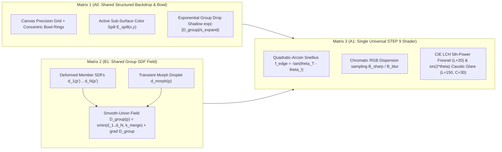

# SPEC-016: Apple Liquid Glass Optical Engine, `A0–B2` 3-Matrix Architecture & 52-Widget Environmental Interaction Matrix (`v0.9.0`)

| Attribute | Specification Value |
| :--- | :--- |
| **Document ID** | SPEC-016 |
| **Document Title** | Apple Liquid Glass Optical Engine, `A0–B2` 3-Matrix Architecture & 52-Widget Environmental Interaction Matrix (`v0.9.0`) |
| **Document Version** | `0.9.0` (SSOT Consolidated — `A0 → A1 → A2 → B1 → B2`) |
| **Status** | Accepted / Normative |
| **Target Milestone** | Milestone 0.9.0 |
| **Target Host** | Standalone crate `egui-macview` (Rust, egui 0.37) consuming standalone MC crate `vitrea` |
| **Author** | Jaco Oversluizen / `egui-macview` contributors |
| **Normative Standards** | ISO/IEC/IEEE 42010:2011 (MVC Separation), ISO/IEC/IEEE 29119-3:2021, Apple WWDC25 Session 219 (*Meet Liquid Glass*), W3C DTCG, W3C WCAG 2.1 AA |
| **Primary Optical Sources** | 1. [`iyinchao/liquid-glass-studio`](https://github.com/iyinchao/liquid-glass-studio) (`src/shaders/fragment-main.glsl`, `src/shaders/fragment-bg.glsl`, `src/shaders/lib/sdf.glsl`, `src/shaders/lib/color.glsl`, `src/Controls.tsx`)<br/>2. [Apple WWDC25 Session 219 — *Meet Liquid Glass*](https://wwdcnotes.com/documentation/wwdcnotes/wwdc25-219-meet-liquid-glass/) (`Glass.regular`, `Glass.clear`, `GlassEffectContainer`) |

---

## 1. Executive Summary & Architectural Philosophy

Apple's **Liquid Glass** design language (macOS 26 Tahoe, iOS 26, visionOS) treats user interface controls not as isolated 2D painted polygons, but as a **coupled optical and physical ecosystem** suspended over a structured, continuous backdrop.

To achieve a **99% optical and behavioral clone** of Apple Liquid Glass and eliminate legacy overdraw ("layers hiding layers"), this specification enforces a strict **5-Block Architecture (`A0 → A1 → A2 → B1 → B2`)**:

1. **Block `A0` — The Structured Backdrop & Recessed Bowl Matrix 1 (`Zero-Overdraw Prerequisite`):**
   - No widget or group may ever paint an opaque background circle, disc mesh, or matte rectangle over the underlying canvas grid.
   - Matrix 1 ($B_{\text{sharp}}(x,y)$ and its Gaussian-blurred twin $B_{\text{blur}}(x,y)$) contains the continuous canvas precision grid, concentric bowl micro-grooves, radial bowl depth shading, sub-surface color spill, and the exponential SDF drop shadow $S(\vec{p}) = \exp(-|d_{\text{shifted}}(\vec{p})|/s_{\text{expand}}) \cdot 0.6 \cdot s_{\text{factor}}$.
2. **Block `A1` — Individual Widget Build Specification (`Solo SDF Families A..D` + Universal `STEP 9` Optical Pipeline):**
   - Geometry (`2D SDF` $d(\vec{p})$ + analytical gradient $\nabla d(\vec{p})$) is strictly separated from Optics (the universal `STEP 9` shader in `vitrea::optics`).
   - Every solo glass widget evaluates the exact 4 `STEP 9` equations from [`iyinchao/liquid-glass-studio/src/shaders/fragment-main.glsl`](https://github.com/iyinchao/liquid-glass-studio/blob/main/src/shaders/fragment-main.glsl):
     1. Quadratic-Arcsin Snellius Bevel Curve ($\theta_I = \arcsin(x_R^2)$, $f_{\text{edge}} = -\tan(\theta_T - \theta_I)$),
     2. Chromatic R/G/B Dispersion ($N_R = 0.98, N_G = 1.00, N_B = 1.02$, scaled by $D_{\text{disp}} = 7.0$) with sharp-rim / blurred-core dual sampling and low passive tint opacity (`0.10..0.25`) so **75%–90% of the interior pixel is genuinely refracted background**,
     3. 5th-Power Localized Fresnel Rim evaluated in **CIE LCH** ($L' = L + 20.0 \cdot f_{\text{fresnel}} \cdot k_F$),
     4. Double-Frequency $\sin(2\theta)$ Anisotropic Glare + Opposite-Side Caustic Crescent (`glareFarside`, `80%` opposite factor) evaluated in **CIE LCH** ($L' = L + 150.0 \cdot f_{\text{glare}},\; C' = C + 30.0 \cdot f_{\text{glare}}$).
3. **Block `A2` — Solo Graphical Verification (`Black-Box Framebuffer Oracles` $O_{\text{solo},1..4}$ + 5-Point Visual AI Audit):**
   - Verifies on rendered `2x` Retina RGBA8 pixels that underlying grid lines bend into an S-curve at the rim while staying calm in the center, R/G/B wavelengths split at the bevel, both the primary top-left glare and the opposite bottom-right caustic crescent peak in CIE LCH Lightness and Chroma, and viscous deformation preserves 2D area ($\det J = 1$).
4. **Block `B1` — Collective Group Build Specification (`GlassEffectContainer` & All 15 `W1..W6` Specs):**
   - A group of widgets does **not** add an extra painting layer or a separate group shader. Instead, a group merges its member SDFs via $C^1$ smooth-union $D_{\text{group}}(\vec{p}) = \text{smin}(d_1 \dots d_N, k_{\text{merge}})$ **before** executing the exact same universal `STEP 9` optical pipeline from `A1`.
   - Defines explicit **Intra-Group** rules (shared `smin` liquid bridge, sub-surface color spill into `A0`, coupled `CASpring`/`DualSpring` kinematics) and **Inter-Group** rules ($k_{\text{merge}} = 0$ between distinct containers so each container keeps a closed Fresnel perimeter, hierarchical Z-order backdrop refraction, and synchronous window/light/focus adaptation).
5. **Block `B2` — Group Ensemble Verification (`Black-Box Oracles` $O_{\text{group},1..4}$ + Zero-Overdraw Guards):**
   - Verifies seamless `smin` meniscus bridging, cross-neighbor sub-surface color bleed, inter-group boundary separation with continuous canvas grid visibility, and synchronous window deactivation dimming.

---

## 2. Block `A0`: The Structured Backdrop & Recessed Bowl Matrix 1 (`REQ-016-A0`)

### 2.1 Why `A0` Is a Mandatory Prerequisite (The Zero-Overdraw Invariant)

A refractive lens is only visible to the human eye if the light rays passing through it originate from a **structured background with spatial contrast** (grid lines, concentric precision rings, underlying UI edges, or color gradients). If a widget first paints an opaque uniform circle (`painter.circle_filled`, `painter.rect_filled`, or an opaque `egui::Mesh` disc) over the canvas, or if Matrix 1 evaluates a featureless uniform color (`[0.98, 0.98, 0.98]`), refracting a coordinate by $\Delta \vec{p} = 6.0\text{ px}$ samples the exact same uniform color and produces zero visible refraction.

Therefore, **Block `A0` enforces three hard invariants (`REQ-016-A0.1..3`)**:

1. **Zero Opaque Pre-Overdraw (`REQ-016-A0.1`):**
   - No Liquid Glass widget (`MacContextThumbDial`, `MacEdgeThumbwheel`, `MacFreeJoystickBowl`, `MacSegmentedControl`, `MacPopoverSurface`, etc.) may emit an opaque `Shape::Circle`, `Shape::Rect`, or opaque background `Shape::Mesh` over the host canvas prior to or underneath its `2x` Retina `TextureHandle` quad.
   - Outside the outer housing contour ($D_{\text{housing}}(\vec{p}) > 0$), Matrix 3 pixels MUST have `alpha = 0` (except for the exponential drop shadow), leaving the host canvas 100% unobstructed.
2. **Structured Dual-Resolution Matrix 1 ($B_{\text{sharp}}(x,y)$ & $B_{\text{blur}}(x,y)$, `REQ-016-A0.2`):**
   - For every `2x` Retina `GlassEffectContainer` raster (`MacContextThumbDial`, `MacEdgeThumbwheel`, `MacFreeJoystickBowl`, and floating glass surfaces), **Matrix 1** evaluates two coupled buffers at `2x` Retina resolution:
     - **$B_{\text{sharp}}(x, y)$ (Sharp Structured Backdrop & Bowl Floor):**
       1. **Continuous World/Canvas Precision Grid:** Evaluates the host canvas major (`64.0 pt`) and minor (`16.0 pt`) coordinate grid hairlines directly in world/screen coordinates $(x_{\text{world}}, y_{\text{world}})$ so the canvas grid runs continuously *into and beneath* the recessed glass bowl without interruption.
       2. **Recessed Parabolic Bowl Profile & Concentric Micro-Grooves:** Inside a circular bowl housing of radius $R_{\text{bowl}}$, let $r = \|\vec{p} - \vec{c}_{\text{bowl}}\|_2 / R_{\text{bowl}} \in [0, 1]$. The recessed bowl floor modulates the `MacTheme` base surface (`window_background` $\leftrightarrow$ `box_background`) with:
          - Radial concave depth shading and inner perimeter ambient occlusion near $r \to 1$,
          - Precision concentric reticle rings / micro-dot rings (`Fine` at $0.45 R$, `Mid` at $0.64 R$, `Fast` at $0.82 R$),
          - Radial sub-surface color spill $E_{\text{spill}}(\vec{p})$ emitted by active, latched, or hovered glass members above the bowl floor:
            $$E_{\text{spill}}(\vec{p}) = \sum_{i \in \text{active}} w_i \cdot \exp\!\left(-\frac{\max(d_i(\vec{p}), 0.0)}{r_{\text{spill}}}\right) \cdot C_{\text{accent},i}$$
       3. **Exponential SDF Drop Shadow ([`fragment-bg.glsl:136-150`](https://github.com/iyinchao/liquid-glass-studio/blob/main/src/shaders/fragment-bg.glsl)):**
          - Given light-shifted sample point $\vec{p}_{\text{shadow}} = \vec{p} - \vec{\Delta}_{\text{shadow}}$ (default $\vec{\Delta}_{\text{shadow}} = (-3.0\text{ pt}, +6.0\text{ pt})$ in screen coordinates, i.e., shadow cast downward-right from a top-left key light) and composite group SDF $D_{\text{group}}(\vec{p}_{\text{shadow}})$:
            $$S_{\text{shadow}}(\vec{p}) = \exp\!\left(-\frac{|D_{\text{group}}(\vec{p}_{\text{shadow}})|}{s_{\text{expand}}}\right) \cdot 0.6 \cdot s_{\text{factor}}$$
          - Default shadow parameters from `Controls.tsx`: $s_{\text{expand}} = 12.5\text{ pt}$ (`shadowExpand = 25` at `2x` Retina), $s_{\text{factor}} = 0.25$ (`shadowFactor = 25%`).
     - **$B_{\text{blur}}(x, y)$ (Calm `Glass.regular` Diffused Backdrop — Zero Interior Grid Clutter, `REQ-016-A0.3`):**
       - In `Glass.regular` (the default regime for typography-bearing controls such as `MacContextThumbDial`, `"↶ Undo"` / `"↷ Redo"` stadium capsules, and `MacFreeJoystickBowl`), high-frequency grid lines MUST be completely diffused out of $B_{\text{blur}}(x, y)$ (`0%` grid-line contrast in the interior plateau $d_{\text{in}} \ge w_{\text{bevel}}$) so 3-tier typography (`Icon + Bold Label + Shortcut`) rests on a calm, frosted translucent surface.
       - Sharp spatial refraction (`B_sharp`, $h_{\text{blur}} \to 0$) is confined strictly to the curved perimeter bevel ($0 < d_{\text{in}} < w_{\text{bevel}}$), where underlying color bands and contour edges bend along the Snellius S-curve.
       - Matrix 1 includes chromatic ambient vector color zones (`theme.control_accent()`, `theme.system_orange()`, `theme.system_purple()`) passing beneath the left-docked glass bowl so both the diffused interior vibrancy and the perimeter CIE LCH caustic crescent visibly refract rich chromatic background transitions.

---

## 3. Block `A1`: Individual Widget Build Specification (`Solo SDF Families A..D` + Universal `STEP 9` Optical Pipeline, `REQ-016-A1`)

### 3.1 Strict Separation of Geometry (`vitrea::sdf`) from Optics (`vitrea::optics`)

In both Apple's Metal framework and [`iyinchao/liquid-glass-studio`](https://github.com/iyinchao/liquid-glass-studio), **every widget shape shares the exact same optical fragment pipeline (`STEP 9`)**. Shapes differ *only* in their 2D Signed Distance Field primitive $S(\vec{p}) = \big(d(\vec{p}), \nabla d(\vec{p})\big)$, where $d(\vec{p}) < 0$ inside the glass, $d(\vec{p}) = 0$ on the boundary, $d(\vec{p}) > 0$ outside, and $\nabla d(\vec{p}) = (\partial_x d, \partial_y d)$ is the outward unit gradient ($\|\nabla d\|_2 = 1$).

#### 3.1.1 The Four Universal Shape Families (`vitrea::sdf`)

| Family | Name & Target Widgets | Exact SDF Primitive in `vitrea::sdf` | Analytical Definition |
| :--- | :--- | :--- | :--- |
| **Family A** | **Superellipse / Squircle & Rounded Capsule**<br/>(`MacButtonCell`, `MacSegmentedControl`, `MacTabView`, `MacTableActionBar`, `MacToggle`, `MacSwitch`, `MacCheckbox`, `MacPopUpButton`, `MacComboBox`, `MacColorWell`, `MacInputCell`, `MacSearchField`, `MacTokenField`, `MacPopoverSurface`, `MacPopover`, `MacPanel`, `MacCard`, `MacBox`, `MacFloatingInfoBox`, `MacToast`) | `sdf_rounded_capsule_sample(pt, center, half_extents, r)` & `sdf_superellipse_sample(pt, center, half_extents, n, r)` | Rounded box / $L_p$ superellipse ($n = 4.0$ squircle or $n = 2.0$ stadium capsule):<br/>$\vec{q} = |\vec{p} - \vec{c}| - (\vec{h} - \vec{r})$,<br/>$d(\vec{p}) = \|\max(\vec{q}, 0)\|_p + \min(\max(q_x, q_y), 0) - r$. |
| **Family B** | **Curved Stadium Arc Capsule**<br/>(`"↶ Undo"` & `"↷ Redo"` crown/skirt capsules, `MacCircularSlider` value arc) | `sdf_curved_stadium_arc_sample(pt, center, (r_in, r_out), (start_rad, end_rad))` | Midline radius $R_{\text{mid}} = \frac{1}{2}(r_{\text{in}} + r_{\text{out}})$, half-thickness $r_{\text{cap}} = \frac{1}{2}(r_{\text{out}} - r_{\text{in}})$:<br/>Distance to circular arc centerline $[\theta_0, \theta_1]$ at radius $R_{\text{mid}}$ minus $r_{\text{cap}}$, yielding hemispherical semicircular end-caps. |
| **Family C** | **Annular Rounded Pebble Sector**<br/>(`MacContextThumbDial` 6 active rosette cushions `N, NE, E, SE, S, W`; `NW` and `SW` remain open recessed glass bowl pockets with zero glass cushion) | `sdf_annular_rounded_sector_sample(pt, center, (r_in, r_out), (center_rad, half_sweep_rad), r_corner)` | Polar sector box eroded by $r_{\text{corner}}$ on all 4 boundaries (inner arc $r_{\text{in}} + r_c$, outer arc $r_{\text{out}} - r_c$, and radial flanks $\pm\Delta\theta$) minus $r_{\text{corner}}$, guaranteeing constant-radius 3D bevels on all 4 sides. |
| **Family D** | **Spherical Marble, Cylindrical Roller & Arbitrary Closed Contour**<br/>(`MacFreeJoystickBowl` 3D crystal marble, `MacEdgeThumbwheel` cylindrical roller, `MacRadioButton`, `MacHelpButton`, `MacTagColorPicker`, vector glyphs/icons) | Radial sphere SDF $d(\vec{p}) = \|\vec{p} - \vec{c}\|_2 - R$, cylindrical profile $\phi(y) = \arcsin((y - y_c)/R_{\text{cyl}})$, and `sdf_closed_polyline_sample(pt, contour)` | Exact radial Euclidean distance or signed closest-segment distance to arbitrary flattened 2D Bézier / SVG contours. |

---

### 3.2 The Universal `STEP 9` Optical Pipeline (`vitrea::optics`, Derived 1:1 from `iyinchao/liquid-glass-studio`)

For every pixel $\vec{p} = (x, y)$ with SDF distance $d = d(\vec{p})$ (in screen points/pixels) and outward unit gradient $\nabla d = (\nabla_x d, \nabla_y d)$, let $d_{\text{in}} = \max(-d, 0.0)$ be the inward distance from the shape perimeter.

#### Equation 1 — Non-Linear Quadratic-Arcsin Snellius Bevel Curve ([`fragment-main.glsl:470-486`](https://github.com/iyinchao/liquid-glass-studio/blob/main/src/shaders/fragment-main.glsl))

Unlike a linear or cubic smoothstep curve (which either flattens the rim or warps the entire interior), Apple Liquid Glass uses a **quadratic-arcsin incident angle profile** over the bevel width $w_{\text{ref}} = \text{bevel\_width\_pt}$ (default `20.0 px` at `2x` Retina / `10.0 pt`, scaled proportionally to shape minor radius so $w_{\text{ref}} \le 0.45 \cdot R_{\text{minor}}$):

$$x_R = \text{clamp}\!\left(1.0 - \frac{d_{\text{in}}}{w_{\text{ref}}},\; 0.0,\; 1.0\right)$$

$$\theta_I = \arcsin\!\big(x_R^2\big), \qquad \theta_T = \arcsin\!\left(\text{clamp}\!\left(\frac{\sin\theta_I}{\eta_{\text{glass}}},\; -1.0,\; 1.0\right)\right)$$

$$f_{\text{edge}}(d_{\text{in}}) = \begin{cases} -\tan(\theta_T - \theta_I) & \text{if } d_{\text{in}} < w_{\text{ref}} \\ 0.0 & \text{if } d_{\text{in}} \ge w_{\text{ref}} \end{cases}$$

- **Physical & Visual Consequence:**
  - At the outer boundary ($d_{\text{in}} \to 0 \implies x_R \to 1.0$), $\theta_I \to \frac{\pi}{2}$ (`90°` vertical grazing edge) and $f_{\text{edge}} = -\tan(\theta_T - \theta_I) > 0$ reaches its maximum (`≈ 0.90` for $\eta_{\text{glass}} = 1.50$), bending background grid lines sharply inward along an S-curve.
  - Because $x_R^2$ is quadratic, the curvature drops rapidly as $d_{\text{in}} \to w_{\text{ref}}$ and vanishes identically ($f_{\text{edge}} = 0.0$) in the interior plateau ($d_{\text{in}} \ge w_{\text{ref}}$), keeping text and icons inside the widget calm and legible.
  - The 2D inward normal vector in the bevel zone is:
    $$\hat{N}_{xy} = -\nabla d(\vec{p}), \qquad \vec{N}_{3\text{D}} = \big(\nabla_x d \cdot \sin\theta_I,\; \nabla_y d \cdot \sin\theta_I,\; \cos\theta_I\big)$$

#### Equation 2 — Chromatic R/G/B Dispersion, Dual Sharp/Blur Sampling & Low Base Tint ([`fragment-main.glsl:134-162, 488-513`](https://github.com/iyinchao/liquid-glass-studio/blob/main/src/shaders/fragment-main.glsl))

Let $d_{\text{ref}} = \text{dome\_thickness\_pt} \cdot f_{\text{ref}}$ be the optical refraction depth (default `refFactor = 1.4`, effective displacement scale $d_{\text{ref}} \approx 14.0\text{ px}$ at `2x` Retina), and let the base chromatic indices be:

$$N_R = 0.98, \qquad N_G = 1.00, \qquad N_B = 1.02$$

with chromatic dispersion gain $D_{\text{disp}} = \text{ref\_dispersion}$ (default `7.0` from `Controls.tsx`, yielding $\pm 14\%$ Red/Blue displacement split at the bevel rim):

$$\vec{\Delta}_c(\vec{p}) = \hat{N}_{xy} \cdot f_{\text{edge}}(d_{\text{in}}) \cdot d_{\text{ref}} \cdot \Big(1.0 - (N_c - 1.0) \cdot D_{\text{disp}}\Big), \qquad c \in \{R, G, B\}$$

$$\vec{p}_c = \vec{p} + \vec{\Delta}_c(\vec{p}), \qquad c \in \{R, G, B\}$$

- **Sharp-Rim / Blurred-Core Dual Sampling (`getTextureDispersion`):**
  Let the normalized bevel depth weight be:
  $$h_{\text{blur}} = \text{clamp}\!\left(\left(\frac{d_{\text{in}}}{w_{\text{ref}}}\right)^{0.5},\; 0.0,\; 1.0\right)$$
  For each wavelength $c \in \{R, G, B\}$, the refracted backdrop channel is blended between the **sharp** Matrix 1 backdrop $B_{\text{sharp}}(\vec{p}_c)$ at the outer lens rim ($h_{\text{blur}} \to 0$) and the **blurred** Matrix 1 backdrop $B_{\text{blur}}(\vec{p}_c)$ in the interior ($h_{\text{blur}} \to 1$):
  $$I_{\text{refr},c}(\vec{p}) = (1.0 - h_{\text{blur}}) \cdot B_{\text{sharp},c}(\vec{p}_c) + h_{\text{blur}} \cdot B_{\text{blur},c}(\vec{p}_c)$$

- **Low Base Tint Mix (Preventing Opaque Plastic Overdraw):**
  In `fragment-main.glsl:509`:
  $$\vec{C}_{\text{base}}(\vec{p}) = \text{mix}\!\Big(\vec{I}_{\text{refr}}(\vec{p}),\; \vec{C}_{\text{tint}},\; \alpha_{\text{tint}} \cdot 0.80\Big)$$
  - For **passive / resting glass**, $\alpha_{\text{tint}} \in [0.10, 0.22]$ (so $\alpha_{\text{tint}} \cdot 0.80 \in [0.08, 0.18]$), guaranteeing that **82%–92% of the interior pixel is the refracted backdrop $\vec{I}_{\text{refr}}(\vec{p})$**!
  - For **active / hovered / latched accent glass**, $\vec{C}_{\text{tint}}$ MUST be the **unmultiplied** `style.accent_col` RGB (never premultiplied via `.gamma_multiply(a)` before passing to the shader!) with $\alpha_{\text{tint}} \in [0.28, 0.42]$.

#### Equation 3 — 5th-Power Localized Fresnel Rim in CIE LCH ([`fragment-main.glsl:515-537`](https://github.com/iyinchao/liquid-glass-studio/blob/main/src/shaders/fragment-main.glsl))

Given Fresnel range $r_{\text{fresnel}}$ (default `30.0 px` at `2x` Retina, or $1.5 \cdot w_{\text{ref}}$), Fresnel hardness $h_{\text{fresnel}}$ (default `0.20`), and Fresnel factor $k_{\text{fresnel}}$ (default `0.20..0.40`):

$$f_{\text{fresnel}}(\vec{p}) = \text{clamp}\!\left(\left(1.0 + \frac{d(\vec{p})}{r_{\text{fresnel}}} + h_{\text{fresnel}}\right)^5,\; 0.0,\; 1.0\right)$$

Instead of mixing chalky sRGB white (`[1, 1, 1]`), the base color $\vec{C}_{\text{base}}(\vec{p})$ is converted to **CIE LCH** $(L, C, H) = \text{srgb\_to\_lch}(\vec{C}_{\text{base}})$, its perceptual Lightness $L \in [0, 100]$ is boosted by:

$$L_{\text{fresnel}} = \text{clamp}\!\big(L + 20.0 \cdot f_{\text{fresnel}}(\vec{p}) \cdot k_{\text{fresnel}},\; 0.0,\; 100.0\big)$$

$$\vec{C}_{\text{fresnel}}(\vec{p}) = \text{mix}\!\Big(\vec{C}_{\text{base}}(\vec{p}),\; \text{lch\_to\_srgb}(L_{\text{fresnel}}, C, H),\; f_{\text{fresnel}}(\vec{p}) \cdot k_{\text{fresnel}} \cdot 0.70 \cdot \|\hat{N}_{xy}\|_2\Big)$$

#### Equation 4 — Double-Frequency $\sin(2\theta)$ Anisotropic Glare + Opposite-Side Caustic Crescent (`glareFarside`) in CIE LCH ([`fragment-main.glsl:539-578`](https://github.com/iyinchao/liquid-glass-studio/blob/main/src/shaders/fragment-main.glsl))

This equation produces Apple Liquid Glass's signature **dual rim illumination**: a crisp specular highlight on the primary top-left rim AND a warm, chromatic **caustic crescent on the opposite bottom-right rim** (`glareFarside == 1`):

1. **Geometric Rim Decay $f_{\text{glare\_geo}}(\vec{p})$:**
   Given glare range $r_{\text{glare}}$ (default `30.0 px` at `2x` Retina, or $1.5 \cdot w_{\text{ref}}$) and glare hardness $h_{\text{glare}}$ (default `0.20`):
   $$f_{\text{glare\_geo}}(\vec{p}) = \text{clamp}\!\left(\left(1.0 + \frac{d(\vec{p})}{r_{\text{glare}}} + h_{\text{glare}}\right)^5,\; 0.0,\; 1.0\right)$$
2. **Double-Frequency Angular Distribution $f_{\text{glare\_angle}}(\vec{p})$:**
   Let $\phi(\vec{p}) = \text{atan2}(\nabla_y d, \nabla_x d)$ be the outward normal angle in $[-\pi, \pi]$, and let $\theta_{\text{glare}}$ be the light angle (default $-\frac{\pi}{4} = -45^\circ$ top-left, steered smoothly by pointer proximity):
   $$\alpha_g(\vec{p}) = 2.0 \cdot \left(\phi(\vec{p}) - \frac{\pi}{4} + \theta_{\text{glare}}\right)$$
   Because $\alpha_g$ doubles the angle ($2\phi$), $\sin(\alpha_g)$ has **two peaks separated by $180^\circ$**:
   - **Primary Light Side** ($\phi - \frac{\pi}{4} + \theta_{\text{glare}} \in [0, \pi/2] \cup [-\pi, -\pi/2]$): weight $w_{\text{side}} = 1.2$.
   - **Opposite Caustic Side (`glareFarside`)**: weight $w_{\text{side}} = 1.2 \cdot k_{\text{opposite}}$, where default $k_{\text{opposite}} = \text{glare\_opposite\_factor} = 0.80$ (`80%` from `Controls.tsx`).
   With glare factor $k_{\text{glare}}$ (default `0.90`) and glare convergence $c_{\text{conv}}$ (default `0.50`):
   $$u_{\text{angle}} = \big(0.5 + 0.5\sin\alpha_g(\vec{p})\big) \cdot w_{\text{side}} \cdot k_{\text{glare}}$$
   $$f_{\text{glare\_angle}}(\vec{p}) = \text{clamp}\!\left(\big(\max(u_{\text{angle}}, 0.0)\big)^{0.1 + 2.0 \cdot c_{\text{conv}}},\; 0.0,\; 1.0\right)$$
   $$f_{\text{glare}}(\vec{p}) = f_{\text{glare\_geo}}(\vec{p}) \cdot f_{\text{glare\_angle}}(\vec{p}) \cdot \|\hat{N}_{xy}\|_2$$
3. **CIE LCH Chromatic Caustic Boost (`L + 150`, `C + 30`):**
   Convert the refracted tinted pixel $\vec{C}_{\text{base}}(\vec{p})$ to CIE LCH $(L_g, C_g, H_g) = \text{srgb\_to\_lch}(\vec{C}_{\text{base}}(\vec{p}))$ and boost **both Lightness and Chroma**:
   $$L'_g = \text{clamp}\!\big(L_g + 150.0 \cdot f_{\text{glare}}(\vec{p}),\; 0.0,\; 100.0\big), \qquad C'_g = \max\!\big(C_g + 30.0 \cdot f_{\text{glare}}(\vec{p}),\; 0.0\big)$$
   $$\vec{C}_{\text{final}}(\vec{p}) = \text{mix}\!\Big(\vec{C}_{\text{fresnel}}(\vec{p}),\; \text{lch\_to\_srgb}(L'_g, C'_g, H_g),\; f_{\text{glare}}(\vec{p})\Big)$$
   - **Why CIE LCH is essential:** On the opposite caustic side (`glareFarside`), boosting Chroma ($C_g + 30 \cdot f_{\text{glare}}$) along with Lightness turns the refracted background/tint color into a **vibrant, saturated caustic rim glow** rather than a flat gray line.

#### Equation 5 — CIE sRGB $\leftrightarrow$ XYZ (D65) $\leftrightarrow$ Lab $\leftrightarrow$ LCH Conversions ([`lib/color.glsl:1-115`](https://github.com/iyinchao/liquid-glass-studio/blob/main/src/shaders/lib/color.glsl))

`vitrea::optics` MUST implement the exact D65 reference white $(X_n, Y_n, Z_n) = (0.95047, 1.00000, 1.08883)$ colour conversions as domain-agnostic colorimetric functions:
- `srgb_to_cie_lch(rgb: [f32; 3]) -> [f32; 3]` returning `[L, C, H_deg]` with $L \in [0, 100]$, $C = \sqrt{a^2 + b^2}$, $H \in [0^\circ, 360^\circ)$.
- `cie_lch_to_srgb(lch: [f32; 3]) -> [f32; 3]` clamping output channels to $[0.0, 1.0]$.
- `compose_dielectric_lch_pixel(sharp_rgb: [f32; 3], blur_rgb: [f32; 3], tint_rgba: [f32; 4], sample: &GlassSurfaceSample, params: &LiquidGlassOpticalParams, fresnel_gain: f32, glare_gain: f32) -> [f32; 4]` executing Equations 2, 3, and 4 in a single deterministic, UI-agnostic, 100% parameter-driven pure function in `vitrea::optics` (with zero hardcoded magic constants in the function body).

---

## 4. Block `A2`: Solo Graphical Verification (`Black-Box Framebuffer Oracles` $O_{\text{solo},1..4}$ & 5-Point Visual AI Audit, `REQ-016-A2`)

### 4.1 Why Triangle-Counting Tests Are Forbidden

Legacy tests that count `Mesh::vertices.len()` or `Mesh::indices.len()` test implementation mechanics rather than optical outcomes—and worse, they force production code to keep emitting obsolete opaque triangle layers underneath the `2x` Retina textures. All `SPEC-016` optical tests MUST evaluate the **rendered `2x` Retina RGBA8 framebuffer pixels** as a black box.

### 4.2 The Four Normative Solo Framebuffer Oracles ($O_{\text{solo},1..4}$)

| Oracle ID | Physical Phenomenon Tested | Black-Box Pixel Measurement on `2x` Retina Framebuffer | Pass Criterion |
| :--- | :--- | :--- | :--- |
| **$O_{\text{solo},1}$** | **Quadratic-Arcsin Snellius S-Curve Grid Line Bending & Chromatic Dispersion** | Render a solo glass shape (`Family A..D`) over Matrix 1 (`A0`) containing a high-contrast background grid line running beneath the shape. Trace a 1D scanline across the shape boundary ($d \in [-w_{\text{ref}}, 0]$) and across the center plateau ($d < -w_{\text{ref}}$). | 1. **Visibility Through Glass:** The background grid line produces a measurable spatial luminance dip/peak inside the glass interior ($\Delta L_{\text{grid}} \ge 0.08$, proving the interior is NOT opaque white paint).<br/>2. **Snellius Bevel Shift:** In the bevel zone ($0 < d_{\text{in}} < w_{\text{ref}}$), the apparent grid-line crossing coordinate is displaced inward by $\|\vec{\Delta}_G\|_2 \ge 2.5\text{ px}$, while in the center plateau ($d_{\text{in}} \ge w_{\text{ref}}$) displacement drops to $0.0\text{ px}$.<br/>3. **Chromatic Split:** At the bevel rim ($d_{\text{in}} \approx 0.25 w_{\text{ref}}$), $\|\vec{p}_B - \vec{p}_R\|_2 \ge 1.5\text{ px}$ and $|I_R - I_B| > 0.03$ across a high-contrast background edge. |
| **$O_{\text{solo},2}$** | **Primary Top-Left Glare + Opposite Bottom-Right Caustic Crescent (`glareFarside`) in CIE LCH** | Sample a diagonal 1D cross-section from top-left ($135^\circ$, primary light rim) through the center plateau to bottom-right ($315^\circ$, opposite shadow/caustic rim) of a rendered solo glass shape. | 1. **Dual Rim Peaks:** Both the top-left rim ($d_{\text{in}} \in [0.5\text{ px}, 5\text{ px}]$) AND the opposite bottom-right rim ($d_{\text{in}} \in [0.5\text{ px}, 5\text{ px}]$) exhibit local CIE LCH Lightness peaks significantly brighter than the center plateau ($L_{\text{top\_left}} > L_{\text{center}} + 12.0$ and $L_{\text{bottom\_right}} > L_{\text{center}} + 8.0$).<br/>2. **Chromatic Caustic Saturation:** On a tinted or colored-backdrop shape, CIE Chroma $C$ at the opposite bottom-right caustic crescent exceeds the center plateau chroma ($C_{\text{bottom\_right}} > C_{\text{center}} + 4.0$). |
| **$O_{\text{solo},3}$** | **Recessed Concave Bowl Depth & Exponential SDF Drop Shadow (`A0`)** | Sample the `A0` bowl matrix along a radial line from bowl center ($r = 0$) to outer housing ($r = 1$) and across the shadow-shifted exterior ($D_{\text{group}}(\vec{p} - \vec{\Delta}_{\text{shadow}}) \in [0, 2 s_{\text{expand}}]$). | 1. **Concave Bowl & Rings:** Concentric precision grooves/dots at $0.45 R$ and $0.82 R$ and canvas grid hairlines are measurably resolved in the bowl floor.<br/>2. **Exponential Shadow Decay:** Exterior shadow attenuation decays monotonically with distance from the shifted SDF contour according to $\exp(-|d|/s_{\text{expand}})$. |
| **$O_{\text{solo},4}$** | **Isochoric Viscous Area Conservation ($\det J = 1$)** | Numerically integrate the 2D interior pixel area ($d(\vec{p}') \le 0$) of a glass droplet at rest ($A_{\text{rest}}$) and under pure velocity stretch ($A_{\text{stretched}}$, $p_{\text{press}} = 0$). | Longitudinal span increases by $> 8\%$ while total 2D area error satisfies $\|A_{\text{stretched}} - A_{\text{rest}}\| / A_{\text{rest}} \le 0.015$ ($\le 1.5\%$). |

### 4.3 Mandatory 5-Point Visual AI Audit Protocol (`REQ-016-A2.5`)

After any COTS test renders a `2x` Retina PNG verification artifact, the AI orchestrator MUST inspect the PNG via `read_file` and explicitly score five visual criteria (failing the task if any criterion is false):
1. **Transparency & Refraction Check:** Can I clearly see the underlying canvas grid lines and concentric bowl rings *through* the interior of the glass cushions/capsules, and do those lines visibly bend near the rounded edges?
2. **Opposite-Side Caustic Crescent Check:** Does every glass cushion, stadium arc, and marble exhibit BOTH a top-left specular highlight AND an opposite bottom-right saturated caustic crescent (no flat matte boundary)?
3. **Zero Opaque Pre-Overdraw Check:** Is the canvas grid completely continuous up to and inside the glass bowl without any opaque gray/white disc hiding the grid?
4. **Hover/Active Color Integrity Check:** When a control (such as `"↶ Undo"`, `"↷ Redo"`, or sector `NE`) is hovered or active, is its glass tint a vibrant, translucent sapphire/cyan lens rather than dark navy/black premultiplied mud?
5. **Typography & Icon Legibility Check:** Are all 3-tier cushion labels (`Icon` + `Bold Label` + `Shortcut`) and arc-rotated `"↶ Undo"` / `"↷ Redo"` captions sharp, centered at the SDF optical centroid, and free of overlap?

---

## 5. Block `B1`: Collective Group Build Specification (`GlassEffectContainer` & All 15 `W1..W6` Specs, `REQ-016-B1`)

### 5.1 How a Combined Widget Group Works Across Layers (Zero Extra Painting Layers!)

In Apple's `GlassEffectContainer` (WWDC25 Session 219) and [`iyinchao/liquid-glass-studio`](https://github.com/iyinchao/liquid-glass-studio), combining multiple widgets into a group **never adds a fourth optical layer or a separate group shader**. Every `GlassEffectContainer` executes the exact same 3-Matrix pipeline (`Matrix 1: A0 Backdrop/Bowl` $\to$ `Matrix 2: Composite Group SDF` $\to$ `Matrix 3: Universal STEP 9 Optical Composition` + `Vector Foreground Overlay`):



### 5.2 Intra-Group Behavior (How Widgets Behave Toward Each Other *Within* a Group)

Within a single `GlassEffectContainer` $\mathcal{C}_A = \{S_1, S_2, \dots, S_N\}$:

1. **Topological SDF Coalescing (`smin` Liquid Bridge, `REQ-016-B1.1`):**
   - Before any optical evaluation, Matrix 2 combines all member SDFs and any active transit morph droplet $S_{\text{morph}}$ using the $C^1$ polynomial smooth-minimum (`vitrea::sdf_smooth_union_with_grad`):
     $$h = \text{clamp}\!\left(\frac{1}{2} + \frac{d_B - d_A}{2 k_{\text{merge}}},\; 0.0,\; 1.0\right), \quad d_\cup = (1 - h)d_B + h d_A - k_{\text{merge}} h(1 - h)$$
     $$\nabla d_\cup = \text{normalize}\!\big((1 - h)\nabla d_B + h\nabla d_A\big)$$
   - Where two adjacent members approach within $k_{\text{merge}}$ (e.g., an active lifted cushion swelling toward its neighbor, or a `DualSpringMorphBlob` bridging two segments), their internal facing boundaries dissolve ($d_\cup < -w_{\text{ref}}$ at the neck), eliminating the internal Fresnel seam and wrapping **one continuous outer Fresnel rim and caustic crescent** around the merged silhouette.
2. **Sub-Surface Color Spill & Cross-Neighbor Refraction (`REQ-016-B1.2`):**
   - When member $S_i$ is active, latched, or hovered with accent color $\vec{C}_{\text{accent},i}$, it injects a radial sub-surface bloom $E_{\text{spill},i}(\vec{p})$ into the group's shared Matrix 1 floor (`A0`).
   - Because neighboring passive members $S_j$ sample Matrix 1 at Snellius-refracted coordinates $[\vec{p}_R, \vec{p}_G, \vec{p}_B]$ pointing outward from their facing bevels ($\hat{N}_{xy} = -\nabla d_j$), the bevel of passive member $S_j$ facing active member $S_i$ refracts and amplifies that accent glow through Equation 2 and Equation 4 (CIE LCH caustic boost).
3. **Coupled Multi-Member Spring Kinematics (`REQ-016-B1.3`):**
   - **Transit Droplet (`DualSpringMorphBlob`):** When selection or hover moves from member $A$ to member $B$, a liquid droplet spans $[a(t), b(t)]$ with a fast leading spring ($T_{\text{lead}} = 0.22\text{ s}$) and softer trailing spring ($T_{\text{trail}} = 0.32\text{ s}$), physically stretching across the gap before coalescing into $B$.
   - **Pointer Tilt, Live Glare Steering & Subtle Transient Coalescing (`AnisotropicCushionSpring`, `REQ-016-B1.3`, `REQ-016-B1.7`):**
     - At rest ($l_i = 0$), adjacent cushions remain crisply separated ($k_{\text{merge}} \to 0$) without permanent blobbing.
     - Pointer motion smoothly steers the anisotropic glare azimuth `glare_angle_rad` toward the pointer vector and lifts the hovered cushion; `smin` coalescing occurs only transiently during active lift or `DualSpringMorphBlob` transit.
     - **Canonical Bimanual Left-Hand Placement (`REQ-016-B1.7`):** In a bimanual studio workspace (`State 1` vector canvas and standalone deployments), the Thumb Pie Menu (`MacContextThumbDial`, `MacFreeJoystickBowl`, and paired `MacEdgeThumbwheel`) docks on the **Left (`MacThumbDockZone::BottomLeft`)** across all inspector modes (`Regular`, `FloatPopover`, `CompactHud`).
     - **1:1 Square Unclipped Container Footprint & Pure `iyinchao/liquid-glass-studio` Dielectric Optics (`REQ-016-B1.10`):**
       1. *Zero Horizontal Clipping on Stadium Crown/Skirt Arcs (`REQ-016-B1.10a`):* Both `MacContextThumbDial` and `MacFreeJoystickBowl` MUST allocate a symmetric `1:1` square bounding rect of size `Vec2::splat((r_skirt_out + bevel_width_pt) * 2.0 * scale)` matching the container quad, so `ui.painter_at(rect)` never horizontally clips the leftmost semicircular end-cap of `"↶ Undo"` ($-148^\circ$) or the rightmost semicircular end-cap of `"↷ Redo"` ($-32^\circ$).
       2. *Pure `iyinchao/liquid-glass-studio` (`fragment-main.glsl`) Optical Fidelity — Zero Grey Mud, Energy-Preserving `B_blur`, and Zero 2D Vector Circle Outlines (`REQ-016-B1.10b`):*
          - Matrix 1 (`A0`) MUST NOT mix a dark-grey `well_depth` wash over the dish floor (`l_se_center >= 88.0` in `Aqua`), and Matrix 3 (`A1`) MUST NOT mix dark `shadow_rgb` rings inside the glass bevel.
          - `B_blur` (`blur_scale > 1.0`) MUST soften background grid lines and concentric rings via an energy-preserving broadened kernel (`width * blur_scale`, `amplitude / blur_scale`) rather than deleting them (`if blur_scale <= 1.0`), so refracted grid lines remain softly visible through the glass and warp continuously into the sharp Snellius bevel.
          - All optical parameters (`fresnel_range_ratio = 1.5`, `fresnel_hardness = 0.20`, `glare_convergence = 0.50`, `glare_opposite_lobe_ratio = 0.80`) MUST use the normative `vitrea::LiquidGlassOpticalParams::default()` profile, and neither `MacContextThumbDial` nor `MacFreeJoystickBowl` may draw 2D `egui::Shape::Circle` stroke outlines (`radius > 40pt`) on top of the raytraced container texture.
     - **120 fps Split Static-Bowl / Dynamic-Marble Patch Caching & In-Place `TextureHandle::set` Reuse (`REQ-016-B1.11`):**
       1. *Static Base + Local Marble Patch (`REQ-016-B1.11a`):* `MacFreeJoystickBowl` MUST cache the static `A0 + Undo/Redo` container buffer (`tex_dim × tex_dim`) independently of `marble_center`. During $360^\circ$ pointer drag or spring return, it MUST clone the cached static buffer and raytrace only the local bounding box enclosing `hub_center` (vector tether origin) and `marble_center ± 2.5 * puck_r` (deformed crystal marble, drop shadow, and caustic crescent), reducing per-frame raytraced pixels by $> 80\%$.
       2. *In-Place GPU & WebGL2 Mega-Atlas Texture Reuse (`REQ-016-B1.11b`):* Container updates in `MacContextThumbDial` and `MacFreeJoystickBowl` MUST update their existing `egui::TextureHandle` in-place via `TextureHandle::set` (preserving a stable `egui::TextureId::Managed(k)` across animation frames with zero texture-ID churn), and `MacWebGlSession` MUST blit same-dimension texture updates directly into the existing Mega-Atlas UV slot without reallocating the Mega-Atlas buffer.
     - **1-Click Joystick Hub Return, Multithreaded `std::thread::scope` CPU Synthesis & WebGL2 `#version 300 es` GPU Liquid Glass Shader (`REQ-016-B1.12`):**
       1. *1-Click Hub Return Across Full `r_hub` Radius (`REQ-016-B1.12a`):* In `MacContextThumbDial` (`Layer 2: FreeJoystickBowl`), the center hub tap target MUST span the full `r_hub` (`24.0 pt * scale`, never `r_hub * 0.5`). Any click/tap that starts inside `r_hub` (`dist <= r_hub`) and releases within `r_hub` (`joystick_offset.length() <= r_hub`) within `latch_tap_max_secs` MUST toggle back to `MacThumbDialLayer::CompassModifiers` in **1 single click/tap** without requiring a double-tap.
       2. *Multithreaded `std::thread::scope` CPU Raytracing & Radial/Shadow SDF Culling (`REQ-016-B1.12b`):* On native targets (`not(target_arch = "wasm32")`), `synthesize_rosette_matrix_rgba` MUST parallelize row synthesis across worker threads via `std::thread::scope`, while culling inner-cushion SDFs for outer-skirt pixels (`r > r_outer + bevel_width_pt`), culling outer stadium-arc SDFs for inner-dish pixels (`r < r_skirt_in - bevel_width_pt`), and skipping shadow-shifted SDF evaluations whenever unshifted `distance > 2.0 * bevel_width_pt`.
       3. *WebGL2 `#version 300 es` GPU Liquid Glass Fragment Shader & Zero-Copy `texSubImage2D` Dirty-Rect Upload (`REQ-016-B1.12c`):* `MacWebGlSession` MUST track `atlas_dirty_rect: Option<(u32, u32, u32, u32)>` for in-place texture updates so WebGL2 uploads only the modified sub-region via `gl.texSubImage2D` from a zero-copy Wasm memory view, while the WebGL2 `#version 300 es` fragment shader evaluates live CIE D65 LCH Fresnel/caustic glare and chromatic lens refraction directly on the GPU.
     - **First-Principles Analytical Velocity Deformation $\dot{l}_i(t)$, Capillary-Local `smin` Topology & Dirty-Sector Patch Synthesis (`REQ-016-B1.13`):**
       1. *Analytical Time-Derivative Velocity $\dot{l}_i(t)$ Driving Viscous Jacobian $\det J = 1$ (`REQ-016-B1.13a`):* Viscous droplet deformation (`vitrea::deform_viscous_droplet_point`) on radial cushions MUST be driven by the closed-form time-derivative spring velocity $\dot{l}_i(t) = \frac{dl_i}{dt}$ (`CASpring::animate_f32_with_velocity_at`), NEVER by static displacement $l_i(t)$. While a cushion is in motion ($0 < t < t_{\text{settle}}$), $\dot{l}_i(t) \ne 0$ stretches the droplet along its motion vector with $\det J = 1$; once settled at rest or steady hover ($t \ge t_{\text{settle}}$), $\dot{l}_i(t) \equiv 0.0$ so surface tension restores the undistorted concentric cushion shape.
       2. *Capillary-Local `smin` & Adjacent-Only `DualSpringMorphBlob` (`REQ-016-B1.13b`):* `vitrea::sdf_smooth_union_with_grad` MUST only blend two members at pixel $\vec{p}$ when both members lie within the capillary neck range $\max(d_A(\vec{p}), d_B(\vec{p})) \le k_{\text{merge}}$. Polar `DualSpringMorphBlob` bridging MUST only activate between physically adjacent sectors ($\Delta\theta \le \text{cardinal\_sweep\_deg} + \text{sector\_gap\_deg}$) with half-sweep bounded by the inter-sector gap; non-adjacent sector jumps (e.g. `NorthEast` $-45^\circ \to$ `West` $180^\circ$) MUST snap the polar morph origin without sweeping a ghost wedge across intermediate sectors or open `NW`/`SW` pockets.
       3. *Dirty-Sector Bounding-Box Patch Synthesis & WebGL2 GPU Chromatic Lens Shader (`REQ-016-B1.13c`):* `MacContextThumbDial` MUST cache the previous member states and RGBA8 container buffer, re-synthesizing only the 2D bounding box of members whose state changed during hover/lift animations ($< 10\%$ of container pixels per frame), while the WebGL2 `#version 300 es` fragment shader evaluates live R/G/B chromatic UV dispersion and CIE D65 LCH Fresnel/caustic glare on the GPU at 60/120 Hz.

### 5.3 Inter-Group Behavior (How One Group Behaves Toward *Other* Groups)

Between two distinct `GlassEffectContainer` instances $\mathcal{C}_A$ and $\mathcal{C}_B$ (for example, `W2.1 MacEdgeThumbwheel` vs. `W1 MacContextThumbDial` vs. `W6 MacPopoverSurface`):

1. **Zero Inter-Group SDF Merging ($k_{\text{merge}}(\mathcal{C}_A, \mathcal{C}_B) = 0$, `REQ-016-B1.4`):**
   - Separate containers NEVER merge their SDF fields across container boundaries. `MacEdgeThumbwheel`, `MacContextThumbDial`, and a floating `MacPopover` each maintain their own closed $360^\circ$ Fresnel perimeter and independent exponential drop shadow.
2. **Hierarchical Z-Order Backdrop Refraction (`REQ-016-B1.5`):**
   - Containers are composited in strict Z-order (`Layer 0: Canvas` $\to$ `Layer 1: Workspace Controls / Triad` $\to$ `Layer 2: Floating HUDs / Popovers / Menus`).
   - A higher Z-order group (such as a floating `MacPopoverSurface` or `MacContextMenu`) samples the already-composited lower Z-order scene as its Matrix 1 backdrop (`A0`), refracting and blurring underlying controls beneath its perimeter bevel.
   - Same-tier sibling groups (`MacEdgeThumbwheel` above `MacContextThumbDial`) share the continuous canvas grid (`A0`) without occluding each other's glass housings.
3. **Global Environmental Synchronization (`REQ-016-B1.6`):**
   - All groups in a window share:
     - The global key-light angle $\theta_{\text{glare}} = -45^\circ$ (plus local cursor proximity modulation),
     - The active `MacGlassRegime` (`Glass.clear` vs. `Glass.regular`) and calculated `.glass_accent(Color32)` palette,
     - The host window focus state (`is_window_active`): when the window becomes `Inactive`, all groups synchronously de-saturate accented members to neutral graphite (`effective_control_accent`, `BUG-SONOMA-01`) and attenuate caustic chroma boost.

---

### 5.4 The 15 Normative Widget & Group Build Specifications (`M1..M3` + `W1-V/C..W6-V/C`)

All 15 iterations and all 52 widgets from the MVC roadmap are anchored to the unified `A0 → A1 → B1` architecture:

| Iteration | Layer / MVC Role | Scope & Widget Family (`A0 / A1 / B1` Mapping) | Primary Verification Oracle (`A2 / B2`) |
| :--- | :--- | :--- | :--- |
| **Iter 1 (`M1`)** | **Model — Geometry & SDF (`vitrea::sdf`)** | Analytical 2D SDF primitives (`Families A..D`): `sdf_rounded_capsule_sample`, `sdf_annular_rounded_sector_sample`, `sdf_curved_stadium_arc_sample`, `sdf_closed_polyline_sample`, and $C^1$ polynomial `sdf_smooth_union_with_grad`. | `tc_016_m1_sdf_annular_sector_stadium_arc_and_3d_normals` |
| **Iter 2 (`M2`)** | **Model — Parameterized Bevel Optics & CIE LCH (`vitrea::optics`)** | Universal parameter-driven optical evaluator (`snell_bevel_edge_factor`, `refract_bevel_chromatic_rgb`, `anisotropic_bipolar_rim_glare`, `exponential_sdf_attenuation`, `srgb_to_cie_lch`, `cie_lch_to_srgb`, `compose_dielectric_lch_pixel`): non-linear Snellius curve ($\theta_I = \arcsin(x_R^p)$, $f_{\text{edge}} = -\tan(\theta_T - \theta_I)$), chromatic dispersion ($N_R=0.98, N_G=1.0, N_B=1.02, D=7.0$), CIE D65 LCH conversions, 5th-power LCH Fresnel ($L+20$), and $\sin(2\theta)$ LCH Glare + opposite Caustic Crescent ($L+150, C+30$). | `tc_016_m2_bevel_snellius_dispersion_and_lch_caustic_glare` |
| **Iter 3 (`M3`)** | **Model — Coupled `CASpring` Dynamics (`vitrea::kinematics`)** | `DualSpringMorphBlob` (leading/trailing velocity-stretched liquid droplet transfer), `AnisotropicCushionSpring` (radial cushion lift + 2.5D parallax), isochoric viscous deformation ($\det J = 1$), W3C DTCG token sync, and `is_at_rest() -> Duration::MAX` zero-idle-wakeups proof. | `tc_016_m3_dual_spring_morph_blob_anisotropic_lift_and_zero_idle` |
| **Iter 4 (`W1-V`)** | **View — Group 1 (`MacContextThumbDial` Rosette & Stadium Arcs)** | **Single Unified Zero-Overdraw 3-Matrix `GlassEffectContainer` (`REQ-016-B1.9`):**<br/>• `A0` Matrix 1: Continuous canvas precision grid + recessed circular bowl + concentric grooves + active sub-surface accent spill + exponential SDF shadow.<br/>• `B1` Matrix 2: Smooth-union (`smin`) of 6 active `Family C` pebble cushions (`N, NE, E, SE, S, W` — leaving `NW` and `SW` intentionally empty recessed bowl pockets with zero glass cushion, `REQ-016-B1.8`), central hub lens, polar morph droplet, AND the two `Family B` `"↶ Undo"` / `"↷ Redo"` stadium arcs evaluated inside the same container texture (`exactly 1 TextureHandle quad` per dial, zero separate `paint_curved_stadium_capsule` textures or fake mini-grids).<br/>• `A1` Matrix 3: Per-pixel `STEP 9` CIE LCH composition (`2x` Retina `TextureHandle`) + 3-tier vector typography (`SF Symbol` + `Bold Label` + `Shortcut`), amber Latch LED, and arc-rotated (`-30°`/`+30°`) Undo/Redo labels with unmultiplied hover accent tint. | `tc_016_w1v_thumb_dial_step9_zero_overdraw_and_caustic_oracles` |
| **Iter 5 (`W1-C`)** | **Controller — Group 1 (`MacContextThumbDial`)** | Exact SDF hit-testing on rounded cushions & curved stadium capsules, polar `DualSpringMorphBlob` gliding between hovered sectors, *Tap-to-Latch* (`< 180 ms`) vs. *Hold-to-Momentary*, `MacTapticEvent` synthesis, and keyboard/`AccessKit` navigation. | `tc_016_w1c_thumb_dial_sdf_hit_polar_morph_latch_and_a11y` |
| **Iter 6 (`W2-V`)** | **View — Group 2 (`MacEdgeThumbwheel` & `MacFreeJoystickBowl`)** | **Single Unified Zero-Overdraw 3-Matrix `GlassEffectContainer` (`REQ-016-B1.9`):**<br/>• `MacEdgeThumbwheel`: Recessed glass trough (`Family A`), cylindrical roller (`Family D` $\phi(y) = \arcsin((y-y_c)/R_{\text{cyl}})$) with pointer-steered Blinn-Phong & CIE LCH specular band and $\cos(\phi)$ ridges, plus illuminated sapphire/accent end-cap rings (`exactly 1 TextureHandle quad`).<br/>• `MacFreeJoystickBowl`: `A0` recessed bowl with `48` micro-dots on `Fine` ($0.45 R$) & `Fast` ($0.82 R$) rings + canvas grid + blue vector tether + caustic floor glow; `B1/A1` `STEP 9` 3D crystal marble lens (`Family D`) + `"↶ Undo"` / `"↷ Redo"` stadium arcs evaluated inside the same container texture (`exactly 1 TextureHandle quad` per bowl) refracting the shared underlying `A0` matrix. | `tc_016_w2v_edge_thumbwheel_and_joystick_bowl_step9_oracles` |
| **Iter 7 (`W2-C`)** | **Controller — Group 2 (`MacEdgeThumbwheel` & `MacFreeJoystickBowl`)** | `MacEdgeThumbwheel` Free-Spin flywheel inertia + Touch-to-Brake coupled to specular ridge shift, and `MacFreeJoystickBowl` quadratic radial velocity + ring-crossing `MacTapticEvent` + caustic shadow displacement. | `tc_016_w2c_flywheel_brake_and_joystick_bowl_physics` |
| **Iter 8 (`W3-V`)** | **View — Group 3 (`MacSegmentedControl`, `MacTabView`, `MacTableActionBar`)** | Recessed translucent glass track housing $N$ segments with an elevated `STEP 9` 3D Liquid Glass selection capsule (`Family A` `paint_liquid_glass_capsule` evaluated via `vitrea::evaluate_glass_surface_sample` + CIE LCH Fresnel & opposite caustic rim) and `.glassEffectUnion` smooth-union bridging. | `tc_016_w3v_segmented_and_tab_morphing_liquid_capsule_view` |
| **Iter 9 (`W3-C`)** | **Controller — Group 3 (`MacSegmentedControl`, `MacTabView`, `MacTableActionBar`)** | 1D `DualSpringMorphBlob` (`step_dual_spring_morph_interval`) stretching the active selection droplet across intermediate segments during index transitions, hover pre-lensing, and `PressAndHold`/`PullDown` menu triggers. | `tc_016_w3c_segmented_and_tab_drag_scrub_and_pre_lensing` |
| **Iter 10 (`W4-V`)** | **View — Group 4 (`MacButtonCell`, `MacToggle`, `MacSwitch`, `MacCheckbox`, `MacRadioButton`, `MacSlider`, `MacCircularSlider`, `MacStepper`, `MacPopUpButton`, `MacComboBox`, `MacColorWell`, `MacHelpButton`, `MacInlineActionButton`, `MacDisclosureButton`, `MacRatingIndicator`)** | `Family A` & `Family D` 3D Liquid Glass capsules and circular lenses evaluated via `vitrea::evaluate_glass_surface_sample` (`STEP 9` dome profile, LCH Fresnel rim, opposite caustic glow, and refractive slider/toggle thumb droplets). | `tc_016_w4v_action_and_value_primitives_liquid_glass_optics` |
| **Iter 11 (`W4-C`)** | **Controller — Group 4 (Action & Value Primitives)** | `AnisotropicCushionSpring` lift and press scale on click/drag, magnetic thumb tracking on `MacSlider`/`MacToggle`, synchronous window-active accent de-saturation (`effective_control_accent`, `BUG-SONOMA-01`), and strict `LayoutPolicy::ExactAppleNib` Sonoma geometry preservation (`<= 0.5 pt`, `REQ-016-07`). | `tc_016_w4c_action_and_value_primitives_spring_controller` |
| **Iter 12 (`W5-V`)** | **View — Group 5 (`MacInputCell`, `MacSearchField`, `MacTokenField`, `MacTextView`, `MacLabel`, `MacOriginMatrix`, `MacTagColorPicker`, `MacRuleEditor`, `MacDatePicker`, `MacPathControl`, `MacForm`)** | Glowing 3D Liquid Glass active/focused inspector row capsule (`MacInputCell::liquid_glass_pill(true)` matching `X: 350.0` in `SelectionInfo`), recessed glass input wells with `1.0 pt` top inset shadow, and 3D glass token pills & tag color spheres. | `tc_016_w5v_inspector_selection_pill_and_input_wells` |
| **Iter 13 (`W5-C`)** | **Controller — Group 5 (Text, Inspector & Form Controls)** | Coupled `CASpring` focus-ring animation (`paint_animated_focus_ring`, `BUG-SONOMA-02`), fluid focus transfer across form rows on `Tab`/`Shift+Tab`, and `2.0 pt` `-[NSTextFieldCell drawingRectForBounds:]` zero-truncation invariant (`REQ-013-08.2`). | `tc_016_w5c_inspector_focus_morph_and_zero_truncation` |
| **Iter 14 (`W6-V`)** | **View — Group 6 (`MacPopoverSurface`, `MacPopover`, `MacPanel`, `MacCard`, `MacBox`, `MacFloatingInfoBox`, `MacToolbar`, `MacMenuBar`, `NSMenu`, `MacCommandPalette`, `MacCanvasFooter`, `MacContextMenu`, `MacToast`, `MacPlayerView`, `MacTrimScrubber`, `MacLevelIndicator`, `MacProgressIndicator`, `MacTableView`, `MacOutlineView`, `MacCollectionView`)** | Hierarchical Z-order `GlassEffectContainer` sheets sampling and blurring (`B_sharp` / `B_blur`) underlying canvas/window backdrops with `STEP 9` perimeter Snellius refraction, CIE LCH Fresnel/caustic rims, and adaptive `register_surface_rect_slot` foreground contrast. | `tc_016_w6v_floating_surfaces_navigation_and_media_refraction` |
| **Iter 15 (`W6-C`)** | **Controller — Group 6 & Full Ecosystem Integration (`MacWebGlSession`)** | Cross-surface `register_surface_rect_slot` propagation, `CASpring` sheet/toast transitions, multi-texture `TextureId::Managed(0..N)` Mega-Atlas packing in `egui_macview::MacWebGlSession` (`REQ-016-09`), full regression suite, and `2x` Retina PNG Golden Master verification. | `tc_016_w6c_full_ecosystem_integration_and_golden_master` |

---

## 6. Complete 52-Widget Environmental Interaction Matrix (*Base Appearance, Outward Emission & Inward Reception*)

Every public widget and layout container in `egui-macview` (52 total across the 6 families) is governed by the following three-column behavioral contract under the `A0 → A1 → B1` architecture:

### 6.1 Family 1 & Family 2: Bimanual Radial Studio HUDs (3 Widgets)

| # | Widget | 1. Base Appearance (*Self / Resting State — `A0 + A1`*) | 2. Outward Emission (*Behavior Toward Environment — `B1`*) | 3. Inward Reception (*Response From Environment — `B1`*) |
| :--- | :--- | :--- | :--- | :--- |
| **1** | **`MacContextThumbDial`** | Zero-overdraw recessed 3D circular glass bowl (`A0` Matrix 1 with continuous canvas grid, concentric grooves, and exponential SDF shadow) containing a 6-cushion $360^\circ$ pebble rosette (`Family C`: `N, NE, E, SE, S, W`, with `NW` and `SW` left as open recessed bowl pockets without glass cushions so their absence is immediately legible, `REQ-016-B1.8`), center reticle hub lens, 3-tier cushion typography (`Icon` + `Bold Label` + `Shortcut`), 3-layer amber Latch LED, and semicircular `"↶ Undo"` / `"↷ Redo"` crown/skirt stadium capsules (`Family B`). Evaluated per-pixel via `STEP 9` (`A1`) with low passive tint (`10%–22%`), LCH Fresnel rim, and opposite-side caustic crescent. | Refracts underlying canvas grid lines and bowl grooves through its 6 curved cushion bevels, hub lens, and Undo/Redo arcs (`STEP 9` quadratic-arcsin Snellius + $\pm 14\%$ R/B dispersion); active/latched cushions emit radial sub-surface accent spill $E_{\text{spill}}$ into Matrix 1 (`A0`), coloring the facing bevels of adjacent passive cushions; emits `MacTapticEvent` micro-clicks and modifier chords. | Tracks 2D pointer via `AnisotropicCushionSpring` (`.lift` radial expansion + $1.25\times$ 2.5D icon parallax); glides polar `DualSpringMorphBlob` liquid bridge across inter-cushion gaps via `sdf_smooth_union_with_grad`; illuminates hovered `"↶ Undo"` / `"↷ Redo"` arcs with unmultiplied accent tint and LCH caustic boost. |
| **2** | **`MacEdgeThumbwheel`** | Wide horizontal cylindrical roller (`Family D`) inside a deep rounded glass trough (`Family A`) evaluated at `2x` Retina resolution (`paint_raytraced_edge_thumbwheel_quad`) with soft outer cyan/white bloom, illuminated 3D sapphire/accent left/right end-cap rings, true cylindrical surface normal $\vec{N} = (0, \sin\phi, \cos\phi)$, and $\cos(\phi)$-foreshortened tactile ridges. | Emits angular delta, Free-Spin flywheel velocity $\omega(t)$, and `MacTapticEvent::RotaryDetentTick` / `FlywheelBraked`; maintains a closed container perimeter ($k_{\text{merge}} = 0$ with `MacContextThumbDial`) while casting its own exponential SDF drop shadow onto `A0`. | Shifts its cylindrical Blinn-Phong & CIE LCH specular highlight band toward the pointer vector $\vec{p}(t)$; brakes immediately on pointer touch (`Touch-to-Brake`); adapts end-cap glow to `.glass_accent(Color32)`. |
| **3** | **`MacFreeJoystickBowl`** | Unobstructed $360^\circ$ recessed 3D glass bowl (`A0` Matrix 1 with continuous canvas grid, `48` circular micro-dots on concentric `Fine` $0.45 R$ and `Fast` $0.82 R$ precision rings, center origin dot, and directional blue vector tether) housing a `STEP 9` 3D refractive crystal marble puck (`Family D`) and semicircular `"↶ Undo"` / `"↷ Redo"` stadium capsules (`Family B`). | Emits continuous quadratic 2D nudge vector $\vec{v}_{\text{nudge}}$, `MacTapticEvent::JoystickRingCrossed`, and casts a moving exponential drop shadow + lower-right CIE LCH sapphire caustic glow onto the bowl floor beneath the marble; refracts and magnifies the `Fine`/`Fast` micro-dots, canvas grid, and tether line through the crystal marble! | Marble puck follows pointer drag across $360^\circ$ with area-preserving viscous stretch ($\det J = 1$) and snaps back to center origin via underdamped `CASpring` on release; primary glare and opposite caustic crescent on the marble track the pointer light angle. |

### 6.2 Family 3: Fluid Morphing Selection Bars (3 Widgets)

| # | Widget | 1. Base Appearance (*Self / Resting State*) | 2. Outward Emission (*Behavior Toward Environment*) | 3. Inward Reception (*Response From Environment*) |
| :--- | :--- | :--- | :--- | :--- |
| **4** | **`MacSegmentedControl`** | Recessed translucent glass track housing $N$ segments, with the selected segment covered by a raised `STEP 9` 3D Liquid Glass capsule (`Family A`, LCH Fresnel rim + opposite caustic crescent + exponential drop shadow). | Active pill emits a `DualSpringMorphBlob` liquid bridge toward any hovered/newly selected sibling segment and suppresses adjacent 1px dividers; emits `MacSegmentEvent` and optional `PressAndHold`/`PullDown` popover menus. | Active capsule stretches and flows (`leading/trailing CASpring`) when selection changes; hovered unselected segment pre-illuminates its LCH Fresnel rim; preserves compact square bezel in `ExactAppleNib`. |
| **5** | **`MacTabView`** | Top segmented Liquid Glass tab bar sitting above a recessed `MacBox`-style content surface (`Bezel` or `Borderless` style). | Registers its inner tab content rect in the surface registry (`register_surface_rect_slot`) so all child widgets inside the active tab automatically adapt their WCAG foreground contrast; morphs active tab pill across tab headers. | Tab indicator capsule flows via `DualSpringMorphBlob` on tab switch; child `<tabViewItem>` nodes switch visibility declaratively (`VisibilityRule::WhenTabSelected`). |
| **6** | **`MacTableActionBar`** | Compact bottom-attached or standalone strip of icon action cells (`+`, `-`, `⚙` / action menu) with crisp 1pt hairline borders. | Emits semantic add/remove/action events and triggers green/red semantic pill glow (`semantic_add_hover_colors` / `semantic_remove_hover_colors`) on hover. | Each cell illuminates its local LCH Fresnel border as the pointer approaches and depresses with a crisp `CASpring` micro-scale on click. |

### 6.3 Family 4: Action & Value Primitives (15 Widgets)

| # | Widget | 1. Base Appearance (*Self / Resting State*) | 2. Outward Emission (*Behavior Toward Environment*) | 3. Inward Reception (*Response From Environment*) |
| :--- | :--- | :--- | :--- | :--- |
| **7** | **`MacButtonCell`** (`MacButton`) | Raised `STEP 9` 3D Liquid Glass capsule (`MacOs26Tahoe`) or rounded AppKit bezel (`MacOs14Sonoma`) with top LCH Fresnel rim, opposite lower caustic glow, convex dome profile, and drop shadow (`paint_liquid_glass_capsule`). | Emits `.glassEffectUnion` smooth-min metaball bridge to adjacent buttons in a shared group; casts expanding drop shadow onto parent surface when lifted. | Lifts (`+3%` scale / magnetic pull) and glides its specular glint with pointer $\vec{p}(t)$; de-saturates synchronously when window is inactive (`BUG-SONOMA-01`); preserves exact `[x, y, w, h]` alignment rect in `ExactAppleNib`. |
| **8** | **`MacToggle`** | Pill-shaped track (accent-filled when ON, recessed glass when OFF) containing a raised `STEP 9` 3D Liquid Glass circular/oval thumb lens (`Family A/D`). | Emits boolean state transition and casts a warm accent caustic glow from the track onto the inner rim of the sliding glass thumb. | Thumb stretches horizontally (`anisotropic squash/stretch`, $\det J = 1$) while sliding across the track via `CASpring`; specular rim tracks pointer proximity. |
| **9** | **`MacSwitch`** | Compact AppKit switch alias sharing the [`MacToggle`] 3D Liquid Glass track-and-lens architecture across `Regular`, `Small`, and `Mini` sizes. | Emits state change and focus-ring halo onto parent row. | Responds to click, drag-throw, and `Space` key with `CASpring` thumb translation. |
| **10** | **`MacCheckbox`** | Rounded square glass well (`14×14pt` Regular, `12×12pt` Small, `10×10pt` Mini) with accent fill and crisp analytical vector checkmark when checked. | Emits boolean/indeterminate state and shares hover highlight with its attached `MacLabel` caption. | Illuminates top LCH Fresnel rim on hover; scales checkmark vector stroke in via `CASpring`; resolves label ink via `theme.label_on(active_surface)`. |
| **11** | **`MacRadioButton`** | Circular 3D glass well (`Family D`) with accent fill and raised inner white specular core dot when selected. | Emits mutual-exclusion selection within a radio group. | Core dot blooms radially via `CASpring` on selection; rim brightens under pointer proximity. |
| **12** | **`MacSlider`** | Recessed glass track (`4.0pt` neutral or accent-filled) with optional tick marks and a raised `STEP 9` 3D refractive Liquid Glass capsule/circle thumb. | Emits continuous value changes and casts a subtle refractive caustic highlight onto the track directly beneath the thumb. | Thumb lifts and enlarges slightly into a translucent glass lens while dragged, with its specular highlight and opposite caustic crescent tracking the pointer. |
| **13** | **`MacCircularSlider`** | Circular rotary glass dial with radial value arc (`Family B`) and a 3D specular dimple indicator at the current angle. | Emits continuous angular value in `[min..=max]`. | Specular rim and dimple track pointer angle; responds to vertical/circular drag and scroll wheel. |
| **14** | **`MacStepper`** | Vertical dual-chevron (`⌃` / `⌄`) split glass capsule paired beside numeric [`MacInputCell`] fields. | Increments/decrements paired numeric field with `Shift` ($10\times$) and `Cmd` ($0.1\times$) multipliers; caret casts `caret_micro_shadow`. | Pressed half-capsule depresses inward with top/bottom specular inversion while the unpressed half remains raised. |
| **15** | **`MacPopUpButton`** | Raised `STEP 9` glass control bezel with left value label and right accent/neutral dual-chevron (`⌄`/`⌃`) badge (`accent_badge`). | Spawns a floating `MacPopoverSurface` / `MacContextMenu` menu layer clamped to viewport bounds, casting backdrop shadow over underlying controls. | Bezel rim tracks pointer highlight; active open state latches accent glow until menu dismissal. |
| **16** | **`MacComboBox`** | Hybrid recessed text-input well on the left fused with a raised Liquid Glass dropdown trigger cap on the right. | Opens viewport-clamped autocomplete/option popover list and commits selected string to the edit buffer. | Spring-animated focus ring (`BUG-SONOMA-02`) wraps the unified capsule; right trigger cap independently highlights under pointer hover. |
| **17** | **`MacColorWell`** | Framed glass swatch pill displaying a live color tile with diagonal alpha checkerboard and inner specular border. | Opens the non-modal floating 2D Saturation-Value + 1D Hue color picker popover (`REQ-002-11`) and feeds live `Color32` (e.g. `.glass_accent`) to target widgets. | Unlocks achromatic colors (`unlock_achromatic_hsva`) when hue bar is dragged; swatch bezel lifts on hover. |
| **18** | **`MacHelpButton`** | Circular `STEP 9` 3D Liquid Glass question-mark button (`?` vector stroke or `Inter-SemiBold` glyph) with outer LCH Fresnel rim. | Triggers contextual help popover or documentation callback. | Exhibits circular radial lens highlight, opposite caustic crescent, and `CASpring` lift on pointer hover. |
| **19** | **`MacInlineActionButton`** | Borderless or subtle pill-framed micro-action icon (`+`, `-`, `↻`, `✕`, chevron) inside inspector rows and headers. | Emits row action; `+` and `-` variants emit semantic green/red translucent pill halos (`REQ-015-02`). | Transitions from `0%` background fill at rest to `inspector_hover_fill` / semantic tint via `CASpring` on pointer hover. |
| **20** | **`MacDisclosureButton`** | Standalone pill/circular chevron button (`▶` / `▼`) for expanding/collapsing detail sections. | Drives sibling detail container visibility and rotates chevron angle via `CASpring`. | Pill bezel illuminates on pointer approach; chevron rotates smoothly between $0^\circ$ and $90^\circ$. |
| **21** | **`MacRatingIndicator`** | Horizontal row of interactive star glyphs (`★` / `☆`) or level dots. | Emits integer/fractional rating value. | Hovered star and all preceding stars ripple-scale upward in sequence via staggered `CASpring` offsets. |

### 6.4 Family 5: Text, Inspector & Form Controls (11 Widgets)

| # | Widget | 1. Base Appearance (*Self / Resting State*) | 2. Outward Emission (*Behavior Toward Environment*) | 3. Inward Reception (*Response From Environment*) |
| :--- | :--- | :--- | :--- | :--- |
| **22** | **`MacInputCell`** | Recessed glass text well with `1.0pt` `input_top_inset_shadow`, `2.0pt` `NSTextFieldSquareBezel` corner radius (in `.nib`) or concentric capsule (in `SelectionInfo` HUD), transactional edit buffer, and optional unit suffix + stepper. | When focused or enabled with `.liquid_glass_pill(true)`, renders a glowing 3D blue `STEP 9` Liquid Glass selection capsule (matching `X: 350.0` in `SelectionInfo` mockup) and participates in `Tab` / `Shift+Tab` focus chain. | Uses `2.0pt` `-[NSTextFieldCell drawingRectForBounds:]` horizontal inset on compact frames (`height < 21pt` or `width <= 54pt`, `REQ-013-08.2`) for 0% text truncation; animates focus halo via `paint_animated_focus_ring` (`BUG-SONOMA-02`). |
| **23** | **`MacSearchField`** | Pill-shaped recessed glass search bar with left magnifying-glass icon, placeholder text, and right clear (`⊗`) button when non-empty. | Filters bound scene/collection/command-palette nodes in real time. | Expands outer focus ring with `CASpring` on focus; clear button fades in/out smoothly as query length changes. |
| **24** | **`MacTokenField`** | Recessed multi-token input well rendering committed items as individual `STEP 9` 3D Liquid Glass removable pills (`×`) alongside a live trailing text-edit cursor. | Emits token array mutations on comma/`Enter`/`Backspace`. | Individual token pills lift and highlight their LCH Fresnel rim when hovered or selected. |
| **25** | **`MacTextView`** | Multi-line scrollable recessed glass document editor with optical typography tracking and selection highlight. | Emits multi-line text buffer changes and scroll telemetry to parent `MacScrollView`. | Focus ring animates around outer scroll frame; adapts text ink to paper/well surface luminance. |
| **26** | **`MacLabel`** | Resolution-independent typographic label (`Regular`, `Medium`, `Semibold`, `Bold`, `Mono`) with Apple SF Pro optical tracking (`sf_pro_tracking`) and baseline anchoring. | Pure content ink on glass (emits zero bezel clutter); optionally forwards click to paired control. | Queries `theme.active_surface_at(rect.center())` (`SPEC-006`/`002A`) to dynamically compute WCAG 2.1 AA ($\ge 4.5:1$) foreground contrast over any background or Liquid Glass sheet. |
| **27** | **`MacOriginMatrix`** | $3 \times 3$ grid of interconnected anchor nodes (top-left through bottom-right + center) for bounding-box transform origin selection. | Emits active [`MacOriginAnchor`] and updates transform matrix pivot in host canvas. | Active anchor node glows as a 3D accent LED dot with specular pinpoint; hovered node pre-illuminates along the connecting grid hairlines. |
| **28** | **`MacTagColorPicker`** | Single- or multi-row matrix of 7 macOS Finder semantic color dots (`Red`, `Orange`, `Yellow`, `Green`, `Blue`, `Purple`, `Gray`). | Emits selected tag color index/mask. | Each color dot renders as a `STEP 9` 3D glass sphere (`Family D`) with upper-left glare and lower-right LCH caustic crescent, expanding radially via `CASpring` on hover/selection. |
| **29** | **`MacRuleEditor`** | Multi-row predicate builder (`Any`/`All` header + dynamic criteria rows of `MacPopUpButton`s and `+`/`-` inline action buttons). | Emits predicate row additions, deletions, and criteria changes. | New predicate rows slide and fade into place via `CASpring`; hovered row receives subtle translucent glass highlight band. |
| **30** | **`MacDatePicker`** | Compact stepper-backed date/time field or expanded calendar matrix + analog clock face (`MacDatePickerStyle`). | Emits [`MacDate`] year/month/day/hour/minute mutations. | Selected calendar day cell renders as a raised 3D Liquid Glass accent pill that glides between clicked dates. |
| **31** | **`MacPathControl`** | Horizontal breadcrumb bar of clickable folder/node capsules separated by vector chevrons, plus an optional `Choose...` button. | Emits clicked path component index to navigate hierarchy. | Hovered breadcrumb segment elevates into a 3D glass pill via `CASpring`. |
| **32** | **`MacForm`** (`MacFormUi`) | Two-column right-aligned label / left-aligned control inspector grid engine with baseline alignment. | Coordinates row hover and focus-band geometry across child `MacLabel` and `MacInputCell` pairs. | Propagates active container surface color and glides the active row highlight pill vertically from focused row to focused row. |

### 6.5 Family 6: Floating Liquid Glass Surfaces, Navigation, Media & Layout Containers (20 Widgets)

| # | Widget | 1. Base Appearance (*Self / Resting State*) | 2. Outward Emission (*Behavior Toward Environment*) | 3. Inward Reception (*Response From Environment*) |
| :--- | :--- | :--- | :--- | :--- |
| **33** | **`MacPopoverSurface`** | Floating translucent `STEP 9` Liquid Glass sheet (`Family A`) with sharp-rim / blurred-core dual backdrop (`B_sharp` / `B_blur`), quadratic-arcsin Snellius edge refraction bevel, CIE LCH Fresnel & opposite caustic rim, and exponential SDF elevation shadow. | Registers its rect in `register_surface_rect_slot` and blocks pointer/scroll leak-through to background canvas (`SPEC-006`). | Samples underlying canvas/window backdrop (`A0`) for Z-order blur/refraction and illuminates its perimeter LCH Fresnel rim closest to the pointer. |
| **34** | **`MacPopover`** | Anchor-attached floating [`MacPopoverSurface`] with directional triangular glass arrow (`Top`, `Bottom`, `Left`, `Right`). | Clamps its frame within window bounds and isolates foreground pointer interaction. | Animates open/close scale and opacity from the anchor point via `hud_panel_transition` `CASpring`. |
| **35** | **`MacPanel`** | Floating utility/HUD window surface (such as `SelectionInfo` in the mockup) with optional title bar and translucent glass body. | Registers panel surface luminance for all child inspector rows and casts soft exponential drop shadow over canvas. | Perimeter glass rim responds to pointer proximity; supports drag-repositioning. |
| **36** | **`MacCard`** | Rounded elevated content card surface with subtle inner top specular hairline and border stroke. | Registers card background surface (`register_surface_rect_slot`) for child typography contrast. | Lifts shadow depth slightly when interactive card mode is hovered. |
| **37** | **`MacBox`** | AppKit `NSBox` grouping container with recessed/raised glass fill, optional title header badge, and configurable content insets. | Registers `box_background` in the per-pass geometric surface registry so both nested and flat `.fixed_rect` NIB children resolve WCAG AA contrast (`SPEC-002A`). | Adapts fill translucency and border contrast to `Aqua`, `DarkAqua`, and `Anthracite` appearances. |
| **38** | **`MacFloatingInfoBox`** | Compact non-modal HUD telemetry pill (`SPEC-006 §2.2`) displaying live coordinates, deltas, or status badges over a canvas. | Floats above canvas without stealing keyboard focus from active tool. | Adapts background vibrancy and label contrast to the canvas region directly beneath it (`REQ-016-06`). |
| **39** | **`MacToolbar`** | Top window toolbar surface with translucent Liquid Glass backdrop, traffic-light/caption-control integration, and grouped toolbar items. | Emits scroll-edge separator luminance and propagates `ProximityLightField` across grouped toolbar buttons (`.glassEffectUnion`). | Dynamically increases backdrop blur and bottom border specular contrast when content scrolls beneath the toolbar. |
| **40** | **`MacMenuBar`** | System/window top menu bar (`File`, `Edit`, `View`, ...) with translucent glass bar and active menu highlight pills. | Spawns cascading [`NSMenu`] dropdown sheets and dispatches global keyboard shortcuts. | Slides active menu header highlight pill horizontally as pointer moves across open menus. |
| **41** | **`NSMenu`** (`NSMenuItem`) | Vertical floating Liquid Glass menu sheet with checkmarks, SF Symbol icons, right-aligned shortcut hints, separators, and cascading submenu arrows. | Dispatches selected menu action and closes menu hierarchy. | Glides a rounded 3D accent selection pill vertically from hovered `NSMenuItem` to hovered `NSMenuItem`. |
| **42** | **`MacCommandPalette`** | Centered modal Spotlight-style Liquid Glass HUD (`Cmd+K`) with large search field and fuzzy-ranked result rows. | Executes selected command and dismisses on `Enter`/`Escape`/click-outside. | Enters with `CASpring` scale-pop; active result row highlight pill glides smoothly with `ArrowUp`/`ArrowDown` or pointer hover. |
| **43** | **`MacCanvasFooter`** | Deterministic `24.0pt` bottom status & breadcrumb bar with zoom preset menu and live coordinate telemetry. | Emits [`MacCanvasFooterAction`] zoom/breadcrumb events to host canvas. | Interactive breadcrumb and zoom capsules highlight their glass rims on pointer hover. |
| **44** | **`MacContextMenu`** | Right-click / secondary-click floating Liquid Glass context menu clamped strictly inside viewport bounds (`clamp_menu_rect`). | Consumes background clicks upon dismissal and returns selected action index. | Opens with `CASpring` origin expansion and glides hover selection capsule across items. |
| **45** | **`MacToast`** (`MacToastManager`) | Floating Liquid Glass notification capsule (`Info`, `Success`, `Warning`, `Error`) with semantic icon badge and `2.5s` auto-dismiss lifecycle. | Stacks multiple active toasts with spring-spaced vertical offsets without blocking canvas work. | Slides in and out via `CASpring` physics and pauses auto-dismiss while hovered. |
| **46** | **`MacPlayerView`** | QuickTime / AVKit media viewport with floating Liquid Glass transport HUD pod (`Play/Pause`, scrub bar, timecode, audio/volume, speed menu). | Drives media playback state and auto-hides the floating glass transport pod when cursor is stationary (`REQ-012-01`). | Floating transport pod samples and blurs the live video frame directly beneath it, refracting video colors at the pod's curved glass rim! |
| **47** | **`MacTrimScrubber`** | AVKit waveform timeline bar with named zones, draggable yellow/accent In/Out trim handles, and `MM:SS.d` playhead lens badge. | Emits trim range `[in_sec, out_sec]` and playhead scrub time. | Playhead badge acts as a magnifying glass pill over the waveform; pauses timeline repaints when window is unfocused (`0.0%` background CPU). |
| **48** | **`MacLevelIndicator`** | Continuous or discrete segmented audio/signal meter with green/yellow-warning/red-critical thresholds and peak-hold tick. | Visualizes live dB/signal telemetry with zero heap allocations. | Illuminated segments glow as translucent glass LED bars with top specular sheen. |
| **49** | **`MacProgressIndicator`** | Determinate/indeterminate horizontal glass progress bar (`Bar`) or 12-spoke fin spinner (`Spinning`). | Communicates task progress while automatically pausing animation repaints when window is unfocused or minimized (`SPEC-011` battery invariant). | Filled progress bar renders a travelling liquid specular sheen across the glass tube. |
| **50** | **`MacTableView`** | Multi-column virtualized `NSTableView` + `NSTableHeaderView` with sort chevrons, alternating row fills, and keyboard navigation. | Emits sort column/direction and single/range/multi row selection changes. | Sticky glass header bar blurs scrolling rows passing beneath it; selected rows render with a cohesive rounded glass selection highlight. |
| **51** | **`MacOutlineView`** | Hierarchical tree view (`MacOutlineTree` / `MacOutlineRow`) with animated `CASpring` disclosure chevrons and indentation guides. | Emits node expansion/collapse and selection events. | Hovered and selected tree rows receive smooth Liquid Glass pill highlights inside the sidebar surface. |
| **52** | **`MacCollectionView`** (`MacThumbnailCell`, `MacImageView`, `MacScrollView`, `MacSplitView`, `MacStackView`, `MacFixedView`, `MacRow`) | $O(1)$ row-culled 2D grid of [`MacThumbnailCell`] items (with strict `clipsToBounds = YES` inner preview & `16pt` footer isolation, `REQ-013-08.3`), framed [`MacImageView`] wells, auto-fading [`MacScrollView`] glass scrollbars, [`MacSplitView`] dividers, and deterministic layout containers. | Layouts cull offscreen items, enforce `subpixel_snap_rect` pixel alignment, and propagate container rects to child controls. | Hovered `MacThumbnailCell` lifts with a 3D glass border glow while strictly clipping inner glyph/image previews above the footer bar; `MacScrollView` thumb expands on hover. |

---

## 7. Block `B2`: Group Ensemble Verification (`Black-Box Framebuffer Oracles` $O_{\text{group},1..4}$, Zero-Overdraw Guards & Test Hygiene, `REQ-016-B2`)

### 7.1 The Four Normative Group Ensemble Oracles ($O_{\text{group},1..4}$)

| Oracle ID | Collective Group Phenomenon Tested | Black-Box Pixel / Field Measurement on `2x` Retina Framebuffer | Pass Criterion |
| :--- | :--- | :--- | :--- |
| **$O_{\text{group},1}$** | **Seamless `smin` Liquid Bridge Closure Between Adjacent Group Members** | Evaluate two adjacent members $S_A, S_B$ in a `GlassEffectContainer` at rest ($l_A = l_B = 0$) and under simultaneous lift/morph bridging ($l_A, l_B > 0$ or active `DualSpringMorphBlob` spanning the gap midpoint $\vec{p}_{\text{gap}}$). | At rest, $D_{\text{group}}(\vec{p}_{\text{gap}}) > 0$ (open inter-member gap). Under bridging, $D_{\text{group}}(\vec{p}_{\text{gap}}) < 0$ with a unit 3D surface normal $\|\vec{N}_{\text{group}}(\vec{p}_{\text{gap}})\|_2 = 1.0$, and the internal facing Fresnel seam disappears along the bridge midline. |
| **$O_{\text{group},2}$** | **Cross-Neighbor Sub-Surface Color Spill & Asymmetric Bevel Refraction** | On the rendered `2x` Retina framebuffer of `MacContextThumbDial` (`NorthEast` active blue `1:1+⊙`, `North` and `NorthWest` passive), sample the **right bevel** of passive cushion `North` (facing active `NorthEast`) and the **left bevel** of passive cushion `North` (facing passive `NorthWest`). | The right bevel of passive cushion `North` refracts the sub-surface blue spill from `A0` Matrix 1 and boosts it via CIE LCH caustic glare, yielding `blue_right > blue_left + 8` and `chroma_right > chroma_left + 4.0`. |
| **$O_{\text{group},3}$** | **Inter-Group Boundary Separation, Z-Order Refraction & Continuous Canvas Grid (`Zero-Overdraw Guard`)** | Render the complete Bimanual Studio Triad (`MacEdgeThumbwheel` + `MacContextThumbDial` + `MacFreeJoystickBowl`) over the `State 1` vector canvas grid on a `2x` Retina framebuffer, plus a floating `MacPopoverSurface`. | 1. **Zero Opaque Pre-Overdraw:** Inspecting the emitted `egui::ClippedPrimitive` list for the dial/bowl/drum verifies **zero** opaque background `Circle` or `Mesh` primitives behind the `TextureHandle` quads.<br/>2. **Continuous Grid Through All Groups:** Canvas grid lines are measurably visible and Snellius-bent inside the glass cushions of `MacContextThumbDial` AND inside the crystal bowl/marble of `MacFreeJoystickBowl`.<br/>3. **Inter-Group Separation:** `MacEdgeThumbwheel` and `MacContextThumbDial` maintain separate closed Fresnel rims ($D_{\text{drum}} > 0$ and $D_{\text{dial}} > 0$ across the inter-group gap). |
| **$O_{\text{group},4}$** | **Synchronous Multi-Group Window Focus, Light & Vibrancy Adaptation** | Toggle host window focus from `Active` to `Inactive` (`BUG-SONOMA-01`), sweep `cursor_pos` between two adjacent group members, and verify foreground labels inside a floating glass container. | 1. Window deactivation drops CIE Chroma $C$ of all accented controls across all groups to neutral graphite ($C < 5.0$).<br/>2. Placing `cursor_pos` in the gap between two neighbors simultaneously increases LCH rim lightness on **both** facing bevels.<br/>3. All child labels inside a floating glass surface maintain WCAG 2.1 AA contrast ($\ge 4.5:1$). |

---

## 8. Cross-Repository Ownership Contract (`vitrea` vs. `egui-macview`) & WebGL2 Mega-Atlas Session (`REQ-016-00`, `REQ-016-09`)

1. **Strict Read-Only Consumer Rule for `vitrea` (`REQ-016-00.4`):**
   - All universal SDF primitives (`vitrea::sdf`), `STEP 9` optical equations and CIE LCH conversions (`vitrea::optics`), and area-preserving droplet kinematics (`vitrea::kinematics`) reside in the standalone, UI-agnostic crate **`vitrea`** (`../vitrea`, depending exclusively on `glam` and `serde`).
   - Sessions working in `egui-macview` MUST NEVER edit, overwrite, or commit files inside `../vitrea`. Whenever new or updated mathematical functions are required in `vitrea`, the `egui-macview` session MUST emit a self-contained handoff prompt for the dedicated `vitrea` session.
2. **W3C DTCG Token Purity in `egui-macview` (`REQ-016-00.2`):**
   - All colors in `egui-macview` originate exclusively from `&MacTheme`, and all optical/geometric ratios originate from `tokens/design_tokens.json` (`macview.metrics.control.liquid_glass` and `thumb_dial`).
3. **Tool- & App-Agnostic Multi-Texture `MWGL` WebGL2 / WASM Session (`egui_macview::MacWebGlSession`, `REQ-016-09`):**
   - `egui_macview::web_session::MacWebGlSession` captures **all** `egui::TextureId::Managed(0..N)` textures from `egui::TexturesDelta` (packing `Managed(0)` font/icon atlas alongside all `Managed(k)` ($k \ge 1$) 3-Matrix Liquid Glass `TextureHandle`s into a single RGBA8 WebGL2 Mega-Atlas and remapping mesh UVs).

---

## 9. Exact Agnostic `vitrea` API Contract for Parameterized Dielectric Optics & CIE LCH Colorimetry (`REQ-016-02.8`)

To support the `A0 → A1 → B1` pipeline with 100% domain-agnostic purity (zero UI jargon, zero `_step9_` identifiers, and zero hardcoded magic numbers inside function bodies), `vitrea::optics` exposes the following normative types and pure functions:

```rust
/// Normative optical and colorimetric parameters for a 2.5D dielectric lens (`vitrea::optics`).
/// All equation coefficients live in this struct so function bodies remain 100% free of magic numbers.
#[derive(Debug, Clone, Copy, PartialEq, Serialize, Deserialize)]
pub struct LiquidGlassOpticalParams {
    /// Refractive index of glass (`eta_glass = 1.48` / `1.50`).
    pub ior_glass: f32,
    /// Legacy 3D vector Snellius RGB refractive indices (`[1.474, 1.480, 1.488]`).
    pub ior_dispersion_rgb: [f32; 3],
    /// Dielectric normal-incidence reflectance (`F0 ≈ 0.0375`).
    pub fresnel_f0: f32,
    /// Bevel refraction width in points (`bevel_width_pt`, `w_bevel`).
    pub bevel_width_pt: f32,
    /// Optical dome thickness in points (`dome_thickness_pt`).
    pub dome_thickness_pt: f32,
    /// Backdrop vibrancy saturation multiplier (`1.50`).
    pub vibrancy_chroma_boost: f32,
    /// Smooth-minimum meniscus merge radius in points (`6.0pt`).
    pub meniscus_merge_k_pt: f32,
    /// Exponent `p` in the non-linear bevel incident angle profile `theta_I = arcsin(x_R^p)` (default `2.0`).
    pub bevel_angle_exponent: f32,
    /// Multiplier on `dome_thickness_pt` for lateral bevel refraction displacement (default `1.4`).
    pub refraction_depth_factor: f32,
    /// Relative per-channel chromatic wavelength ratios `[N_R, N_G, N_B]` (default `[0.98, 1.00, 1.02]`).
    pub chromatic_channel_ratios: [f32; 3],
    /// Chromatic dispersion amplification factor `D_disp` (default `7.0`).
    pub dispersion_gain: f32,
    /// Exponent mapping normalized inward bevel depth `d_in / bevel_width_pt` to `blur_mix_weight` (default `0.5`).
    pub blur_transition_exponent: f32,
    /// Fresnel decay range relative to `bevel_width_pt` (default `1.5`).
    pub fresnel_range_ratio: f32,
    /// Baseline rim hardness offset inside the Fresnel power curve (default `0.20`).
    pub fresnel_hardness: f32,
    /// Dielectric rim power-law falloff exponent (default `5.0`).
    pub fresnel_exponent: f32,
    /// Perceptual CIE L* lightness boost at full Fresnel reflectance (default `20.0`).
    pub fresnel_lch_lightness_boost: f32,
    /// Blend gain for the CIE LCH Fresnel highlight (default `0.70`).
    pub fresnel_mix_gain: f32,
    /// Primary directional light azimuth in radians (default `-FRAC_PI_4`).
    pub glare_angle_rad: f32,
    /// Primary angular glare lobe amplitude (default `1.2`).
    pub glare_lobe_gain: f32,
    /// Opposite farside caustic crescent amplitude ratio relative to the primary lobe (default `0.80`).
    pub glare_opposite_lobe_ratio: f32,
    /// Angular concentration parameter controlling glare lobe sharpness (default `0.50`).
    pub glare_convergence: f32,
    /// Perceptual CIE L* lightness boost for anisotropic glare and opposite caustic crescent (default `150.0`).
    pub glare_lch_lightness_boost: f32,
    /// Perceptual CIE C* chroma boost for saturated caustic rim glow (default `30.0`).
    pub glare_lch_chroma_boost: f32,
    /// Scaling factor applied to `tint_rgba[3]` when mixing material tint over the refracted backdrop (default `0.80`).
    pub base_tint_mix_scale: f32,
    /// Exponential SDF shadow decay scale length in points (default `12.5`).
    pub shadow_decay_length_pt: f32,
    /// Peak exponential SDF shadow opacity multiplier (default `0.60`).
    pub shadow_max_opacity: f32,
}

/// Evaluates the non-linear Snellius bevel edge refraction factor
/// `f_edge = max(-tan(theta_T - theta_I), 0.0)` and incident angle `theta_I = arcsin(x_R^p)`
/// for `d_in = max(-distance, 0.0) < params.bevel_width_pt` and `(0.0, 0.0)` on the interior plateau.
pub fn snell_bevel_edge_factor(distance: f32, params: &LiquidGlassOpticalParams) -> (f32, f32);

/// Evaluates the wavelength-dispersed 2D background sample coordinates `[p_R, p_G, p_B]`,
/// the edge refraction factor `f_edge`, and the sharp-to-blur interpolation weight `blur_mix_weight in 0.0..=1.0`.
pub fn refract_bevel_chromatic_rgb(
    pt: Vec2,
    sample: SdfSample2d,
    params: &LiquidGlassOpticalParams,
) -> ([Vec2; 3], f32, f32);

/// Evaluates the power-law Fresnel rim factor `f_fresnel` and double-frequency `sin(2*theta)`
/// bipolar anisotropic glare + opposite-side caustic crescent factor `f_glare`.
pub fn anisotropic_bipolar_rim_glare(
    sample: SdfSample2d,
    params: &LiquidGlassOpticalParams,
    light_angle_override: Option<f32>,
) -> (f32, f32);

/// Evaluates the exponential SDF shadow attenuation `exp(-|shifted_distance| / l_decay) * max_opacity * intensity_scale`.
pub fn exponential_sdf_attenuation(
    shifted_distance: f32,
    params: &LiquidGlassOpticalParams,
    intensity_scale: f32,
) -> f32;

/// Converts sRGB `[r, g, b]` in `0.0..=1.0` to CIE D65 LCH `[L, C, H_deg]`
/// (`L in 0.0..=100.0`, `C >= 0.0`, `H_deg in 0.0..360.0`).
pub fn srgb_to_cie_lch(rgb: [f32; 3]) -> [f32; 3];

/// Converts CIE D65 LCH `[L, C, H_deg]` back to clamped sRGB `[r, g, b]` in `0.0..=1.0`.
pub fn cie_lch_to_srgb(lch: [f32; 3]) -> [f32; 3];

/// Pure, parameter-driven CIE LCH dielectric pixel compositor:
/// 1. Interpolates `sharp_rgb` and `blur_rgb` by `sample.blur_mix_weight`,
/// 2. Mixes `tint_rgba` weighted by `tint_rgba[3] * params.base_tint_mix_scale`,
/// 3. Boosts CIE LCH Lightness by `params.fresnel_lch_lightness_boost` at the Fresnel rim,
/// 4. Boosts CIE LCH Lightness by `params.glare_lch_lightness_boost` and Chroma by `params.glare_lch_chroma_boost`
///    for both the primary glare lobe and the opposite-side caustic crescent.
pub fn compose_dielectric_lch_pixel(
    sharp_rgb: [f32; 3],
    blur_rgb: [f32; 3],
    tint_rgba: [f32; 4],
    sample: &GlassSurfaceSample,
    params: &LiquidGlassOpticalParams,
    fresnel_gain: f32,
    glare_gain: f32,
) -> [f32; 4];
```

---

## 10. `[ARCHIVED]` Historical Architectural Rationale (Superseded Approaches)

> **[ARCHIVED — PROCESS HISTORY ONLY, DO NOT IMPLEMENT]**
> The following notes preserve the engineering rationale for why earlier rendering approaches in `v0.9.0` development were retired in favor of the `A0 → A1 → A2 → B1 → B2` 3-Matrix `STEP 9` pipeline:
> 1. **Why 3D Voxel Grids ($X \times Y \times Z$) Were Rejected:** Every Apple Liquid Glass widget is a 2.5D heightfield with a single front surface elevation $z(x,y)$ and normal $\vec{N}(x,y)$ per 2D screen coordinate. Voxel grids add $O(N^3)$ cost with zero visual gain.
> 2. **Why Coarse Gouraud Triangle Meshes (`$10 \times 20$ 2D-grid cushion meshes`, `16-band cosine drum strips`, `5-layer WHITE_UV capsules`) Were Retired:** Linear vertex-color interpolation across triangles smears 5th-power Fresnel curves $(1 + d/r_F)^5$, double-frequency $\sin(2\theta)$ opposite caustic crescents, and per-pixel R/G/B Snellius dispersion into flat plastic slabs, and caused multi-layer opaque overdraw when stacked beneath `TextureHandle` quads.
> 3. **Why Triangle-Vertex-Count Tests Were Retired:** Early tests asserted `mesh.vertices.len() > 200` on `WHITE_UV` meshes, inadvertently forcing production code to keep rendering hidden opaque triangle meshes underneath the `2x` Retina optical textures. All verification is now performed exclusively through the `A2` and `B2` Black-Box Framebuffer Oracles and the 5-Point Visual AI Audit.
